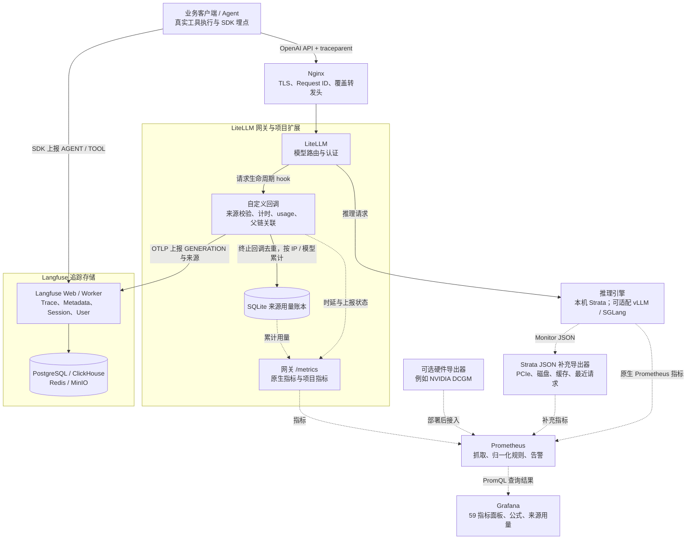

# LiteLLM / Langfuse / Strata 推理观测

## 1. 项目背景

本项目用于把模型请求、推理性能、GPU 状态与客户端工具执行关联起来。改造前的环境已部署 LiteLLM、Langfuse、Prometheus 和 Grafana，主要存在三个缺口：

1. Grafana 没有完整接入 Strata Monitor 指标，GPU、TTFT / TPOT、缓存等信息缺失，部分指标的标签、单位和统计口径也不一致。
2. LiteLLM 原有 OTEL 路径默认不采集消息内容，Langfuse 中出现有 Token、无输入输出的记录；客户端执行工具时没有 TOOL 埋点及父链传播。
3. 来源 IP 没有进入观测数据，Token 指标也缺少 IP 维度，无法按来源追踪用量和保留累计值。

为补齐这些信息，项目增加了 **LiteLLM 自定义回调、Strata JSON 补充导出器、来源 IP 用量账本、真实工具链示例，以及配套的指标规则、看板和部署工具**。Langfuse 使用其原生 Trace / Metadata / 查询能力，来源采集与数据上报由本项目实现。具体根因见[观测调查记录](docs/observability-findings.md)。

离线部署目标为 **麒麟 V10 服务器（RPM / YUM 环境）**。Windows / Ubuntu 24.04 WSL 是已验证的复用环境，两者的运行布局、系统包和镜像验收分别记录。

| 范围（2026-11-09） | 当前状态 |
| --- | --- |
| WSL 复用部署 | 真实流式推理、Langfuse 输入输出 / 工具链 / 来源 IP、Grafana 已验证；59 指标面板、7 分区、94 查询，28 项回归测试通过 |
| WSL DDN 换源 | Prometheus、Grafana、PostgreSQL、Redis、Nginx 五项已同版本重建并核对数据；其余四个相关容器保留原镜像 |
| 麒麟完全离线新装 | 已提供物料清单、准备工具和验收步骤；**完整离线包尚未交付，麒麟实机断网冷装待验收** |

## 2. 架构与数据流



实线表示请求、观测上报或持久化，虚线表示指标数据流；Prometheus 主动抓取指标，Grafana 查询 Prometheus。图中节点是逻辑组件，可以部署在同一 WSL 或不同内网服务器；静态版本见[架构图](assets/architecture-topology.svg)。

自定义回调运行在 LiteLLM 进程内，SQLite 是单独的来源累计账本。Grafana 按 IP 用量从账本导出的指标计算；Langfuse 保存请求观测，二者使用同一次回调确认的来源和 usage。Strata 补充导出器为独立 Python 服务；vLLM / SGLang / DCGM 是预留接入，本机未部署。

| 部署方式 | 入口与组件归属 |
| --- | --- |
| 已验证 WSL | 宿主 Python venv + 用户级 systemd 运行 LiteLLM / 补充导出器；已有 Docker 运行 Langfuse、数据库、Prometheus、Grafana、Nginx |
| 麒麟新装模板 | Compose 部署 Nginx / LiteLLM / Langfuse 及依赖；默认复用内网 Prometheus、Grafana 和推理服务，新增组件要另带镜像与配置 |

## 3. 仓库目录说明

```text
.
├── README.md                          项目背景、架构、迁移适配入口
├── docker-compose.yml                 网关 / Langfuse 新装模板；不是 WSL 原部署配置
├── .env.example                       运行配置模板与 DDN 镜像 digest
├── requirements-observability.txt      宿主 Python / 示例 / 验收工具直接依赖
├── requirements-callback.txt           LiteLLM 镜像内自定义回调所需依赖
├── litellm/
│   ├── config.yaml                    模型路由、Prometheus 与自定义回调
│   └── observability_callback.py       来源校验、SQLite 累计、时延指标、OTLP 上报
├── exporters/strata_extra.py           Strata Monitor JSON → Prometheus 补充指标
├── examples/traced_tool_agent.py       真实 AGENT / TOOL / 两次 GENERATION 示例
├── nginx/nginx.conf                    TLS、请求入口、覆盖转发头与指标入口
├── prometheus/
│   ├── litellm-scrape.yml              抓取片段，需合并到已有主配置
│   ├── recording-rules.yml             16 条指标归一化规则
│   └── alerts.yml                      9 条告警规则
├── grafana/dashboards/
│   └── litellm-gpu-overview.json        生成的 59 面板 / 94 查询看板
├── ops/
│   ├── build_dashboard.py              同时生成看板 JSON 与公式文档
│   ├── dashboard_formulas.py           每个面板的公式、单位与统计口径
│   ├── deploy_wsl.py                   发现 / 更新既有 WSL 部署，含本机布局假设
│   ├── verify_runtime.py               服务、PromQL、流式、工具链与来源验收
│   ├── check.sh                        验收脚本入口
│   ├── pull-from-ddn.sh                按 digest / 平台从 DDN 拉取镜像
│   └── offline_bundle.py               本地镜像导出、离线包封包与校验
├── offline/                            新装候选 / WSL 实际镜像映射与环境模板
├── assets/architecture-topology.svg    架构静态图
├── docs/                               迁移适配、公式、离线部署与验收文档
└── tests/                              回调、流式、来源统计、镜像与离线包回归测试
```

运行数据不进入 Git：`.env`、`data/`、`backups/`、证书、`.runtime/` 和本地 override 均在忽略列表中。WSL 源码与运行目录分开，推送 GitHub 后还需按部署流程加载代码，详见 [WSL 目录与启动说明](docs/windows-wsl.md)。

## 4. 自定义改动与迁移适配（重点）

**迁移时必须一起迁移自定义代码、依赖、配置、数据目录和客户端埋点。** 只启动官方 LiteLLM / Langfuse 镜像，无法自动恢复本项目补充的来源 IP、用量账本、流式指标和完整工具链。逐项操作与通过标准见[自定义改动与迁移适配清单](docs/migration-adaptation.md)。

| 自定义位置 | 本项目增加 / 修改了什么 | 迁移时必须适配 |
| --- | --- | --- |
| `litellm/observability_callback.py`、`litellm/config.yaml` | 记录真实输入输出、usage、模型参数、错误和流式 TTFT / TPOT，直接发送 Langfuse v4 OTLP | 回调文件的加载路径 / 挂载、Python / OTEL 依赖、LiteLLM hook 与 usage 结构；移除重复的 generation 上报回调 |
| 同文件的 `source_address()` | 校验连接 peer 与可信代理链，写入 `source_ip`、`network_peer_ip`、`source_ip_origin` | Nginx 真实地址、代理信任 CIDR、多级代理头覆盖；NAT 后只能记录入口可见地址 |
| 同文件的 `SourceUsageCollector` | 按 IP / 模型去重累计 Token，持久化 SQLite，导出 Prometheus 指标 | 账本目录、镜像实际 UID / GID、WAL / SHM 权限、SELinux、一致性备份；当前按单 worker 验收 |
| `examples/traced_tool_agent.py` | 客户端创建真实 AGENT / TOOL，并传播 `traceparent` | 实际业务 Agent / IDE / 工具执行器逐处埋点、同一 Langfuse 项目、Session / User 与父节点传播；示例不会自动改造其他客户端 |
| `exporters/strata_extra.py` | 补齐 Monitor JSON 的硬件 / 缓存字段和最近请求性能 | Strata JSON schema、认证、轮询地址、监听地址 / 端口、MiB / Byte 单位；更换 GPU / NPU 时核对数据来源 |
| `prometheus/`、`ops/build_dashboard.py`、`ops/dashboard_formulas.py` | 统一标签 / 单位，生成指标面板、公式和来源用量表 | 实际引擎 / job / 模型 / GPU 标签、Token 文件挂载、数据源与规则；修改后同步生成看板及公式 |
| `ops/deploy_wsl.py` | 复用容器 / venv、备份并更新回调 / 抓取 / 看板 | `--runtime-root` / 容器名可传参；venv 路径、8080 / 9402、用户服务、deployment 标签和 Prometheus 组 ID 仍需按代码适配 |
| Compose、`.env.example`、`offline/` | 新装模板、DDN digest、依赖与离线物料锁定 | 新装候选与现有版本分开选择；保留原数据卷 / 项目 / 加密键，检查镜像架构及回调依赖 |

网关的关键配置如下。它们是部署模板，地址、Key、代理和路径必须替换为现场值：

```yaml
litellm_settings:
  callbacks:
    - prometheus
    - observability_callback.observability
general_settings:
  use_x_forwarded_for: false
```

```dotenv
LITELLM_OTEL_V2=false
LITELLM_LOCAL_MODEL_COST_MAP=True
FORWARDED_ALLOW_IPS=
# 填实际代理 /32 或 /128；本机 WSL 部署脚本会发现 Nginx 地址。
GATEWAY_TRUSTED_PROXY_CIDRS=
# 下列为 Compose 容器路径；宿主 venv 部署使用对应的持久化绝对路径。
GATEWAY_SOURCE_USAGE_DB=/var/lib/llm-observability/usage.sqlite3
GATEWAY_SOURCE_MAX_SERIES=1024
# 下列主机名仅适用于网关与 Langfuse 处于同一个 Compose 网络。
LANGFUSE_HOST=http://langfuse-web:3000
LANGFUSE_TRACING_ENVIRONMENT=production
```

迁移前尤其注意以下边界：

- **版本与接口**：WSL 已验证 LiteLLM 1.106.6、Langfuse 服务 4.73.0、Langfuse Python SDK 4.18.0。回调使用 v4 OTLP；验证脚本使用 `/api/public/v2/observations` 并显式选择时间字段。更换版本需重新验证真实 loader、流式 hook、usage 与 Trace 查询。
- **网关数据库**：WSL 的无数据库网关启动脚本会清除 `DATABASE_URL` 等变量，防止误连 Langfuse 数据库；有 LiteLLM 自身数据库的环境必须调整这个启动逻辑。
- **来源账本**：迁移原账本才能延续累计值；活跃 WAL 模式用 SQLite backup API 备份，恢复时处理整个专用目录与旧 WAL。所选时段 `increase` 为采样外推，累计表从账本起点计数，缺失历史无法补回。
- **Token / 时延口径**：缓存属于输入子集、推理属于输出子集；Langfuse 明细按互斥分项上报，原值在 `usage_raw`。SSE 帧数不等于 Token；Strata 上下文占用不等于物理 KV 显存占用。
- **Langfuse 页面字段**：来源已写入 Metadata，可在 Tracing 用 `metadata.source_ip:实际IP` 筛选；本机 4.73.0 的独立“来源 IP”列表列尚未实现，需要另改 Langfuse 前端。
- **镜像与数据**：DDN 新装候选 Langfuse 为 Web / Worker 4.63.0，本机为 4.73.0；候选清单不能直接覆盖现有数据做降级。五项 WSL 实际换源与四项保留原因见[换源记录](docs/wsl-ddn-migration.md)。

## 5. Grafana 指标与计算公式

**全部 59 个指标面板、94 条查询都标注了计算公式、统计口径、单位和实际 PromQL。** 在看板点击面板标题旁的信息图标，或打开顶部“计算公式与指标口径（59 面板）”链接。完整说明见 [Grafana 看板计算公式与统计口径](docs/grafana-formulas.md)。

| 分区 | 已接入的指标 |
| --- | --- |
| 实时总览 | Decode / Prefill、GPU、显存、最近 TTFT / TPOT、运行与排队请求 |
| 延迟 | 网关 TTFT、TPOT、首段可见答案、端到端延迟、引擎 TTFT / ITL、LiteLLM API 延迟与额外开销 |
| Token 与质量 | 输入 / 输出速率、期间 Token、缓存读取 / 推理 Token、QPS、并发、错误率、工具提议数 |
| 缓存与上下文 | 前缀命中率、专家缓存、会话缓存、MTP 接受率、上下文占用、槽位、驻留 KV 位置 |
| 硬件 | 显存容量、GPU 温度与功耗、PCIe、CPU、RAM、磁盘吞吐 |
| 数据质量 | 抓取健康、JSON 数据年龄、Langfuse 上报错误、价格配置状态、其他引擎 KV 指标 |
| 来源 IP 与用量 | 时段 / 累计输入、输出、总 Token、请求数、缓存 / 推理速率、持久化状态 |

| 重点指标 | 计算公式 | 口径限制 |
| --- | --- | --- |
| 网关 TTFT | `首个有效增量时刻 − pre-call hook 起始时刻` | 有效增量包括正文、推理或工具参数；不代表客户端实际收包 |
| 网关 TPOT | `(末有效输出时刻 − 首有效输出时刻) / (completion_tokens − 1)` | 仅成功且有效的流式；分母包含推理 Token，不能用帧数 |
| 最近引擎 TPOT / 解码速度 | `decode_seconds / (output_tokens − 1)`；`engine_generated / decode_seconds` | N−1 与 N 不同，Token 来源也可能不同，不能直接取倒数 |
| P50 / P95 / P99 | `histogram_quantile(q, sum by (le) (rate(bucket[W])))` | 合并所选样本的 bucket 后估算，不平均各实例 P95，不把两个 P95 相减 |
| 网关 Token/s、QPS | `sum by (requested_model) (rate(counter[5m]))` | recording rule 固定 5 分钟窗口，非瞬时速率 |
| 显存占用率 | `100 × used_bytes / total_bytes` | 每 GPU 计算；包含驻留模型，区别于 KV 占用 |
| 前缀命中率 / MTP 接受率 | `sum(rate(命中或接受 Token[W])) / max(sum(rate(查询或草稿 Token[W])), 10⁻⁶)` | Token 加权，非请求加权；W 为 Grafana 的动态速率窗口 |
| 最近 Prefill 吞吐 | `max(0, prompt_tokens − reused) / (prompt_ms / 1000)` | 排除缓存复用 Token，缺少处理时间时无有效值 |
| PCIe / 磁盘吞吐 | `原始 MiB/s × 1048576 → B/s` | 原始字段已经是速率，不再次调用 rate |
| 按来源 IP 的时段 / 累计 Token | `sum by (source_ip) (increase(counter[所选时段]))` / `sum by (source_ip) (counter)` | 时段值由采样外推；累计值来自持久账本，总量只加 input + output |

公式说明和看板由 `python ops/build_dashboard.py` 同时生成，保证文档中的 PromQL 与面板一致。

指标参考 [vLLM](https://github.com/vllm-project/vllm)、[SGLang](https://github.com/sgl-project/sglang)、[NVIDIA dcgm-exporter](https://github.com/NVIDIA/dcgm-exporter)，并以本机 Strata Monitor 的实际实现和采样数据校正。来源用量在看板底部 **07 · 来源 IP 与 Token 用量** 查看，顶部“来源 IP”可筛选；完整采集 / 对账示例见[来源统计说明](docs/source-ip-usage.md)。

## 6. 部署入口与验证

### 6.1 既有 Windows / WSL 环境

以下入口与路径仅对应已验证本机。登录与 API Key 保存在 WSL 运行目录的 `.env`，不随仓库分发。

| 服务 | Windows 访问地址 | 用途 |
| --- | --- | --- |
| Grafana | [推理观测看板](http://localhost:3002/d/litellm-gpu-overview) | 59 个指标面板、7 个分区 |
| Langfuse | [项目观测列表](http://localhost:3001/project/7e8bc81c-0f6b-4377-bd85-9e06624fbafb/traces) | 输入输出、推理 Token、工具执行、来源与 Session |
| LiteLLM | `http://localhost:4000/v1` | 模型别名 `qwen-strata` |
| Strata | [Strata Monitor](http://localhost:8080) | 推理引擎及原始监控，需要既有认证 |

先预览发现的配置，再在允许网关重启的窗口应用更新：

```powershell
wsl -d Ubuntu-24.04 -- env LITELLM_LOCAL_MODEL_COST_MAP=True /home/yys/llm-observability/.venv/bin/python /mnt/e/project/tsproject/litellm-langfuse-monitoring/ops/deploy_wsl.py --dry-run
wsl -d Ubuntu-24.04 -- env LITELLM_LOCAL_MODEL_COST_MAP=True /home/yys/llm-observability/.venv/bin/python /mnt/e/project/tsproject/litellm-langfuse-monitoring/ops/deploy_wsl.py
```

部署脚本保留既有模型、密钥和其他回调，在改动前生成备份清单，只重启网关及新增导出器，并热加载 Prometheus。运行目录、依赖、启动、验收和回滚步骤见 [Windows WSL 部署说明](docs/windows-wsl.md)。

读取运行状态 / 查询指标，或执行真实工具链示例：

```powershell
# 不触发模型生成；检查服务、采集与看板查询。
wsl -d Ubuntu-24.04 -- bash /mnt/e/project/tsproject/litellm-langfuse-monitoring/ops/check.sh
# 会调用模型两次并真实执行 add_numbers(17, 25)。
wsl -d Ubuntu-24.04 -- /home/yys/llm-observability/.venv/bin/python /mnt/e/project/tsproject/litellm-langfuse-monitoring/examples/traced_tool_agent.py --env-file /home/yys/litellm-langfuse-monitoring/.env
```

### 6.2 麒麟 V10 完全离线部署

[完全离线部署手册](docs/offline-deployment-baseline.md) 面向**麒麟 V10 服务器（类似 CentOS 7.9 的 RPM / YUM 环境）**，列出 9 个核心镜像、同产品 / SP / 架构的 RPM 依赖、独立 Python 3.12、完整 wheelhouse、Tokenizer / 模型物料和配置证书。包含禁用全部仓库的本地安装、SELinux / firewalld、存储 / cgroup / glibc 兼容与验收命令；Windows / WSL 仅保留为历史复用部署记录。

`ops/pull-from-ddn.sh` 在联网准备机按平台与 digest 拉取 DDN 镜像；`ops/offline_bundle.py` 导出已经在本地的最终镜像，生成全物料 SHA-256 清单，并在离线导入后核对完整 image ID / 架构。离线目标使用包内本地别名和 `--pull never --no-build`。

新装候选为 `offline/ddn-image-map.amd64.tsv`，WSL 五项实际迁移为 `offline/ddn-runtime-wsl.amd64.tsv`，使用前按[DDN 版本说明](docs/ddn-images.md)区分。ARM 需要独立核查的镜像 / RPM / wheel 清单，不能直接改 amd64 清单的文件名或复制 Ubuntu venv。

### 6.3 迁移后的通过标准

1. 目标解释器 / 镜像能用 LiteLLM 真实 loader 加载回调，服务健康，必需 Prometheus targets UP。
2. 每个部署模型的非流式 / 流式请求有真实 usage；Langfuse 输入输出、Token 分项、Session / User、TTFT 正确；真实工具链含 AGENT、TOOL 和两次 GENERATION。
3. 看板 94 条查询执行成功，现场必需硬件 / Token / 时延有真实样本；两个来源的累计差值与 usage 一致，伪造来源不能改变归属。
4. 在目标维护窗口验证重启、账本与历史数据持久化、一致性备份恢复；离线交付还必须在干净麒麟目标机全程阻断互联网后冷装、冷启并执行上述检查。

本机来源账本已完成一致性备份与新进程重开副本验证；启用后未为持久化测试再次重启在线网关。**这不替代目标环境重启 / 恢复或麒麟断网冷装验收。** 记录使用[离线验收模板](docs/offline-acceptance-template.md)。

## 7. 详细文档

| 文档 | 内容 |
| --- | --- |
| [自定义改动与迁移适配](docs/migration-adaptation.md) | 版本依赖、需改配置 / 代码的位置、迁移顺序和通过标准 |
| [观测指标与 Langfuse 缺失调查](docs/observability-findings.md) | 缺失根因、实际配置修改、指标边界与真实链路证据 |
| [来源 IP 与 Token 用量](docs/source-ip-usage.md) | 来源校验、SQLite、筛选、Token 对账、公式与备份 |
| [Grafana 全部公式](docs/grafana-formulas.md) | 59 面板 / 94 查询的公式、PromQL、单位和统计窗口 |
| [Windows / WSL 部署](docs/windows-wsl.md) | 本机复用组件、启动脚本、客户端接入、检查与回滚 |
| [DDN 镜像准备](docs/ddn-images.md) | 新装候选镜像、digest、架构核查与联网准备 |
| [WSL DDN 迁移记录](docs/wsl-ddn-migration.md) | 已换源五项、保留四项、数据核对、原镜像与回退 |
| [麒麟完全离线手册](docs/offline-deployment-baseline.md) | 系统 / 镜像 / Python / 模型物料、冷装与离线验收 |
| [离线验收记录模板](docs/offline-acceptance-template.md) | 现场逐项结果和证据归档 |
