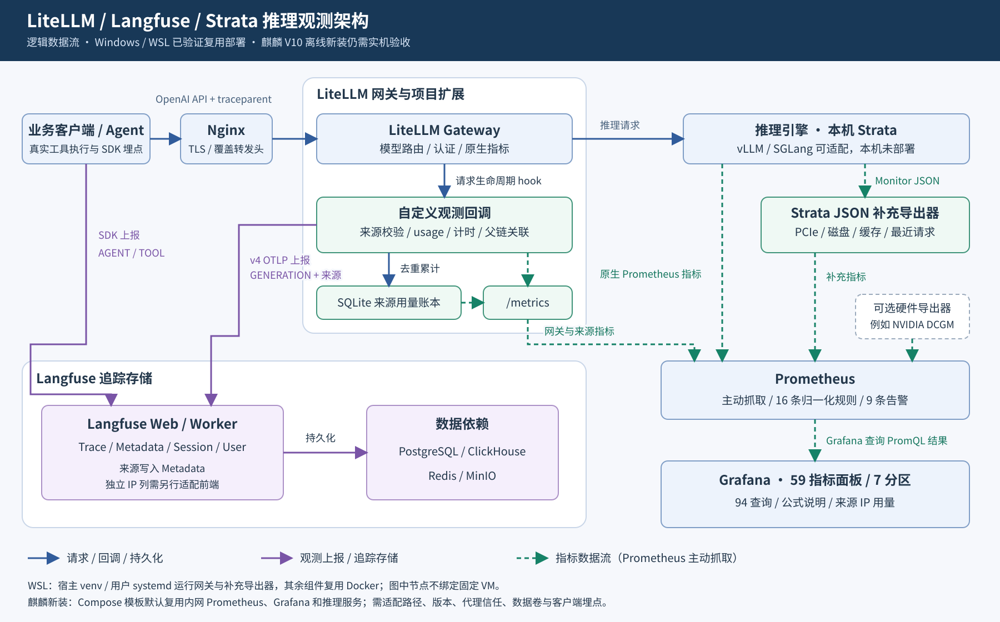

# LiteLLM + Langfuse 完全离线部署与运维手册

版本：2026-11-09 / 单机网关与观测节点部署基线  
状态：**配置已通过 YAML 语法检查，尚未执行容器端到端验证**。生产实施前须按本文的版本与兼容性检查清单验收。  
适用：VM-01 运行 LiteLLM + Langfuse；VM-02 已有 Prometheus；VM-03 已有 Grafana；后端 GPU VM 已运行 vLLM/SGLang/Strata。

## 架构拓扑图



> 拓扑图中的 IP/Token 逐请求关联、精确流式 TPOT、Strata KV Cache Exporter 属于待实现/验收能力，不代表当前 Compose 已自动实现。

## 1. 架构与边界

```text
Client --(4000)--> VM-01 LiteLLM ----> GPU VM A /v1 (vLLM)
                       |          \--> GPU VM B /v1 (SGLang)
                       |           \-> GPU VM C /v1 (Strata)
                       +--> Langfuse Web/Worker -> PostgreSQL/ClickHouse/Redis/MinIO
                       +-- /metrics --> VM-02 Prometheus --> VM-03 Grafana
```

不部署 OpenTelemetry Collector、Tempo、Loki、独立 ClickHouse 分析平台。ClickHouse 是 Langfuse v4 内部必需依赖。**不承诺**只靠 LiteLLM 获取 GPU 物理利用率、显存或 KV Cache；这类指标必须从 GPU VM/推理引擎采集。Client IP 与逐请求 Token 关联、TPOT 的准确采集也需要按版本验收或追加自定义回调。

## 2. 资源和网络规划

| 主机 | 示例 IP | 组件 | 建议 |
|---|---|---|---|
| VM-01 | 192.168.10.10 | LiteLLM + Langfuse 全栈 | 16 vCPU、48-64GiB、300GiB SSD 起 |
| VM-02 | 192.168.10.20 | Prometheus 已有 | 只改 scrape job |
| VM-03 | 192.168.10.30 | Grafana 已有 | 复用现有数据源 |
| GPU VM | 10.0.0.11-13 | 推理引擎 | 保持现状 |

防火墙：客户端→VM-01:4000；管理员→VM-01:3000；Prometheus→VM-01:4000（或经验证的独立 Metrics 端口）；VM-01→GPU VM 推理端口。MinIO 的 9090 映射到对象 API，仅允许管理网段访问（需要在浏览器访问 Langfuse 媒体资源时使用）；禁止公网访问。数据库、Redis、ClickHouse 不映射主机端口。

**安全注意**：Docker 端口发布可能绕过 ufw；必须在上游防火墙/安全组限制。建议生产中以 TLS 反向代理暴露 4000、3000、9090，随后取消不必要的主机直连端口。本文使用内网 HTTP 作为最小可操作基线。

## 3. 目录结构

```text
/opt/llm-gateway/
├── docker-compose.yml
├── .env
├── litellm/config.yaml
├── prometheus/litellm-scrape.yml
├── ops/check.sh
└── data/{postgres,clickhouse,clickhouse-logs,redis,minio}/
```

下载包已包含上述配置模板。以下命令均以 VM-01 为执行环境，除非标明 VM-02/VM-03。

## 4. 在联网的中转机准备离线镜像

**先固定兼容版本，再打包。** `.env.example` 中 `REPLACE_TESTED_TAG` 为刻意保留的占位符，不允许原样上线；`langfuse:4` 也是浮动大版本标签，正式部署必须替换成测试过的具体版本或 digest。Docker Compose 配置中包括以下镜像：

- PostgreSQL：`postgres:17`
- ClickHouse：`clickhouse/clickhouse-server:24.8`（仅示例基线，须验证 Langfuse 版本兼容性）
- Redis：`redis:7.4`
- MinIO：`minio/minio:<固定标签>`
- MinIO Client：`minio/mc:<固定标签>`
- Langfuse Web：`docker.langfuse.com/langfuse/langfuse:<固定版本>`
- Langfuse Worker：`docker.langfuse.com/langfuse/langfuse-worker:<同版本>`
- LiteLLM：`ghcr.io/berriai/litellm:<固定版本>`

在联网机器将已确认的镜像标签写入 `.env` 后：

```bash
cp .env.example .env
vi .env
# 修改所有 IMAGE、密码和 IP
# 先逐个拉取，确认实际镜像在仓库存在且架构匹配
set -a; source .env; set +a
docker pull "$POSTGRES_IMAGE"
docker pull "$CLICKHOUSE_IMAGE"
docker pull "$REDIS_IMAGE"
docker pull "$MINIO_IMAGE"
docker pull "$MINIO_MC_IMAGE"
docker pull "$LANGFUSE_WEB_IMAGE"
docker pull "$LANGFUSE_WORKER_IMAGE"
docker pull "$LITELLM_IMAGE"
# 只打包已拉取的镜像
docker save -o llm-images.tar \
  "$POSTGRES_IMAGE" "$CLICKHOUSE_IMAGE" "$REDIS_IMAGE" \
  "$MINIO_IMAGE" "$MINIO_MC_IMAGE" "$LANGFUSE_WEB_IMAGE" \
  "$LANGFUSE_WORKER_IMAGE" "$LITELLM_IMAGE"
sha256sum llm-images.tar > llm-images.tar.sha256
# 同时复制整个部署目录（不要把生产密钥放入公共介质）
tar czf llm-configs.tar.gz docker-compose.yml .env.example litellm prometheus ops
```

将 `llm-images.tar`、校验文件、`llm-configs.tar.gz` 拷贝到 VM-01；核对：

```bash
sha256sum -c llm-images.tar.sha256
docker load -i llm-images.tar
docker image ls
```

如果部署节点架构是 `aarch64`，不能直接导入仅 `amd64` 的镜像；需要在中转机下载对应架构镜像。

## 5. VM-01 配置准备

```bash
sudo mkdir -p /opt/llm-gateway
cd /opt/llm-gateway
sudo tar xzf /path/to/llm-configs.tar.gz
sudo cp .env.example .env
sudo chmod 600 .env
sudo mkdir -p data/{postgres,clickhouse,clickhouse-logs,redis,minio}
```

编辑 `.env`：

```bash
vi .env
```

**必须修改** `HOST_IP`、全部 `*_IMAGE`、数据库/Redis/MinIO 密码、`NEXTAUTH_URL`、`LANGFUSE_MEDIA_PUBLIC_ENDPOINT`、`LITELLM_MASTER_KEY`、三个推理引擎密钥；所有 `REPLACE` 字符串必须消失。

生成安全随机值：

```bash
openssl rand -hex 32   # ENCRYPTION_KEY: 恰好 64 位十六进制
openssl rand -base64 48 # SALT
openssl rand -base64 48 # NEXTAUTH_SECRET
openssl rand -base64 36 # 各服务密码（避免 @ : / 等 URL 特殊字符）
```

`DATABASE_URL` 由 Compose 使用 PostgreSQL 密码拼接，因此**不要在 POSTGRES_PASSWORD 中使用 URL 保留字符**，否则需 URL 编码；推荐使用 `openssl rand -hex 24`。MinIO、Redis、ClickHouse 密码同样建议只用十六进制字符，降低 shell/URL 转义风险。

配置 GPU VM 实际地址：

```bash
vi litellm/config.yaml
```

示例已包含三个模型。必须在 GPU VM 上检查模型 ID：

```bash
curl -H 'Authorization: Bearer YOUR_UPSTREAM_KEY' http://10.0.0.11:8000/v1/models
curl -H 'Authorization: Bearer YOUR_UPSTREAM_KEY' http://10.0.0.12:30000/v1/models
curl -H 'Authorization: Bearer YOUR_UPSTREAM_KEY' http://10.0.0.13:8008/v1/models
```

`litellm_params.model` 的 `openai/` 后面填写真实上游模型 ID；`model_name` 是对外暴露的统一名称。无上游鉴权的服务可按实际策略配置，但不应把生产 GPU API 暴露到不可信网络。

## 6. Langfuse 首次启动

**重要**：初次启动时 `.env` 中的 `LANGFUSE_PUBLIC_KEY` / `LANGFUSE_SECRET_KEY` 尚未生成，先仅启动 Langfuse 和内部依赖。`minio-init` 创建对象存储桶。Compose 的 MinIO 健康检查/版本兼容性应在验收时验证。

```bash
cd /opt/llm-gateway
docker compose --env-file .env config -q
docker compose --env-file .env up -d --pull never \
  postgres clickhouse redis minio minio-init langfuse-worker langfuse-web
docker compose ps
docker compose logs --tail=100 langfuse-web langfuse-worker
```

浏览器访问 `http://192.168.10.10:3000`，注册首个管理员，创建 Organization、Project，然后在 Project Settings 中创建 API Keys。Langfuse **没有预置默认管理员密码**。

检查 API：

```bash
curl -i http://192.168.10.10:3000/api/public/health
```

把生成的公钥、私钥写入 VM-01 的 `.env`：

```dotenv
LANGFUSE_PUBLIC_KEY=pk-lf-实际公钥
LANGFUSE_SECRET_KEY=sk-lf-实际私钥
LANGFUSE_HOST=http://langfuse-web:3000
```

注意：某些 Langfuse v4 发布版本对媒体对象存储外部端点、MinIO CORS、ClickHouse 数据库初始化等有附加要求。若实际版本与此示例不兼容，**必须以同一发布标签的官方 Compose 作为兼容性基线**，不要强行修改内部依赖或绕过健康检查。当前部署包是可审查的独立配置，不是经过官方认证的版本锁定发行包。

## 7. LiteLLM 启动与联调

`litellm/config.yaml` 已启用 `prometheus` 与 `langfuse_otel` 回调；需要选择支持这两个回调的 LiteLLM 镜像。

```bash
cd /opt/llm-gateway
docker compose --env-file .env up -d --pull never litellm
docker compose ps litellm
docker compose logs -f --tail=200 litellm
```

验证模型列表：

```bash
curl -fsS http://192.168.10.10:4000/v1/models \
  -H 'Authorization: Bearer sk-实际MasterKey'
```

非流式调用：

```bash
curl -sS http://192.168.10.10:4000/v1/chat/completions \
  -H 'Authorization: Bearer sk-实际MasterKey' \
  -H 'Content-Type: application/json' \
  -d '{"model":"qwen-vllm","messages":[{"role":"user","content":"只回复OK"}],"max_tokens":32}'
```

流式调用（验证 TTFT）：

```bash
curl -N -sS http://192.168.10.10:4000/v1/chat/completions \
  -H 'Authorization: Bearer sk-实际MasterKey' \
  -H 'Content-Type: application/json' \
  -d '{"model":"qwen-strata","stream":true,"messages":[{"role":"user","content":"用三句话解释KV Cache"}],"max_tokens":96}'
```

随后在 Langfuse 项目 Trace 列表查看调用；若无 Trace，检查 `langfuse_otel` 版本兼容性、Langfuse API Key、`LANGFUSE_HOST`、`litellm` 容器日志。注意回调可能异步上报，通常不是零延迟出现。

## 8. Prometheus（VM-02 已有）

**优先复用 LiteLLM 原生 `/metrics` 端点。** 部署包的 Compose 不启用独立 4001 端口，因为该参数与镜像版本存在兼容差异。先在 VM-01 验证：

```bash
curl -i -H 'Authorization: Bearer sk-实际MasterKey' \
  http://192.168.10.10:4000/metrics
```

如果返回 404，再检查 `/metrics/`；如果返回 401，核对认证；如果不暴露指标，检查 Prometheus 回调是否成功加载及所选镜像版本。不要盲目开放无鉴权的独立 Metrics 端口。

在 VM-02 创建仅 Prometheus 进程可读的密钥文件：

```bash
sudo install -d -m 750 /etc/prometheus/secrets
printf '%s' 'sk-实际MasterKey' | sudo tee /etc/prometheus/secrets/litellm_master_key >/dev/null
sudo chown prometheus:prometheus /etc/prometheus/secrets/litellm_master_key
sudo chmod 600 /etc/prometheus/secrets/litellm_master_key
```

把 `prometheus/litellm-scrape.yml` 中的 **列表条目** 合并到现有 `/etc/prometheus/prometheus.yml` 的 `scrape_configs:` 列表内，不要直接用该片段覆盖主配置。若 Prometheus 运行在 Docker 中，必须把密钥文件挂载到容器，并确保路径与 `credentials_file` 一致。

```bash
promtool check config /etc/prometheus/prometheus.yml
# systemd 安装：
sudo systemctl reload prometheus || sudo systemctl restart prometheus
# Docker 部署：按现有方式重启/热加载，不要执行无效的 systemctl 命令
```

Grafana Explore / Prometheus：

```promql
up{job="litellm-gateway"}
```

若为 0，检查网络、认证、metrics_path、Prometheus Target 页面及 `docker compose logs litellm`。

## 9. Grafana（VM-03 已有）

无需启动新 Grafana。使用现有 Prometheus 数据源，新建 Dashboard：

| Panel | PromQL 示例 | 说明 |
|---|---|---|
| 网关可用性 | `up{job="litellm-gateway"}` | 1=抓取正常 |
| 输入 Token 速率 | `sum(rate(litellm_input_tokens_metric[5m]))` | 根据实际导出类型调整 |
| 输出 Token 速率 | `sum(rate(litellm_output_tokens_metric[5m]))` | tokens/s |
| 请求速率 | `sum(rate(litellm_proxy_total_requests_metric[5m]))` | requests/s |
| 请求失败速率 | `sum(rate(litellm_proxy_failed_requests_metric[5m]))` | errors/s |

**重要**：Prometheus 客户端库可能对 Counter 自动添加 `_total`，Histogram 也有 `_bucket/_sum/_count`；指标名称和 label 必须以 VM-01 实际 `/metrics` 为准。不要将上面示例当成所有 LiteLLM 版本都可直接执行的固定契约。

查询实际指标名：

```bash
curl -sS -H 'Authorization: Bearer sk-实际MasterKey' \
  http://192.168.10.10:4000/metrics \
  | grep -E '^# (HELP|TYPE) litellm_' | head -80
```

P95 TTFT 只有在实际暴露相应 Histogram 时才能使用 `histogram_quantile(0.95, sum by(le,...) (rate(..._bucket[5m])))`。若 TTFT 只暴露 Summary，则应使用相应 quantile 序列且不能跨实例聚合 quantile。

## 10. 指标能力边界与数据治理

| 需求 | 可用方案 | 限制 |
|---|---|---|
| Token / 成本 / 模型调用 | Langfuse + LiteLLM Prometheus | 成本需模型价格配置正确 |
| TTFT | LiteLLM 流式请求 Metrics | 非流式请求未必有首 Token 事件 |
| TPOT | 先检查当前 LiteLLM 是否导出；否则增加网关自定义 Callback | 不能直接把请求总耗时 / 输出 Token 当准确 TPOT |
| Client IP | LiteLLM 指标/可信反向代理日志 | 逐请求 IP+Token 联表不是原生保证 |
| GPU 利用率 | GPU VM 的 DCGM Exporter | 网关无法推断硬件利用率 |
| KV Cache | vLLM/SGLang 自身 /metrics | Strata 的指标接口需独立验证 |

**推荐**：用户维度采用 LiteLLM User ID / Virtual Key；IP 作为辅助审计字段，不要将原始请求 ID 或任意高基数 IP 无限制写入 Prometheus 标签。Langfuse 可以保存请求级 Trace，但如果要将 IP 写入 Trace，必须先验证可信 IP 传递和回调字段映射；不要假定自动存在。

## 11. 运维命令速查

```bash
cd /opt/llm-gateway
# 查看服务
docker compose ps
# 查看单服务日志
docker compose logs --tail=200 -f litellm
docker compose logs --tail=200 -f langfuse-worker
# 重启网关（不动数据库）
docker compose restart litellm
# 重启 Langfuse
docker compose restart langfuse-web langfuse-worker
# 查看资源
docker stats --no-stream
# 只停应用，不删除数据
docker compose stop litellm langfuse-web langfuse-worker
# 恢复
docker compose up -d --pull never
# 检查 Compose 展开
docker compose --env-file .env config -q
```

**禁止在未备份时执行** `docker compose down -v`、删除 `data/`、直接升级 ClickHouse 数据目录、随意修改 `ENCRYPTION_KEY`。

## 12. 备份、恢复、升级

生产备份应在一致性边界上执行。推荐：停止 LiteLLM 与 Langfuse Web/Worker 写入，随后对 PostgreSQL、ClickHouse、MinIO 和 Redis 做应用一致性备份；再恢复业务。以下是**停机备份**的保守流程（先安排维护窗口）：

```bash
cd /opt/llm-gateway
docker compose stop litellm langfuse-web langfuse-worker
mkdir -p /backup/llm-$(date +%F)
# 在业务停止写入后，停止数据库/对象存储进程以获得一致的文件快照
docker compose stop postgres clickhouse redis minio
sudo tar -C /opt/llm-gateway -czf /backup/llm-$(date +%F)/data.tar.gz data
sudo cp docker-compose.yml /backup/llm-$(date +%F)/
sudo cp -a litellm /backup/llm-$(date +%F)/
sudo cp -a .env /backup/llm-$(date +%F)/env.secret
sudo chmod 600 /backup/llm-$(date +%F)/env.secret
docker compose up -d --pull never
```

恢复必须在**同一套镜像版本**下进行，并在隔离测试环境先演练：停止全部容器→恢复 `data/`、`.env`、配置→检查目录权限→启动依赖→启动 Langfuse→启动 LiteLLM→核对历史 Trace 和 Token 数据。备份文件应加密并异地保存。高并发或严格 RPO 环境应改用 PostgreSQL 逻辑/物理备份、ClickHouse 原生备份及 MinIO 对象级备份，不应依赖每日长时间停机。

升级：先记录 `docker image inspect` digest，备份，使用同版本 staging 环境测试迁移，验证 Langfuse Web/Worker 与 ClickHouse 兼容，再按依赖顺序升级。**不要直接使用浮动 `latest` 标签。**

## 13. 验收清单

- [ ] 离线镜像完整且 SHA256 一致；镜像架构正确
- [ ] 所有镜像均固定具体版本/digest，`.env` 无 REPLACE
- [ ] PostgreSQL、ClickHouse、Redis、MinIO 健康，MinIO 桶已创建
- [ ] Langfuse Web、Worker 正常；Project Keys 已创建
- [ ] LiteLLM `/v1/models` 列出三个模型
- [ ] vLLM、SGLang、Strata 各完成一次流式/非流式请求
- [ ] Langfuse 收到三种模型的 Trace、Token、成本字段
- [ ] Prometheus `up{job="litellm-gateway"} == 1`
- [ ] Grafana 可以看到 Token、QPS、错误率
- [ ] TTFT/TPOT 的实际数据类型和标签已核对
- [ ] IP+Token 的关联能力已单独验收（未实现则明确标注）
- [ ] 防火墙限制 DB/MinIO/管理入口，密码未出现在日志中
- [ ] 备份、恢复、告警已演练

## 14. 常见故障排查

| 现象 | 优先检查 |
|---|---|
| Langfuse Web 502/启动失败 | `docker compose logs langfuse-web langfuse-worker`、ClickHouse 迁移、DB 连接 |
| MinIO 桶不存在 | `docker compose logs minio-init`、对象 API 端口和凭据 |
| LiteLLM 无 Trace | `langfuse_otel` 版本、Keys、LANGFUSE_HOST、Langfuse Worker |
| Token 为 0 | 上游 `usage` 字段、模型映射、stream usage、LiteLLM Token 计算方式 |
| Prometheus 401 | Master Key / Bearer 认证 / metrics 路径 |
| Prometheus 404 | Metrics callback 未启用或版本/端点差异 |
| TTFT 不存在 | 流式请求是否完成、导出类型是否支持、Metrics 标签名 |
| TPOT 偏差大 | 网关和引擎统计口径不同、输出 Token 数过少、网络延迟 |
| Strata 请求失败 | 模型 ID、Strata API Key、`/v1/models`、GPU VM 防火墙 |
| Langfuse 页面媒体无法打开 | 9090 对象 API 可达性、媒体 endpoint、MinIO CORS |

## 15. 官方技术依据（仅供审计，不要求操作时再去查找）

- Langfuse Compose 自部署： https://langfuse.com/self-hosting/deployment/docker-compose
- Langfuse 参考 Compose： https://github.com/langfuse/langfuse/blob/main/docker-compose.yml
- LiteLLM Prometheus： https://docs.litellm.ai/docs/proxy/prometheus

**交付说明**：本文及同目录 Compose 是一套独立可审查的部署基线。因为无法在此环境拉取目标镜像、启动真实 GPU 推理后端，不能宣称已完成生产验收。正式上线前须锁定版本、核验 Langfuse v4 依赖兼容性、LiteLLM 回调和 Prometheus 实际指标。

## 补充：三类高级指标的落地验收

1. **IP + Token 逐请求关联**：可信 Nginx 统一生成 `X-Request-ID` 并验证真实来源 IP；LiteLLM Callback 将 request_id、client_ip、user_id、model、usage、cost、status 写入 Langfuse generation metadata。确认 Callback 当前版本能取得可信请求元数据，否则需在入口增加中间件。禁止将 request_id/client_ip 作为 Prometheus 标签。
2. **TTFT / TPOT**：网关在流式响应路径记录请求开始、首个有效输出、最后有效输出的单调时间戳，并以模型 usage 的输出 token 数计算 `TPOT=(last-first)/(output_tokens-1)`（仅 output_tokens>1）；SSE chunk 数不等于 token 数。Langfuse 记录每次请求的计时字段，Prometheus 使用低基数 histogram；非流式、取消、缺少 usage 的请求单独标记，禁止混入精确统计。
3. **GPU / KV Cache**：GPU VM 运行 DCGM Exporter（需要 NVIDIA 驱动和容器 GPU 权限）；Prometheus 直接抓取 vLLM/SGLang 的 `/metrics`。Strata 先验证 `/metrics`，不存在时需定制 Exporter 或修改引擎埋点；LiteLLM 无法推断引擎内部 KV Cache。

上述扩展属于实施清单，**本部署包尚未包含完整 Callback、流式拦截器和 Strata Exporter 的生产实现**。

## Nginx 反向代理：离线安装、启动、配置与验证（新增）

本项目已经将 Nginx 纳入同一 VM-01 Docker Compose，配置位于 `nginx/nginx.conf`。Nginx 为 **唯一对外 API 入口**：`https://VM01:8443/v1/...`；Langfuse UI：`https://VM01:8444`；Prometheus 从 VM-02 抓取 `http://VM01:9401/metrics`。LiteLLM:4000 与 Langfuse:3000 仅在 Docker 内网暴露，不能再按本文早期章节的直连 4000/3000 操作。生产优先使用内网 DNS、企业 CA 证书与标准 443 端口；示例 8443/8444 用于避免同一 IP 端口冲突。

### 1. 离线镜像准备

联网准备机（与目标机相同 CPU 架构）：

```bash
docker pull nginx:1.28-alpine
docker save -o nginx-1.28-alpine.tar nginx:1.28-alpine
sha256sum nginx-1.28-alpine.tar > nginx-1.28-alpine.tar.sha256
```

将 TAR 和校验文件通过受控方式传至 VM-01：

```bash
sha256sum -c nginx-1.28-alpine.tar.sha256
docker load -i nginx-1.28-alpine.tar
docker image inspect nginx:1.28-alpine --format '{{.Id}}'
```

其余镜像同样离线导入。正式生产请固定经验证的不可变 digest，避免使用浮动标签。

### 2. 目录和 TLS 证书

```bash
cd /opt/llm-gateway
mkdir -p nginx/certs data/nginx-logs
chmod 700 nginx/certs
# 最好从企业 CA 签发带 DNS/IP SAN 的证书，放到以下位置：
# nginx/certs/server.crt
# nginx/certs/server.key
chmod 600 nginx/certs/server.key
```

没有企业 CA 时，以下命令仅用于内网测试（把 IP 改为 VM-01 的实际 IP）：

```bash
openssl req -x509 -nodes -newkey rsa:3072 -sha256 -days 30 \
  -keyout nginx/certs/server.key -out nginx/certs/server.crt \
  -subj "/CN=llm.internal" \
  -addext "subjectAltName=DNS:llm.internal,IP:192.168.10.10"
chmod 600 nginx/certs/server.key
```

测试证书不应替代正式 CA 证书。若以 IP 访问，证书必须包含该 IP 的 SAN。

### 3. 启动与配置检查

```bash
cp -n .env.example .env
# 编辑 .env，设置真实 HOST_IP、NGINX_IMAGE、密钥、镜像标签和 NEXTAUTH_URL
docker compose config -q
docker compose up -d postgres clickhouse redis minio minio-init
docker compose up -d langfuse-worker langfuse-web litellm
docker compose up -d nginx
docker compose exec nginx nginx -t
docker compose ps
docker compose logs --tail=100 nginx
```

如果此前已有 LiteLLM/Langfuse 直连端口的客户端，先做好切换窗口与回滚计划。此 Compose 已取消宿主机 4000、3000 的端口发布。注意 Docker 端口发布可能绕过主机 ufw：应在上游防火墙/安全组只允许受信客户端访问 8443、管理员访问 8444、Prometheus VM-02 访问 9401；8080 仅用于 HTTP 跳转。MinIO 9090 只允许授权网段。

### 4. 请求透传、流式响应和安全

- `proxy_buffering off` 防止 SSE 流式输出被 Nginx 缓冲；`proxy_read_timeout 600s` 适配长生成。
- `X-Request-ID` 使用 Nginx 生成的 `$request_id`；`X-Real-IP` 与 `X-Forwarded-For` 使用可信入口的 `$remote_addr`，覆盖客户端伪造的同名请求头。
- 如果 Nginx 前面还有 LB，需要在 Nginx 中显式配置可信的 `set_real_ip_from` 与 `real_ip_header`，不能无条件信任外部 `X-Forwarded-For`。
- 访问日志位于 `data/nginx-logs/access.log`，为 JSON 格式，包含 IP、Request ID、耗时、状态码；**日志本身不等于 IP-Token 关联已经完成**。关联仍需 LiteLLM 请求级 Callback 与相同 Request ID。
- 默认按 IP 限速 `20r/s`，突发 `60`；应按真实并发调整，并关注共享 NAT 下多个用户使用同一 IP 的情况。
- `/metrics` 单独使用 9401 端口，并以 Nginx `allow` 限制 Prometheus 源 IP。若 LiteLLM 版本要求 Metrics Bearer Token，需在 Prometheus 使用 `bearer_token_file`，不要在 Git 提交密钥。

### 5. 验证命令

```bash
# 在 VM-01 上检查证书和反向代理（测试自签名证书时用 -k）
curl -k -i https://192.168.10.10:8443/health/readiness
curl -k -i https://192.168.10.10:8444/
curl -k -sS https://192.168.10.10:8443/v1/models -H "Authorization: Bearer YOUR_KEY"
# 在 VM-02 Prometheus 机器上执行：
curl -i http://192.168.10.10:9401/metrics
# 若返回 401，使用正确的 Metrics Bearer Token；若返回 403，检查 Nginx allow 与来源地址。
# 在 VM-01 查看 Nginx 日志：
docker compose logs --tail=100 nginx
tail -f data/nginx-logs/access.log
```

验证流式响应：

```bash
curl -k -N https://192.168.10.10:8443/v1/chat/completions \
  -H "Authorization: Bearer YOUR_KEY" -H "Content-Type: application/json" \
  -d '{"model":"qwen-vllm","stream":true,"messages":[{"role":"user","content":"你好"}]}'
```

如使用正式 CA 证书，删除 `-k` 并通过系统信任链验证 TLS。

### 6. 常见故障与回滚

| 现象 | 检查项 |
|---|---|
| 502 Bad Gateway | `docker compose ps`、`docker compose logs litellm langfuse-web nginx`、Docker 网络 |
| 504 / SSE 中断 | 推理引擎响应、`proxy_read_timeout`、客户端超时 |
| 413 Request Entity Too Large | `client_max_body_size` |
| 429 Too Many Requests | Nginx `limit_req` 和 LiteLLM 限流策略 |
| Prometheus 403 | 9401 allow IP / 防火墙 / NAT |
| Prometheus 401 | LiteLLM Metrics 鉴权 |
| TLS 握手失败 | 证书 SAN、证书链、密钥权限、协议 |

仅回滚 Nginx 配置时，先恢复上一个已验证的 `nginx/nginx.conf`，执行：

```bash
docker compose exec nginx nginx -t
docker compose exec nginx nginx -s reload
```

**部署验收状态：** 本节为可操作的部署配置，尚未在实际 VM-01 上进行完整容器与 TLS 端到端验证。此前章节提到的 4000/3000 直连端口、`NEXTAUTH_URL` HTTP 地址，应以本节 Nginx 入口为准。


## Prometheus / Grafana 监控指标、部署配置和告警（新增）

VM-02、VM-03 已经存在，不再新建 Prometheus 或 Grafana 容器。仓库提供：

- `prometheus/litellm-scrape.yml`：LiteLLM、vLLM、SGLang、DCGM 的 Scrape Job。
- `prometheus/alerts.yml`：网关不可用、错误率、请求积压、KV Cache、GPU 温度告警。
- `grafana/dashboards/litellm-gpu-overview.json`：16 个可导入的监控面板。

### 1. VM-02：配置 Prometheus

先在 VM-01 的 LiteLLM 容器确认 Metrics 接口：

```bash
docker compose exec litellm sh -c 'curl -fsS http://127.0.0.1:4000/metrics || true'
# /metrics 默认可能需要 LiteLLM API Key；请用 Bearer Token 重试。
```

在 VM-02 中创建密钥文件（不要提交 Git）：

```bash
sudo install -d -m 700 /etc/prometheus/secrets
sudo sh -c 'umask 077; cat > /etc/prometheus/secrets/litellm_metrics_token'
# 粘贴有效的 LiteLLM Master Key 或具有指标权限的 Key，然后按 Ctrl-D
sudo chmod 600 /etc/prometheus/secrets/litellm_metrics_token
```

将 `prometheus/litellm-scrape.yml` 的各 Job 追加到现有 `/etc/prometheus/prometheus.yml` 的 `scrape_configs:` 下，**不能直接把该片段当成完整 prometheus.yml**。如需 GPU/推理指标，先验证 GPU VM 的 `/metrics` 与 DCGM :9400 能够从 VM-02 访问。

在已有 `prometheus.yml` 的顶层合并：

```yaml
rule_files:
  - /etc/prometheus/rules/llm-alerts.yml
```

复制告警文件到 VM-02：

```bash
sudo mkdir -p /etc/prometheus/rules
sudo cp prometheus/alerts.yml /etc/prometheus/rules/llm-alerts.yml
promtool check rules /etc/prometheus/rules/llm-alerts.yml
promtool check config /etc/prometheus/prometheus.yml
```

如果 Prometheus 是容器部署，请将密钥和告警规则文件映射进容器，并在容器内执行 `promtool`。重新加载时按现有部署方式发送 SIGHUP 或启用 `--web.enable-lifecycle` 后调用：

```bash
curl -X POST http://127.0.0.1:9090/-/reload
```

### 2. VM-03：导入 Grafana Dashboard

打开 Grafana → Dashboards → New → Import → Upload JSON，选择 `grafana/dashboards/litellm-gpu-overview.json`，绑定已有 Prometheus 数据源并保存。该 JSON 包含：

| 面板 | 监控指标 |
|---|---|
| 网关健康 | Target UP、QPS、错误率、并发请求 |
| Token 与成本 | 输入/输出 Token 速率、24h 模型成本 |
| IP 统计 | 24h 按 IP 请求数 Top20（不是按 IP Token） |
| vLLM 推理性能 | TTFT P95、请求级 TPOT P95、KV Cache、运行请求 |
| GPU | 利用率、显存、温度、功耗 |

**指标口径：** `litellm_*_total` 是 Prometheus Counter 样本；不要查询 `_created`。TTFT/TPOT 的 vLLM Histogram 依赖当前引擎版本，SGLang、Strata 的对应指标需要在确认实际 Metrics 名称后补充。vLLM 的 ITL 不等同于请求级 TPOT。IP-Token 精确关联仍需 LiteLLM Callback + Langfuse 请求元数据，不能由 IP 请求排行榜代替。

### 3. PromQL 验收

```promql
up{job="litellm"}
sum(rate(litellm_proxy_total_requests_metric_total[5m]))
sum by (requested_model) (rate(litellm_input_tokens_metric_total[5m]))
sum by (requested_model) (rate(litellm_output_tokens_metric_total[5m]))
topk(20, sum by (client_ip) (increase(litellm_proxy_total_requests_metric_total[24h])))
DCGM_FI_DEV_GPU_UTIL
{__name__="vllm:kv_cache_usage_perc"} * 100
```

### 4. 重要运维限制

- `/metrics` 可能需要 LiteLLM Bearer Token，Nginx 9401 的 IP 白名单与防火墙只是第二道控制；在 VM-02 测试 `curl -H "Authorization: Bearer ..."`。
- `prometheus/litellm-scrape.yml` 的 IP 地址是示例值，必须替换成真实 VM 地址。
- 生产中应将告警规则挂载到已有 Prometheus，并配置已有 Alertmanager 的 receiver；本仓库不覆盖原有告警路由。
- 告警阈值为初始建议值，需按模型、GPU、业务并发基线调优。
- 现有 Dashboard 不保证所有面板立即有数据；只有实际暴露的指标才会出现。
- 默认不会将 Client IP 或 Request ID 作为新的高基数 Prometheus 自定义标签。
