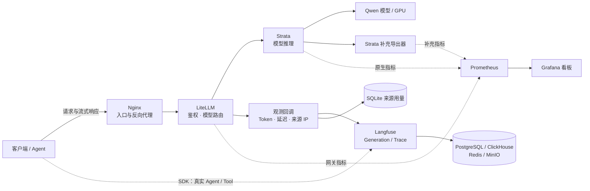
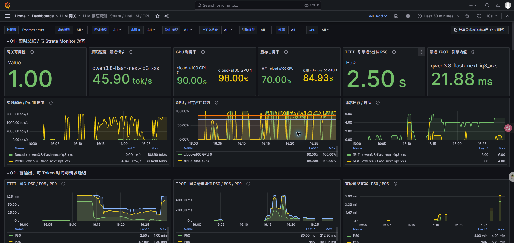
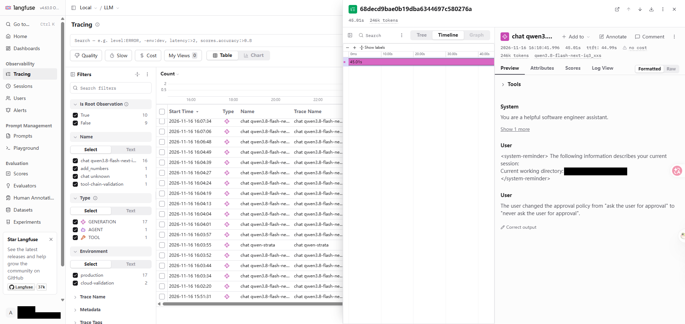
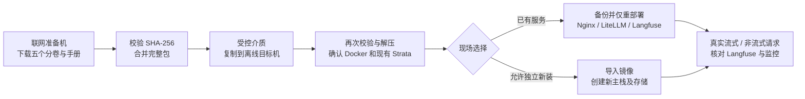

# 大模型网关与推理观测

本项目把 **Nginx、LiteLLM、Langfuse、Prometheus、Grafana 和 Strata** 组合成一条可部署、可追踪、可监控的大模型调用链。它面向已有 GPU 推理服务和内网离线环境：客户端走统一网关，运维可以查看单次请求的 Trace，也可以从看板观察 Token、延迟、GPU 和来源用量。

部署操作与排障见 [脱敏版离线手动部署文档](离线手动部署文档.md)，涵盖网关、Strata、Langfuse Trace、Grafana 和离线物料准备；文中地址均为示例，目标环境仍需单独验收。

文档和配置里的地址、路径需要换成自己的环境：

| 占位 | 含义 |
| --- | --- |
| `203.0.113.30` | 文档专用公网地址（RFC 5737），代替原云端服务器公网 IP。URL、SSH 和 curl 示例里出现它时，换成自己的服务器公网 IP。 |
| `203.0.113.10`、`192.0.2.10`、`198.51.100.0/24` | 同样是文档专用地址，分别表示示例公网入口、示例宿主网卡和示例来源地址，不是现网地址。 |
| `YOUR_USER` | 本机用户名占位，例如 `/home/YOUR_USER/...`。 |
| `YOUR_PROJECT` | 本机检出本仓库的目录名占位。 |
| `YOUR_CLIENT_PROJECT` | 调用方本地项目目录名占位。 |
| `YOUR_MODEL_DIR` | 模型数据目录名占位。 |

`10.0.0.0/8`、`172.16.0.0/12`、`192.168.0.0/16`、`127.0.0.0/8` 和 `0.0.0.0` 是内网、回环或通配监听地址，按原样保留。密钥类字段在示例里仍是 `REPLACE`，不要把真实口令写回仓库。

项目中的回调、来源 IP 账本、Strata 补充导出器和看板是针对原有组件的适配；Langfuse 本身仍负责 Trace、Session、User 和 Metadata 等能力。业务 Agent 的真实工具执行节点需要客户端在执行位置埋点，模型返回 `tool_calls` 本身不代表工具已运行。

> 运维从这里开始：[离线部署 README：包目录、配置和启动](docs/offline-deployment-README.md) · [逐步操作命令](docs/kylin-v10-offline-operations-step-by-step.md) · [下载离线包](https://github.com/tyloryang/litellm-langfuse-monitoring/releases/tag/offline-reuse-amd64-20261116) · [完整离线手册](docs/kylin-v10-full-offline-deployment-20261116.md) · [Grafana 公式](docs/grafana-formulas.md)

需要迁移云端已有 Trace 和项目数据时，另见 [云端历史数据离线恢复](docs/cloud-history-offline-restore-20261116.md)：加密备份及 SHA-256 在同一 Release，解密密钥通过受控渠道单独转交。

## 项目背景

原有组件各自提供了网关、追踪、模型服务和指标，但现场仍需解决几个具体问题：

| 现场问题 | 本项目的处理 |
| --- | --- |
| Langfuse 中部分 Generation 缺少输入输出，工具链只有模型提出的调用 | LiteLLM 回调上报内容和 usage；客户端使用 Langfuse SDK 记录真实 AGENT / TOOL，并传播 `traceparent` |
| 无法按可信来源 IP 查看 Token 用量 | Nginx 覆盖转发头，回调按可信代理解析来源；SQLite 保存累计账本并导出指标 |
| GPU、首 Token、每 Token 耗时和 Strata Monitor 数据分散 | Prometheus 汇总原生指标和补充导出器，Grafana 统一展示并在面板说明中记录公式 |
| 内网需要可复用的部署物料 | 提供镜像清单、离线包、校验、配置模板和麒麟 V10 操作手册 |
| 需要观察请求按上下文长度如何选模 | 提供 LiteLLM 自动路由试验配置、路由指标与解释信号；接入实际模型前仍需适配 |

## 整体架构

业务请求经 Nginx 和 LiteLLM 到达 Strata，答案沿原路返回；Langfuse 是异步追踪支路，Prometheus / Grafana 是指标采集与展示支路。



默认新安装示例的网关、Langfuse 入口分别为 HTTPS `8443`、`8444`；实际端口、证书、代理地址和网络以现场配置为准。云端历史测试也使用过独立的 HTTP 映射，不应直接当作内网默认配置。

## 界面与指标

以下图片是用户提供的**云端历史快照**，用于说明界面和字段；不是麒麟目标机验收结果，也不是性能承诺。

### Grafana：请求、Token 与 GPU

看板包含 **68 个面板、8 个分区、105 条查询**，覆盖实时概览、TTFT / TPOT、Token、缓存、GPU、来源 IP 和自动路由。是否有样本取决于对应引擎、回调和实际请求。



常用指标的计算边界：

| 指标 | 计算 / 口径 |
| --- | --- |
| 网关 TTFT | `首个有效增量时间 − 网关 pre-call 时间`；有效增量可为正文、推理或工具调用 |
| 网关 TPOT | `(最后有效增量时间 − 首个有效增量时间) / (completion_tokens − 1)`；仅统计符合条件的流式请求 |
| 引擎最近 TPOT | `(decode_ms / 1000) / (output_tokens − 1)`；是最近一个请求的均值 |
| Token/s、QPS | 对计数器使用 `rate` 后聚合；部分 recording rule 固定 5 分钟窗口 |
| GPU 显存占用 | `100 × used_bytes / total_bytes`；包含模型及其他驻留数据 |
| 路由启发式分数 | `Σ(维度分 × 权重)`；用于解释信号，上下文档位才决定此试验配置的选模 |

截图中的总览 TTFT 是**引擎近 5 分钟 P50**，不是最近一次请求的精确首 Token 时间。每个面板的计算公式、PromQL、单位和采样条件见 [Grafana 指标公式与口径](docs/grafana-formulas.md)。

### Strata：模型运行状态

Strata Monitor 可查看模型状态、预填充和解码速度、上下文、显存、GPU、CPU、磁盘和最近请求。本项目的补充导出器将原生指标未覆盖的部分 Monitor JSON 字段供 Prometheus 抓取。


### Langfuse：单次请求追踪

Langfuse Tracing 用于查看 Generation 的模型、输入输出、Token、首输出时间和链路节点。工具执行是否出现取决于客户端是否真实执行并上报 TOOL。



## 离线部署与使用

当前推荐的离线交付针对 **已具备 Docker、Strata 和模型** 的 `linux/amd64` 目标机：网关包包含 Nginx、LiteLLM、Langfuse Web / Worker 及其存储依赖的 9 个镜像；Prometheus 2.45.1 和 Grafana 10.1.5 在独立监控物料中。模型、Strata 镜像、GPU 驱动、真实密钥和历史业务数据需要现场提供或复用。



1. 从 [离线 Release](https://github.com/tyloryang/litellm-langfuse-monitoring/releases/tag/offline-reuse-amd64-20261116) 下载五个分卷和校验文件；另下载 `offline-full-chain-update-20261116.tar.gz` 及其校验文件。
2. 在准备机依次校验、合并；把完整 tar、校验文件及手册带入内网，在目标机再次校验并解压。
3. 确认现有 Strata 的模型 ID、地址、密钥及容器网络可达性，再按现场选择“仅重部署现有服务”或“新建独立主栈”。
4. 运行真实非流式和流式请求，再按指南第 8.1 节执行工具链验收，检查 Langfuse 中 Agent、两个 Generation、实际 Tool 和 Token；按范围检查 Prometheus / Grafana 和数据恢复。

先看 **[离线部署 README](docs/offline-deployment-README.md)** 的解压目录、物料清单和目标机需修改项，再按 **[麒麟 V10 离线操作指南](docs/kylin-v10-offline-operations-step-by-step.md)** 逐条执行。完整的模型来源、系统依赖、客户端接入、Strata JSON、`memlock`、大页及回滚见 [麒麟 V10 全链路离线部署手册](docs/kylin-v10-full-offline-deployment-20261116.md)。

离线包是发布时的快照：新版入口、手册和工具链脚本以 Release 的 `offline-full-chain-update-20261116.tar.gz` 独立交付，不覆盖原始大包或更改其校验和；旧手册包和旧的独立指南附件不会自动更新。CentOS 7 / NVIDIA RPM 仅为候选，**麒麟 V10 特定 SP / Build 的依赖闭包和目标机断网冷安装尚未验收**。Nginx 和 Strata 未在本交付中承诺独立内部 span，须结合日志定位各跳。

## 仓库目录

```text
.
├── docker-compose.yml              # 网关、Langfuse 和存储依赖的基础拓扑
├── .env.example                    # 镜像、地址和私有变量占位
├── nginx/                          # 网关、Langfuse 与指标反向代理
├── litellm/                        # 模型配置、路由、观测回调和来源统计
├── source/strata/                  # Strata v0.1.45 上游源码快照，不含模型权重
├── deploy/strata/                  # CUDA 12、四槽 JSON 与 Compose 使用说明
├── exporters/                      # Strata Monitor JSON 补充指标
├── prometheus/                     # 抓取样例、Recording Rule 和告警
├── grafana/dashboards/             # 推理观测看板 JSON
├── examples/                       # 配置与 Agent / Tool 链路示例
├── ops/                            # 离线封包、监控生成与验收脚本
├── offline/                        # 渡渡鸟镜像清单及离线配置
├── docs/                           # 操作手册、公式、现场记录与验收模板
└── tests/                          # 回调、路由、封包和指标测试
```

## 自定义配置与迁移注意事项

| 项目 | 迁移时需要确认 |
| --- | --- |
| LiteLLM 观测回调 | 挂载 `observability_callback.py`，镜像内具备回调依赖；使用真实 loader 和请求验证 Generation |
| 来源 IP / Token | `GATEWAY_TRUSTED_PROXY_CIDRS` 只包含可信代理；SQLite 目录可写、持久化并纳入一致性备份 |
| Langfuse 项目 | Web / Worker 版本匹配，项目 key、盐、加密密钥和存储保持一致；不能将较新数据库直接挂给较旧镜像降级 |
| 工具链 | 客户端实际执行并上报 AGENT / TOOL，传播 Trace 上下文；仅依靠代理无法推断工具真实执行时间 |
| Strata 上下文 / 并发 | 云端修复配置为 262144 上下文、4 个 batch 槽；迁移时核对目标二进制、模型路径、GPU 和 RAM，不把配置值当作压力验收 |
| 大页 / memlock | HugeTLB 池、`memlock` 和 `MALLOC_MMAP_THRESHOLD_` 是不同设置；云端锁页后内存余量偏低，需按目标容量和负载评估 |
| 自动路由 | `token_router_config.yaml` 是 mock 试验，须替换真实后端、认证、tokenizer、上下文边界和日志路径后才能使用 |
| Prometheus / Grafana | 复用时备份配置和数据，合并 job / rule，使用目标版本 `promtool` 验证；没有样本不等于指标为零 |

更多细节见 [自定义改动与迁移适配](docs/migration-adaptation.md)、[来源 IP 与 Token 用量](docs/source-ip-usage.md)、[云端 Strata 配置审计](docs/cloud-strata-json-log-audit-20261116.md)及 [Strata 锁页部署记录](docs/cloud-strata-memlock-deployment-20261116.md)。

## 当前验证范围

- 云端双 A100：Strata 实际加载；经 Nginx / LiteLLM 的流式和非流式推理返回正确答案，并在 Langfuse 存储中查到 Generation。工具链曾以客户端真实执行示例验证。详见 [云端真实推理记录](docs/cloud-real-inference-20261116.md)及[锁页后验证](docs/cloud-strata-memlock-deployment-20261116.md)。
- WSL：已有环境验证过真实推理、Trace、来源 IP 和 Grafana；Prometheus 2.45.1 / Grafana 10.1.5 的兼容试验有独立数据与限制，不能代表目标机全部指标均已验收。
- 麒麟 V10：目标机已有服务可供核对，硬件信息见离线部署手册中的文字记录；具体 SP / Build、离线依赖闭包、断网冷启动、真实请求、监控及备份恢复仍需现场执行并记录。[离线验收模板](docs/offline-acceptance-template.md)可用于记录结果。

## 部署中遇到的问题

以下根据实际部署整理；服务器地址和端口以目标环境为准，完整命令见[脱敏版离线手动部署文档](离线手动部署文档.md)。

| 现象 | 原因和处理 |
| --- | --- |
| Dockerfile 报 `unknown instruction: IMPORT` | 旧版构建器无法解析 Dockerfile 的 heredoc。使用 `DOCKER_BUILDKIT=1` 构建；同时确认 Docker/BuildKit 版本。 |
| CUDA 基础镜像 `failed size validation` | 镜像层传输中断导致数据不完整。检查网络和磁盘，保留已完成的镜像层，从可信源重试；也可在准备机校验后导出并离线导入镜像。 |
| 首次启动 Strata 后容器显示 `unhealthy` | 模型 pack、tokenizer 和 MTP 下载或打包期间服务尚未监听。结合日志、重启次数和 OOM 状态确认进度，待 `/health` 返回 `loaded: true` 后再验收。 |
| 断网环境无法完成 Strata 首次启动 | GGUF 之外还需要匹配版本的镜像、MTP 和运行数据。提前在兼容环境准备物料，并在目标机执行断网冷启动验证。 |
| Strata 内存占用超出预期 | 安装过程可能依据磁盘类型自动加入 `--ple-io ram`。检查生成配置、可用内存和锁页，再按存储性能及容量决定是否调整。 |
| LiteLLM 调用模型返回 401 | 分别核对客户端的 LiteLLM master key 与上游模型的 API key；项目中的 `STRATA_API_KEY` 是模型配置引用的自定义变量，更新后需重建 LiteLLM。 |
| Langfuse 停在 `Waiting for first trace` | 确认项目公私钥、项目和自定义回调一致，再通过 LiteLLM 发起真实模型请求；直连 Strata 不会触发 LiteLLM 的回调。 |
| Grafana 已启动但没有数据 | 检查 Prometheus targets、采集地址、token 和实际流量；模型服务或网关密钥轮换后，需要同步监控侧密钥。 |
| Grafana 与已有服务端口冲突 | 先用 `ss -ltnp` 核对实际绑定，修改独立监控代理的宿主端口及公网映射，不覆盖已有服务。 |
