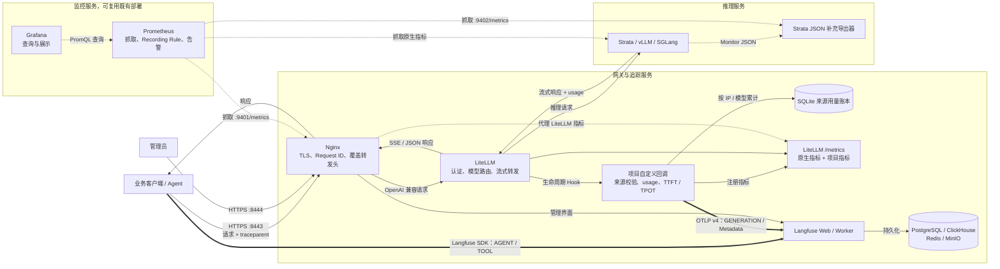

# LiteLLM / Langfuse / Strata 推理观测

这个仓库补齐了大模型网关的观测链路。业务请求从 Nginx 进入 LiteLLM，再转发到推理引擎。Langfuse 保存请求内容、Token、时延、来源 IP 和工具调用，Prometheus 采集网关与推理引擎指标，Grafana 负责查询和展示。

项目面向内网和离线环境。Windows 11 + Ubuntu 24.04 WSL 的既有环境已经完成真实推理、Trace、工具调用和看板验证。[linux/amd64 配置与镜像包](https://github.com/tyloryang/litellm-langfuse-monitoring/releases/tag/offline-amd64-20261109)已经发布，包含 11 个渡渡鸟镜像、Compose 和监控配置。麒麟 V10 的系统 RPM、Python wheel、模型权重和断网冷安装仍未验收，不能把这个 Release 当作完整离线环境。

## 1. 项目背景

原环境已经运行 LiteLLM、Langfuse、Prometheus、Grafana 和 Strata 推理服务，但这些组件的原生能力没有形成一条完整的观测链路：

- LiteLLM 原有 OTEL 路径没有记录完整输入输出，Langfuse 中会出现有 Token、无消息内容的 Generation。
- 客户端调用工具时只有模型返回的 `tool_calls`，没有实际执行 TOOL 的节点，也没有稳定的父子链路。
- Strata 的原生 Prometheus 指标没有覆盖 Monitor JSON 中的部分 GPU、缓存和最近请求数据，已有指标的标签、单位和统计口径也不统一。
- 请求来源没有进入 Trace 和指标，无法按来源 IP 查询 Token 用量，也无法在服务重启后延续累计值。

本项目没有修改 LiteLLM 或 Langfuse 的上游源码，而是在它们的扩展点和部署配置上增加以下能力：

| 位置 | 本项目的改动 | 解决的问题 |
| --- | --- | --- |
| LiteLLM 自定义回调 | 采集输入输出、usage、错误、TTFT、TPOT 和可信来源 IP，通过 OTLP v4 写入 Langfuse | 补齐 Generation 内容、时延和来源信息 |
| 来源用量账本 | 按来源 IP 和模型去重累计 Token，使用 SQLite 持久化，并导出 Prometheus 指标 | 支持按 IP 查询时段用量和重启后累计值 |
| 客户端示例 | 用 Langfuse SDK 创建真实 AGENT / TOOL，并通过 `traceparent` 把两次模型调用挂到同一 Trace | 区分“模型提出工具调用”和“客户端实际执行工具” |
| Strata 补充导出器 | 把 Monitor JSON 中的 PCIe、磁盘、缓存和最近请求字段转换为 Prometheus 指标 | 补齐 Strata 原生指标没有暴露的数据 |
| Prometheus 规则与 Grafana 看板 | 统一引擎、模型、GPU、来源 IP、单位和统计窗口 | 提供 68 个面板、8 个分区和 105 条查询 |
| Nginx 与部署工具 | 提供 TLS 入口、覆盖转发头、限制指标入口，准备镜像和离线包 | 固定代理信任边界和离线交付方式 |

Langfuse 的 Trace、Metadata、Session、User 和筛选能力仍由 Langfuse 原生服务提供。来源校验、usage 归一化、流式计时和 Generation 上报来自本项目的 LiteLLM 回调；业务侧的 AGENT / TOOL 节点需要接入方在实际执行位置埋点。

## 2. 架构与数据流

下面以“业务用户发起一次流式请求”为例，展示请求如何到达推理引擎，以及观测数据如何进入 Langfuse、Prometheus 和 Grafana。



图中的实线是业务请求和响应，粗线是 Trace 上报，虚线是 Prometheus 指标抓取与查询。完整过程如下：

1. 客户端通过 Nginx 的 `8443` 端口访问 LiteLLM。Nginx 终止 TLS，生成 Request ID，并用连接地址覆盖外部传入的 `X-Forwarded-For` 和 `X-Real-IP`。
2. LiteLLM 完成认证和模型路由，把请求转发到 Strata、vLLM 或 SGLang。流式响应沿原路径返回客户端。
3. 自定义回调在 LiteLLM 进程内处理请求生命周期。它只信任 `GATEWAY_TRUSTED_PROXY_CIDRS` 中的代理地址，据此确认来源 IP，计算 usage、TTFT 和 TPOT。
4. 回调把 Generation 通过 OTLP v4 写入 Langfuse，并把来源累计值写入 SQLite。业务客户端直接向同一个 Langfuse 项目上报 AGENT / TOOL，`traceparent` 负责维持父子关系。
5. Prometheus 从 Nginx 的 `9401` 入口抓取 LiteLLM 指标，同时抓取推理引擎原生指标和可选的 Strata 补充导出器。Recording Rule 统一标签、单位和统计口径。
6. Grafana 查询 Prometheus 展示网关、Token、时延、GPU、缓存和来源 IP 数据。Langfuse 用于查看单次请求的输入输出、工具链和 Metadata，两者不是同一份存储。

Nginx 访问日志当前写入本地文件，仓库没有配置日志采集后端。图中也没有把 vLLM、SGLang 或 DCGM 标成已部署组件，它们是配置中预留的适配目标。

## 3. 仓库目录

仓库内容分为运行配置、离线物料和验收工具。下表中的“从零部署”指新建整套环境；“复用监控”指已有 Prometheus、Grafana 和推理服务，只新建网关与 Langfuse 配套服务。

| 路径 | 用途 | 从零部署 | 复用监控 |
| --- | --- | --- | --- |
| `docker-compose.yml` | 部署 Nginx、LiteLLM、Langfuse Web / Worker、PostgreSQL、ClickHouse、Redis 和 MinIO | 必需，但不包含 Prometheus / Grafana | 必需 |
| `.env.example` | 运行变量、镜像引用和密钥占位模板 | 必需，现场生成 `.env` | 必需，按既有地址调整 |
| `litellm/` | 模型路由、自定义回调、Prometheus 回调配置 | 必需 | 必需 |
| `nginx/` | API、Langfuse 和指标入口；TLS 与代理头策略 | 必需 | 必需 |
| `prometheus/` | 抓取片段、16 条 Recording Rule 和 9 条告警规则 | 必需，合并到新建 Prometheus | 必需，合并到既有 Prometheus |
| `grafana/dashboards/` | 68 面板、105 查询的推理观测看板 | 必需，导入新建 Grafana | 必需，导入既有 Grafana |
| `exporters/` | Strata Monitor JSON 补充导出器 | 使用 Strata 时必需 | 使用 Strata 时必需 |
| `offline/` | DDN amd64 镜像映射、新装候选镜像变量和 WSL 实际换源清单 | 制作离线镜像包时必需 | 只准备新增组件的镜像时使用 |
| `ops/pull-from-ddn.sh` | 在联网准备机按平台和 digest 拉取 DDN 镜像 | 制作镜像包时必需 | 新增组件没有本地镜像时使用 |
| `ops/offline_bundle.py` | 导出本地镜像、生成锁文件、封包和校验 SHA-256 | 制作与验收离线包时必需 | 需要离线交付新增组件时必需 |
| `ops/deploy_wsl.py` | 发现并更新本机已有 WSL 环境 | 不用于麒麟新装 | 仅适用于文档记录的 WSL 布局 |
| `ops/check.sh`、`ops/verify_runtime.py` | 检查服务、PromQL、真实流式请求、Trace 和来源用量 | 验收使用 | 验收使用 |
| `ops/build_dashboard.py`、`ops/dashboard_formulas.py` | 同时生成看板 JSON 和公式文档 | 修改面板时使用 | 修改面板时使用 |
| `requirements-observability.txt` | 宿主验证工具、示例和导出器的直接 Python 依赖 | 生成完整 wheelhouse 的输入 | 目标宿主缺少运行环境时使用 |
| `requirements-callback.txt` | LiteLLM 镜像内自定义回调所需依赖 | 检查或构建最终 LiteLLM 镜像 | 检查既有 LiteLLM 环境 |
| `examples/` | 真实 AGENT / TOOL / 两次 GENERATION 的验证示例 | 验收使用，不是服务依赖 | 验收使用，不是服务依赖 |
| `tests/` | 回调、来源统计、DDN 拉取和离线封包回归测试 | 发布前使用，不部署 | 发布前使用，不部署 |
| `docs/` | 离线部署、迁移适配、指标公式、来源统计和验收记录 | 随离线包交付 | 按部署范围选用 |
| `assets/` | 不支持 Mermaid 时可使用的静态架构图 | 文档使用 | 文档使用 |

运行数据和密钥不进入 Git。`.env`、`data/`、`backups/`、证书、`.runtime/` 以及本地 Compose override 均应保留在部署环境中。

## 4. 两种离线部署方式

先确认现场是否已经有可复用的 Prometheus、Grafana 和推理服务。两种方式使用相同的 LiteLLM 回调、Langfuse Trace 和看板，但需要准备的镜像与宿主物料不同。

| 现场条件 | 选择 | 需要新增的主要组件 |
| --- | --- | --- |
| 没有可用的容器运行时、监控服务或推理服务 | 从零搭建 | 宿主运行环境、网关与 Langfuse、Prometheus、Grafana，以及按范围准备推理运行时 |
| 已有 Prometheus、Grafana 和内网推理服务 | 复用既有监控 | Nginx、LiteLLM、Langfuse Web / Worker 及其 PostgreSQL、ClickHouse、Redis、MinIO |

### 4.1 从零搭建完全离线环境

从零部署不能只下载仓库里的 9 个镜像。完整交付物需要同时覆盖宿主系统、容器镜像、Python 依赖、模型、配置和验收证据。

#### 需要准备的物料

| 类别 | 必备内容 |
| --- | --- |
| 麒麟宿主 | 与目标机相同产品、SP / Build 和架构的 ISO 或仓库快照；Docker / containerd / runc、Compose V2、Python 3.12、系统运行库和完整 RPM 依赖闭包 |
| 网关与 Langfuse 镜像 | Nginx、LiteLLM、Langfuse Web、Langfuse Worker、PostgreSQL、ClickHouse、Redis、MinIO、MinIO Client，共 9 个核心镜像 |
| 监控镜像 | Prometheus 和 Grafana；需要 DCGM 时再准备 dcgm-exporter 与 NVIDIA Container Toolkit |
| 推理服务 | 复用内网服务时记录地址、版本、模型 ID 和认证；新装时准备引擎、驱动、运行库、模型权重、Tokenizer、配置和许可文件 |
| Python 离线包 | `requirements.lock.txt`、完整 `wheelhouse/`、pip / setuptools / wheel，以及实际模型需要的 Tokenizer 缓存 |
| 项目文件 | 同一 Git 提交的 `source.tar`、Prometheus 配置、Grafana 看板、Nginx / LiteLLM 配置、部署脚本和文档 |
| 现场配置 | `.env`、TLS 证书与 CA、模型 Key、Langfuse 项目 Key、指标 Bearer Token、代理信任 CIDR、端口和防火墙规则 |
| 完整性与验收 | `images.lock.json`、本地 `images.env`、`manifest.json`、`SHA256SUMS` 和离线验收记录 |

仓库的 [amd64 DDN 清单](offline/ddn-image-map.amd64.tsv)只包含 9 个网关与 Langfuse 核心镜像。Prometheus、Grafana、推理引擎和 DCGM 需要按现场版本另外锁定并加入离线包。ARM 必须使用独立的 arm64 镜像、RPM 和 wheel 清单，不能修改 amd64 文件名后直接复用。

#### 准备和部署顺序

1. 在目标机记录麒麟产品、SP / Build、CPU 架构、内核、glibc、Docker、cgroup、存储和 SELinux 状态。联网准备机必须与目标机保持同产品、同 SP / Build、同架构。
2. 在准备机准备完整 RPM 闭包、独立 Python 3.12、wheelhouse、Tokenizer、模型和配置。使用 [DDN 准备流程](docs/ddn-images.md)拉取并验证最终镜像。
3. 使用 `ops/offline_bundle.py images` 导出已经在本地验证过的镜像，再用 `seal` 生成清单和 SHA-256。工具不会下载镜像，也不会把哈希通过当成部署通过。
4. 把物料送到干净的麒麟验收机。先阻断互联网出口，再校验签名与哈希，禁用全部 YUM / DNF 仓库安装 RPM，使用 `--no-index` 安装 Python 依赖，导入镜像后核对完整 image ID 和架构。
5. 部署 Nginx、LiteLLM、Langfuse 及其存储依赖。首次进入 Langfuse 创建 Organization、Project 和项目 Key，回填 `.env` 后重新创建 LiteLLM。
6. 新建 Prometheus 和 Grafana，合并抓取配置、规则和告警，导入看板。需要 Strata 补充指标时，再部署 `exporters/strata_extra.py`。
7. 全程使用本地镜像启动，Compose 命令带 `--pull never --no-build`。完成真实非流式 / 流式请求、工具链、来源 IP、PromQL、冷启动、持久化和恢复验收。

具体命令、离线包目录结构、SELinux / firewalld 配置和失败处理见[麒麟 V10 完全离线部署手册](docs/offline-deployment-baseline.md)。已发布的配置与镜像包包含上述 9 个核心镜像，以及 Prometheus 和 Grafana；它不包含麒麟 RPM、wheelhouse 和模型权重，也没有完成麒麟实机断网冷装，因此不能把上述流程写成“已验证成功”。

### 4.2 复用已有 Grafana 和 Prometheus

这种方式适合现场已经有 Prometheus、Grafana 和可访问的推理服务，只需要增加网关、Langfuse 和观测配置。仓库的默认部署拓扑就是这种方式：VM-01 运行网关与追踪服务，VM-02 / VM-03 继续运行现有 Prometheus 和 Grafana。

#### 新增组件

`docker-compose.yml` 在 VM-01 部署以下 9 个镜像：

- Nginx 和 LiteLLM；
- Langfuse Web 和 Langfuse Worker；
- PostgreSQL、ClickHouse、Redis、MinIO 和一次性运行的 MinIO Client。

Prometheus、Grafana 和推理引擎不在这个 Compose 文件中。离线包不需要重复携带它们的镜像，但仍要携带 Prometheus 抓取片段、规则、告警和 Grafana 看板。

#### 接入步骤

1. 先记录现有 Prometheus / Grafana 版本、配置路径、数据源 UID、权限、备份和重载方式。不要覆盖现有主配置、数据卷或告警接收器。
2. 在 VM-01 部署 9 个核心镜像，配置 Nginx `8443` API 入口、`8444` Langfuse 入口和 `9401` 指标入口。把 `nginx/nginx.conf` 中的 `allow` 改为真实 Prometheus 来源地址。
3. 将 `prometheus/litellm-scrape.yml` 合并到现有 `scrape_configs`，按现场修改网关、推理引擎和 exporter 地址。这个文件不是完整的 `prometheus.yml`，未部署的 vLLM、SGLang、DCGM 或 Strata job 应删除。
4. 将 `prometheus/recording-rules.yml` 和 `prometheus/alerts.yml` 加入现有 `rule_files`。先运行 `promtool check config` 和 `promtool check rules`，再按现有运维方式 reload。
5. 将 `grafana/dashboards/litellm-gpu-overview.json` 导入已有 Grafana，绑定已有 Prometheus 数据源。若使用 provisioning，保持看板 UID 和文件权限一致。
6. 使用 Strata 时，在能访问 Monitor JSON、且能被 Prometheus 抓取的主机运行补充导出器；使用其他推理引擎时不部署该服务，并按实际指标调整面板和验收项。
7. 用 `ops/verify_runtime.py` 检查所有 Prometheus target、105 条 PromQL、真实流式请求、Langfuse Trace 和来源累计值。复用服务不等于跳过版本兼容和数据备份。

复用现有服务后，VM-01 仍需离线准备 9 个核心镜像、回调依赖和运行配置。现有 Prometheus / Grafana 也必须能够在不访问公网插件站、镜像仓库或软件源的情况下加载本项目配置。

## 5. 关键配置与迁移边界

自定义观测能力依赖代码、配置、数据目录和客户端埋点，不能只启动官方 LiteLLM / Langfuse 镜像。

```yaml
litellm_settings:
  callbacks:
    - prometheus
    - observability_callback.observability
general_settings:
  use_x_forwarded_for: false
```

```dotenv
LITELLM_OTEL_V2=false
LITELLM_LOCAL_MODEL_COST_MAP=True
FORWARDED_ALLOW_IPS=
GATEWAY_TRUSTED_PROXY_CIDRS=
GATEWAY_SOURCE_USAGE_DB=/var/lib/llm-observability/usage.sqlite3
GATEWAY_SOURCE_MAX_SERIES=1024
LANGFUSE_HOST=http://langfuse-web:3000
LANGFUSE_TRACING_ENVIRONMENT=production
```

迁移或改造时需要注意：

- `GATEWAY_TRUSTED_PROXY_CIDRS` 只能填写实际受控代理地址。经过 NAT 后只能记录入口可见地址，`source_ip` 不能代替业务用户身份。
- SQLite 账本目录必须允许 LiteLLM 运行用户创建数据库、WAL 和 SHM。当前按单 worker 验收，多 worker 或多实例需要重新设计聚合方式。
- Langfuse 会保存请求输入输出。生产环境需要确认脱敏位置、访问权限和保留周期。
- LiteLLM 镜像必须包含 `requirements-callback.txt` 中的依赖，并使用真实 loader 验证回调。挂载 Python 文件不会自动安装依赖。
- Langfuse Web / Worker 必须成对选版。现有 4.73.0 数据不能直接用当前 DDN 4.63.0 新装候选降级启动。
- 业务 Agent 需要自己创建 AGENT / TOOL 并传播父节点；`examples/traced_tool_agent.py` 只是可运行示例，不会自动改造其他客户端。
- 更换推理引擎、GPU 或指标版本时，需要同时核对抓取标签、Recording Rule、看板查询、单位和验收矩阵。

完整迁移清单见[自定义改动与迁移适配](docs/migration-adaptation.md)。

## 6. 已验证环境与验收标准

WSL 复用环境已经验证 LiteLLM 1.106.6、Langfuse 服务 4.73.0、Langfuse Python SDK 4.18.0，以及真实 Strata 流式推理、工具执行、来源 IP 和 Grafana 看板。看板现为 68 个面板、8 个分区和 105 条查询，分为实时总览、延迟、Token 与质量、缓存与上下文、硬件、数据质量、来源 IP 与用量、自动路由；公式和 PromQL 见[Grafana 指标说明](docs/grafana-formulas.md)。

在该已知 WSL 布局中，可以先预览再部署：

```powershell
wsl -d Ubuntu-24.04 -- env LITELLM_LOCAL_MODEL_COST_MAP=True /home/YOUR_USER/llm-observability/.venv/bin/python /mnt/e/project/YOUR_PROJECT/litellm-langfuse-monitoring/ops/deploy_wsl.py --dry-run
wsl -d Ubuntu-24.04 -- env LITELLM_LOCAL_MODEL_COST_MAP=True /home/YOUR_USER/llm-observability/.venv/bin/python /mnt/e/project/YOUR_PROJECT/litellm-langfuse-monitoring/ops/deploy_wsl.py
```

`ops/deploy_wsl.py` 包含本机路径、端口、用户级 systemd、容器名和网络假设，不用于麒麟新装，也不应原样用于其他多 VM 环境。

任何目标环境至少需要满足以下通过标准：

1. LiteLLM 能通过真实 loader 加载回调，服务健康，部署范围内的 Prometheus target 全部为 UP。
2. 每个模型分别完成非流式和带 usage 的流式请求；Langfuse 中输入、输出、Token、TTFT、Session 和 User 完整。
3. 工具链在同一个 Trace 中包含一个 AGENT、一次真实 TOOL 执行和两次 GENERATION，父子关系正确。
4. 105 条 PromQL 可以执行，现场承诺的 Token、时延、GPU 和缓存指标有真实样本；两个来源的累计差值与响应 usage 一致，伪造来源头不能改变归属。
5. 在断网条件下完成冷启动、主机重启、来源账本和 Langfuse 数据持久化，以及备份恢复验证。

验收结果记录在[离线验收模板](docs/offline-acceptance-template.md)。文件哈希、Compose 语法和容器启动只能证明物料或进程状态，不能替代真实推理和数据链路验收。

## 7. 相关文档

| 文档 | 适用场景 |
| --- | --- |
| [麒麟 V10 完全离线部署](docs/offline-deployment-baseline.md) | 准备 RPM、镜像、Python、模型和证书，实施断网冷装与验收 |
| [DDN 镜像准备](docs/ddn-images.md) | 在联网准备机查询、锁定、拉取和导出镜像 |
| [自定义改动与迁移适配](docs/migration-adaptation.md) | 迁移回调、来源账本、客户端埋点、指标和看板 |
| [Windows / WSL 复用部署](docs/windows-wsl.md) | 维护当前已验证的本机环境 |
| [WSL DDN 换源记录](docs/wsl-ddn-migration.md) | 查看已换源组件、数据核对和回退方式 |
| [观测缺失调查](docs/observability-findings.md) | 查看问题根因、配置证据和指标边界 |
| [来源 IP 与 Token 用量](docs/source-ip-usage.md) | 查看来源校验、Token 对账、SQLite 备份和恢复 |
| [Grafana 公式与口径](docs/grafana-formulas.md) | 查看 68 个面板的公式、PromQL、单位和统计窗口 |
| [离线验收模板](docs/offline-acceptance-template.md) | 记录现场环境、请求、Trace、指标、重启和恢复证据 |
