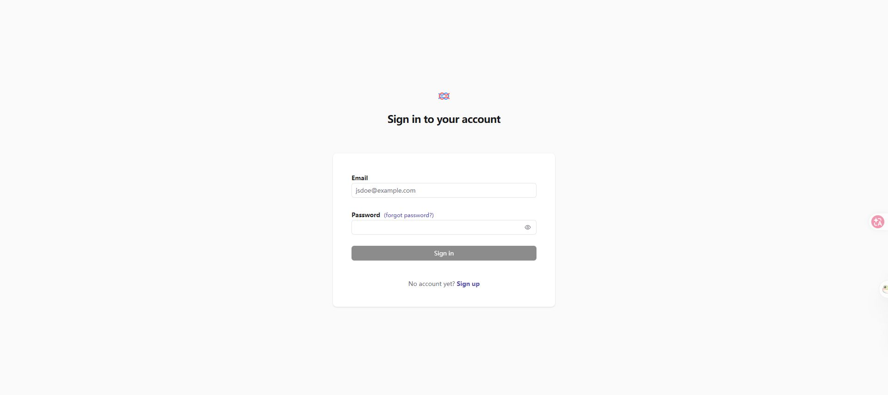

# 云 GPU 容器部署记录与内网离线迁移手册

记录日期：2026-11-16。状态：**云端模拟离线链路已取得入库证据，本地隧道已观察到登录页；真实模型推理及麒麟离线冷装均待验收**。本文区分已经收到的实际执行记录与后续操作方案；未标为通过的命令不能视为已经执行或验证。

## 1. 背景、目标和范围

在云 GPU 服务器按本仓库方式部署 Nginx、LiteLLM、Langfuse 和其数据库 / 对象存储依赖，并以容器运行 Strata 0.1.45 和 Qwen3.8-Next-Flash IQ3_XXS 模型。以真实推理和 Trace 验证整条链路；再将网关及 Langfuse 的已验证镜像与配置整理为离线物料，由人工转移到麒麟 V10 内网环境，完成无互联网冷安装和验收。所有应用服务使用容器，宿主仍需要匹配的 NVIDIA 驱动、容器运行时和 Docker。

```text
客户端 ── HTTPS ── Nginx ── LiteLLM ── Strata 容器 ── 双 A100
                       │
                       └── Langfuse Web / Worker
                            ├── PostgreSQL
                            ├── ClickHouse
                            ├── Redis
                            └── MinIO / 初始化任务
```

现有仓库 Compose 包含网关、Langfuse 及依赖，不包含 Strata、Prometheus 或 Grafana。Strata 的容器构建、模型挂载、网络和 GPU 配置以本次实际完成并复核后的发布物为准；不能仅凭架构图断言服务已运行。

## 2. 云端环境与当前进展

以下为部署执行方提供的实测信息；本文编写者未独立登录服务器。

| 项目 | 已报告的实际情况 |
| --- | --- |
| 云服务器 | `203.0.113.30`，SSH 端口 `13212`；认证信息通过独立渠道管理 |
| 系统 / 内核 | CentOS 7.9；`3.10.0-1160.118.1` |
| GPU / 驱动 | 2 × NVIDIA A100-SXM4 40 GB；驱动 550.78；NVIDIA 容器运行时已存在 |
| 内存 / 磁盘 | 约 94 GiB RAM；根盘初始空闲约 172 GiB，非当前实时剩余量 |
| Docker / Compose | Docker 20.10.17；Compose v2.29.7 二进制可运行 |
| 云端工作目录 | `/opt/llm-observability-deploy` |
| 网关源码 | 本地 main 的 Git archive；本文所查本地基线为 `9aeb9ce797a7e5682ae044ed49a7cfad6bec27a7`，云端实际归档对应 SHA 待部署方确认 |
| Strata 源码 / 镜像 | 源码固定提交 `477ac13cbe8e582c20484871ce459d20d82df09d`。部署方报告镜像 `local/strata:0.1.45-cuda12` 已构建成功，`BUILD.json` 的 version 为 `0.1.45`、archs 为 `[80]`；容器内 `nvidia-smi` 识别两张 A100。运行中的引擎版本及模型加载仍待验证 |
| 镜像与模型 | 9 个核心镜像已导出并成功执行 `docker load`；最终 tag、digest 和 image ID 清单待补。GGUF 两片官方大小分别为 47,039,860,096 和 28,800,138,432 字节；最近报告各下载约 2.5 GiB，并发断点下载仍在进行，远未完成 |
| 配置与启动 | Compose v2.29.7 的 `config --quiet` 检测通过，项目名 `llm-a100`；据部署方最新反馈，Langfuse Web / Worker、Nginx、LiteLLM、PostgreSQL、ClickHouse、Redis、MinIO 已启动且服务仍健康。真实推理尚未验收 |
| 云端接口检查 | 部署方反馈：服务器内部 `https://127.0.0.1:8444/api/public/health` 返回 HTTP 200；带项目凭据访问 `/api/public/projects` 返回 HTTP 200；经 Nginx 访问 LiteLLM `/v1/models` 返回 HTTP 200 并列出 `qwen-strata`。这证明接口及模型别名可访问，不能证明模型已加载或推理成功 |
| 外网访问 | 部署方反馈，本机访问 `https://203.0.113.30:13258/health/liveliness`、`https://203.0.113.30:13259/api/public/health` 和 `https://203.0.113.30:13262/minio/health/live` 均返回 HTTP 200，使用自签名证书。历史 SSH 隧道端口配置已变化，不再作为当前访问入口 |
| 离线模拟 | 部署方反馈，同一云主机的独立 Compose 项目使用 Docker internal 网络及本地镜像启动服务；模拟请求经网关返回 HTTP 200，隔离 ClickHouse 有对应事件。范围及限制见第 6.1 节 |
| 离线候选包 | `/opt/llm-observability-deploy/offline/nginx-litellm-langfuse-amd64-centos7-candidate-20261116-v3.tar`，约 5.4 GiB；服务器和本机副本的 SHA-256 均为 `627e4b44ba9fcf4da8a7f9f3d1227348815ca021d153c978236758ced206b702`。部署方报告包内 19 项校验通过，九镜像导入通过；物料范围与验收限制见第 6.1 节 |
| Windows 浏览器 | 2026-11-16 在 Chrome 实际打开公网 HTTPS 地址，返回 `net::ERR_CERT_AUTHORITY_INVALID`。随后通过用户提供的临时本地 SSH 隧道 `http://127.0.0.1:18031/` 观察到 Langfuse 登录页；按部署方说明，该隧道直达同一云端 Langfuse Web 容器 3000 端口。公网自签名证书仍需用户自行信任或处理 |

部署方提供的当前端口映射如下。云主机端口和公网端口是不同层次，访问控制、证书、地址配置仍需按现场检查；其他端口暂未分配。

| 用途 | 容器内 Nginx 入口 | 云主机端口 | 公网入口 |
| --- | --- | --- | --- |
| LiteLLM API | HTTPS 8443 | 8800 | `https://203.0.113.30:13258` |
| Langfuse | HTTPS 8444 | 8801 | `https://203.0.113.30:13259` |
| MinIO 媒体 TLS | Nginx TLS 媒体入口，内部监听端口待补 | 8804 | `https://203.0.113.30:13262` |

模型文件、构建层、镜像导入层、离线包和数据库增长会共同占用磁盘；上表是初始容量快照。实际继续构建与导出前应复核剩余空间和 Docker data-root，记录文件大小和 SHA-256，避免把下载中或未校验的分片当作完整模型。

云端初始化账号已通过 Auth session API 验证可登录；具体密码保存在云端私有 .env 中，不写入手册。

## 3. 已执行操作记录

本节只列出已收到的执行结果；待部署方提供不含凭据的原始命令、时间、退出状态、日志路径和最终版本后，补录具体命令，避免以示例冒充实际执行。

| 阶段 | 当前结果 | 尚需记录 |
| --- | --- | --- |
| 环境检查 | 见第 2 节 | CPU / 架构、存储位置、Docker / NVIDIA runtime 详细输出、GPU 容器实测 |
| 源码准备 | 两个源码归档已准备 | 实际归档 SHA-256、部署目录、网关 commit 和本次修改清单 |
| Compose 配置检查 | v2.29.7 `config --quiet` 通过；项目名 `llm-a100` | 实际 `-f`、`--env-file` 和完整调用；不要输出展开后的密钥 |
| 镜像拉取 | 已开始；数据库及 MinIO 服务已能启动 | 每个服务最终 tag、digest、image ID、架构及完整拉取结果 |
| 模型下载 | 并发断点下载仍在运行，最近报告每片约 2.5 GiB；官方大小及 SHA-256 见第 4.1 节 | 文件名、官方来源链接、下载完成时间、实际大小与哈希校验结果 |
| Strata 构建 | `local/strata:0.1.45-cuda12` 已构建，`BUILD.json` 报告版本 0.1.45 / archs `[80]`；容器内 `nvidia-smi` 识别两张 A100 | Dockerfile、构建参数、实际命令、完整镜像 ID、最终启动参数和日志 |
| Strata 自动启动 | 部署方报告后台 supervisor 在模型校验通过后才触发启动；脚本和日志路径见第 4.1 节 | 校验细节、实际触发结果和运行状态；模型尚未下载完成 |
| 基础依赖启动 | PostgreSQL、Redis、ClickHouse 健康；MinIO 和 minio-init 启动成功 | 实际启动命令、镜像版本、初始化任务最终退出状态和证据 |
| Langfuse 启动 | 初次迁移因缺少单节点设置而报无 ZooKeeper；增加 `CLICKHOUSE_CLUSTER_ENABLED=false` 并重建。部署方后续反馈 Web / Worker 已启动，健康接口及项目接口返回 200 | 配置文件位置、修改涉及的服务、重建命令及迁移完成日志证据 |
| 网关模型列表 | 部署方反馈经 Nginx 的 `/v1/models` 返回 200，显示 `qwen-strata` | 请求时间、实际入口、脱敏命令与响应；模型列表不是推理成功证据 |
| 浏览器页面 | Chrome 经本地 SSH 隧道显示 Langfuse 登录页；公网 HTTPS 因自签名证书被拦截 | 公网证书信任及登录后的页面和 Trace 仍需单独验证 |
| 真实请求 | 待执行 | 服务健康状态、非流式和流式请求 / usage、Trace ID |
| 离线演练 | 同机隔离网络模拟已完成一次 mock 请求并查询到事件，详见第 6.1 节 | 完整执行命令、镜像锁 / 包 SHA-256、网络检查、冷装及目标机证据 |
| 页面 / 截图 | 已保存本地隧道登录页截图，见第 4 节 | 如需登录后截图，应经真实浏览器观察并确认脱敏范围 |

建议记录不包含凭据的只读环境信息：

```bash
cat /etc/os-release
uname -m && uname -r
free -h
df -h / /opt
nvidia-smi
docker version
docker info --format 'root={{.DockerRootDir}} runtimes={{json .Runtimes}}'
docker compose version
```

如果本次使用独立 Compose 二进制而不是 Docker CLI 插件，应将最后一行替换成实际的可执行文件路径。不要把 `.env`、`docker inspect` 的环境字段、展开后的 `docker compose config` 或带认证头的请求输出写入公开文档。

本次 Langfuse 使用单节点 ClickHouse。部署方反馈初次 Web 迁移报缺少 ZooKeeper，随后参照 Langfuse 4.63.0 官方 Compose 增加 `CLICKHOUSE_CLUSTER_ENABLED=false` 并重建，后续报告 Web / Worker 已启动且健康及项目接口返回 200。隔离环境的模拟请求已查询到 ClickHouse 事件；迁移完成日志、云端真实模型请求及其 Trace 仍需核对。该变量及其实际作用服务需要随最终 Compose 配置进入离线包，且仅在对应版本和单节点拓扑验证后复用。

## 4. 云端实施与功能验收

以下为待实施 / 待补证步骤，具体执行参数以部署方最终交付的 Compose、镜像锁和实际部署目录为准。

1. 确认模型两片下载完成，与可信来源逐片核对大小、SHA-256 和模型格式；确认磁盘剩余空间覆盖解压、镜像构建、运行数据及后续离线导出。
2. 固定 Strata 源码提交、CUDA 基础镜像和构建产物。记录构建命令、镜像完整 ID、引擎 `--version`、模型路径、GPU 分配、端口、上下文配置；容器内确认可见 GPU。不要根据 GPU 数量推断 TP 或 PD 配置。
3. 配置网关上游为实际 Strata 容器可达地址和真实模型 ID；Nginx 证书、地址和 Langfuse 公网 / 内网 URL 必须与实际入口一致。现场生成密钥，不放入归档和提交。
4. 用与配置检测相同的 Compose 文件、环境文件和项目名启动。等待 PostgreSQL、ClickHouse、Redis、MinIO 初始化及 Langfuse Web / Worker 就绪，再验证 LiteLLM 和 Nginx。保留不含密钥的 `ps`、健康状态和关键错误日志。
5. 经 Nginx 入口执行一次非流式和一次流式真实对话，记录时间、模型别名、返回状态、usage 和 request ID；核对 Strata 实际加载模型和 GPU 使用。随后在 Langfuse 确认对应 Trace、模型、输入输出和 token 用量；工具链需实际发起工具执行链后才能验收。
6. 记录断开 / 重启后的数据持久化和恢复结果，截图经浏览器真实观察后保存到 `cloud-container-deployment-20261116-assets/`，并在本节引用。截图前检查页面上的密钥、个人信息和请求内容。

### 4.1 模型文件完整性检查

部署方提供的官方参考值如下；本次文件仍在下载，**尚未进行完整文件校验**。文件名及官方来源链接待部署方补充，确认分片顺序后再使用下表。

| 分片 | 官方大小（字节） | 官方 SHA-256 |
| --- | ---: | --- |
| 第 1 片 | 47039860096 | `219ea929900dfa9ef091f3aa473fdba6874b65fcb36526d7d851ac9e95856d15` |
| 第 2 片 | 28800138432 | `316b46f3a2dbd68c900f43136ab9449f9dcc3725dfd8c794847c204bc161e113` |

以下是供下载完成后执行的校验命令，**不是已执行结果**。将两条路径替换成服务器上的真实文件名；命令逐片检查字节数和 SHA-256，任一不符返回非零。完整文件的哈希校验可能耗时，等待下载器结束且文件不再写入后执行。

```bash
export MODEL_SHARD_1=/实际模型目录/第一片.gguf
export MODEL_SHARD_2=/实际模型目录/第二片.gguf
bash <<'BASH'
set -eu
verify_shard() {
  path=$1 expected_size=$2 expected_hash=$3
  test -f "$path" || { printf 'file missing: %s\n' "$path" >&2; return 1; }
  actual_size=$(stat -c '%s' -- "$path")
  test "$actual_size" = "$expected_size" || { printf 'size mismatch: %s\n' "$path" >&2; return 1; }
  actual_hash=$(sha256sum -- "$path" | cut -d ' ' -f 1)
  test "$actual_hash" = "$expected_hash" || { printf 'SHA-256 mismatch: %s\n' "$path" >&2; return 1; }
  printf 'verified: %s\n' "$path"
}
verify_shard "$MODEL_SHARD_1" 47039860096 219ea929900dfa9ef091f3aa473fdba6874b65fcb36526d7d851ac9e95856d15
verify_shard "$MODEL_SHARD_2" 28800138432 316b46f3a2dbd68c900f43136ab9449f9dcc3725dfd8c794847c204bc161e113
BASH
```

部署方报告后台 supervisor 仅在校验通过后触发启动 Strata，脚本为 `/opt/llm-observability-deploy/models/download_and_start_supervisor.sh`。下载日志位于 `/opt/llm-observability-deploy/logs/parallel-model-download.log`，启动日志位于 `/opt/llm-observability-deploy/logs/strata-start-after-download.log`。应以日志、容器状态、模型加载和真实 API 请求确认实际结果；校验命令本身不会证明 supervisor 已触发或模型已运行。

**云端结果：接口可用性及隔离环境 mock 事件入库由部署方报告通过；真实模型推理与其 Trace 待验收。** Chrome 经临时本地 SSH 隧道打开 `http://127.0.0.1:18031/`，跳转到 `/auth/sign-in` 并显示邮箱、密码和登录按钮。下图仅证明登录界面可显示；未登录，也未验证 Trace。隧道按部署方说明直达同一云端 Langfuse Web 容器，不经过公网 Nginx HTTPS 入口；公网自签名证书仍需用户自行信任或处理。



## 5. 需要准备并携带的离线文件

以云端真实通过验收的版本为准生成本次包，旧的 1.5 GiB 历史镜像包早于自动路由和当前看板，不能视为本次完整交付。下表的九类镜像均须锁定实际 tag、digest / image ID 和 `linux/amd64` 架构；不应假定现有示例版本已在本次云机验证。

| 物料 | 具体内容 |
| --- | --- |
| 应用镜像 | Nginx、LiteLLM、Langfuse Web、Langfuse Worker、PostgreSQL、ClickHouse、Redis、MinIO、MinIO Client；包含完成回调依赖后的最终 LiteLLM 镜像 |
| 镜像索引与完整性 | 镜像导出 tar、完整 image ID / digest / 架构锁、本地镜像别名、`SHA256SUMS`、manifest、独立渠道提供的校验值 |
| 应用配置 | 精确版本的源码归档、Compose、LiteLLM 模型与回调配置、Nginx 配置、证书生成 / 替换说明、`.env.example`、本手册及实际修改文件；运行密码和私钥单独交付 |
| 系统与工具 | 对应麒麟 V10 实际 SP / Build / 架构的 Docker、containerd、runc、Compose 及其完整依赖和签名；独立 Python 3.12 / wheelhouse 仅在实际采用仓库宿主脚本时需要；完整清单按目标机确认 |
| 缓存与模型接入 | 实际请求路径所需 tokenizer 缓存；内网 Strata 的 API 地址、模型 ID、认证和网络规则。若内网也新装推理服务，另备已验证的 Strata 镜像、模型全部分片 / tokenizer、驱动及 NVIDIA 容器运行时 |
| 运维资料 | 版本记录、离线安装顺序、验收模板、备份恢复方法、历史数据迁移方案（如需）、Prometheus 抓取片段及 Grafana 看板（若复用已有监控） |

Docker、内核、CPU 指令集和麒麟发行版差异都需在目标环境验证；CentOS 7.9 云机成功也不自动代表麒麟 V10 通过。详见 [麒麟 V10 完全离线部署](offline-deployment-baseline.md)、[迁移适配](migration-adaptation.md) 和 [验收模板](offline-acceptance-template.md)。

## 6. 打包、迁移与无网验收步骤

### 6.1 本次同机隔离演练的实际结果

以下是部署方提供的实测进度，本文编写者未独立复核服务器日志：

- 九个网关及 Langfuse 核心镜像已导出至 `/opt/llm-observability-deploy/offline/nginx-litellm-langfuse/images/images.tar`，约 5.2 GiB，部署方报告 `docker load` 成功；完整镜像清单、精确字节数和 SHA-256 待补。
- 离线目录 `/opt/llm-observability-deploy/offline/nginx-litellm-langfuse` 已包含源码、Compose、准备脚本及 CentOS 7 的 Docker CE 20.10.17、Docker CLI 20.10.17、containerd.io 1.6.7 三个 RPM。部署方报告包准备脚本会生成新的私有 `.env`，单节点配置验证通过；具体脚本路径、调用方式及实际输出证据待补，勿将生成的私有配置纳入公开归档。麒麟 V10 的系统依赖闭包仍未完成，不能以这三个 CentOS RPM 推断目标机可安装。
- 离线候选包位于 `/opt/llm-observability-deploy/offline/nginx-litellm-langfuse-amd64-centos7-candidate-20261116-v3.tar`，约 5.4 GiB。服务器和本机副本的 SHA-256 均为 `627e4b44ba9fcf4da8a7f9f3d1227348815ca021d153c978236758ced206b702`。包内 `SHA256SUMS` 共 19 项，执行 `sha256sum -c` 通过；9 个镜像执行 `docker load` 通过。包内包含部署记录和登录截图、Compose v2.29.7、上述三枚 CentOS 7 RPM 和依赖清单；不含完整麒麟依赖、模型或 Strata。
- 在同一台 CentOS 7.9 云主机另建 Compose 项目 `llm-offline-test`，使用 `internal=true` 的 Docker 网络限制容器外连；通过本机镜像及 `--pull never --no-build` 启动 Nginx、LiteLLM、Langfuse 和数据库等依赖。实际完整 Compose 文件、命令、网络检查与启动日志待补。
- 模拟上游 `offline-mock` 的请求经网关返回 HTTP 200 和 `offline-validation-ok`。隔离环境 ClickHouse 的 `events_full` 查到 `name=chat offline-mock`，事件时间为 **2026-11-16 02:06:22 UTC**。此前对 `/api/public/observations` 的查询返回 404，不能把该接口调用当作本次通过依据；此次入库依据是 ClickHouse 查询结果。
- 部署方反馈 Docker 20 的该 internal 网络配置下，宿主 localhost 的发布端口不可用；本次从容器网络内通过目标容器 IP 的 8443 / 8444 端口测试。具体发起位置、网络和命令待补；这一现象是本次环境观察，不能推断所有 Docker 配置均如此。

这次结果证明所报告的同机、隔离容器网络和 mock 上游条件下，请求及事件入库路径运行过；**尚未证明干净麒麟机器的离线安装，也不是实际模型推理或 Langfuse 界面 Trace 验收**。本机镜像加载成功也不等于已经完成完整离线包封装、校验和目标机器导入。

查看离线镜像归档大小和计算校验值的命令如下；仅供后续执行，结果需另行留存并通过独立渠道核对：

```bash
ARCHIVE=/opt/llm-observability-deploy/offline/nginx-litellm-langfuse/images/images.tar
stat -c '%n %s bytes' -- "$ARCHIVE"
sha256sum -- "$ARCHIVE"
```

### 6.2 通用打包与目标机部署

下面是仓库提供的通用操作框架，**不是本次已执行记录**。实际部署若使用新增 Compose override 或定制镜像，须将它们和对应启动参数一起归档并测试。先在准备机完成下载、构建和真实请求验收，再按 [离线手册](offline-deployment-baseline.md) 生成完整包。镜像导出工具不会自动拉取镜像；`git archive` 只包含已提交文件，未提交部署变更需先以受控方式纳入版本或另行归档并校验。

```bash
# 准备机：设置为实际路径；images.local.env 仅包含已验收的镜像引用。
export TARGET_PLATFORM=linux/amd64
export BUNDLE=/srv/offline/llm-observability-amd64
export PYTHON312=/opt/llm-python/bin/python3.12
"$PYTHON312" ops/offline_bundle.py images \
  --images-env offline/images.local.env --platform "$TARGET_PLATFORM" --bundle "$BUNDLE"
# 在补齐 source.tar、requirements.lock.txt、host/README.md、models/README.md、
# config/README.md 及其他实际所需物料后封包。
"$PYTHON312" ops/offline_bundle.py seal \
  --bundle "$BUNDLE" --platform "$TARGET_PLATFORM" --python-version 3.12
"$PYTHON312" ops/offline_bundle.py verify --bundle "$BUNDLE"
```

当前 `seal` 工具无论应用是否全部容器化，都要求 `requirements.lock.txt` 等固定文件存在；该要求不代表目标宿主一定要运行 Python 应用。若现场需要运行仓库宿主脚本，还须提供适配目标的 Python 和完整 wheelhouse。按第 5 节补齐麒麟特定的运行时物料和依赖，检查封包结果与清单。实际内网部署先核对文件哈希，安装经目标版本验证的容器运行时，再导入镜像；现场填入配置及密钥，完成 TLS、上游地址和模型 ID 适配。以下命令要求已按手册进入解压后的源码目录、设置实际 `BUNDLE` 并放置运行 `.env`：

```bash
cd "$BUNDLE"
sha256sum -c SHA256SUMS
docker load -i "$BUNDLE/images/images.tar"
cd /实际部署目录
docker compose --env-file .env --env-file "$BUNDLE/images.env" config -q
docker compose --env-file .env --env-file "$BUNDLE/images.env" up -d --pull never --no-build
docker compose --env-file .env --env-file "$BUNDLE/images.env" ps -a
docker compose --env-file .env --env-file "$BUNDLE/images.env" exec nginx nginx -t
```

如果最终使用不同 Compose 二进制或 override，所有命令必须使用相同的实际文件和参数。`sha256sum`、镜像导入和容器启动分别证明文件完整性、镜像可加载和进程启动，不能代替真实业务验收。

在目标麒麟 V10 同 SP / Build、同架构的干净机器上，**从安装开始阻断互联网**，仅保留所需内网通信，记录出口策略及时间；禁止拉取镜像或联网安装。依次验收：组件健康、MinIO 初始化、TLS 登录、非流式 / 流式推理及 usage、Langfuse Trace / 工具链、来源 IP、监控接入、重启与数据持久化、备份恢复。将每项结果和证据填入 [离线验收模板](offline-acceptance-template.md)，未完成项目写明原因，不将云端结果等同于内网验收。

## 7. 实际结果及待补信息

- **已报告**：服务器环境检查、源码归档准备、Compose 配置检测；应用和依赖容器已启动，外网健康接口及 Langfuse 项目接口、LiteLLM 模型列表接口返回 200；九个核心镜像已导出并成功加载；Strata 镜像已构建，容器内可识别两张 A100。
- **同机隔离演练**：mock 请求返回 200，ClickHouse 查到对应事件，范围和证据限制见第 6.1 节。
- **独立浏览器观察**：Windows Chrome 通过本地 SSH 隧道显示 Langfuse 登录界面，截图见第 4 节；公网入口的自签名证书仍被 Chrome 拦截。部署方反馈本机访问公网入口的健康接口返回 200。
- **进行中**：模型两片并发断点下载；后台 supervisor 等待校验通过后触发启动 Strata。镜像精确版本和锁文件待补。
- **待完成**：Langfuse 迁移完成日志确认、模型文件完整性校验及 Strata 实际加载、真实推理及其 Langfuse Trace 验证、麒麟依赖闭包和目标适配、干净麒麟 V10 断网冷装验收。
- **待部署方补充**：各阶段实际命令和退出状态、配置 / 构建文件位置、端口与访问方式、精确版本 / digest、模型名称和哈希、容器健康与请求证据、离线包位置及哈希、浏览器截图与时间。提供前移除密码、token、私钥和敏感请求内容。
