# LiteLLM + Langfuse 监控网关：空机器部署指南

用仓库根目录的 `docker-compose.yml` 在一台空的 Linux x86_64 机器上启动 Nginx、LiteLLM 和 Langfuse，并在 Langfuse 里看到第一条调用记录。所有模型请求走同一个入口，每次调用的输入、输出和 Token 都会留下记录。

> [!NOTE]
> 更新于 2026-11-19，基于本仓库 main 分支提交 `e4218a3`。标【补充建议】的内容来自通用经验，仓库其他文档里没有。图注标“示意”的图不是实机截图。

**目录**：[背景](#背景) · [适用机型](#适用机型) · [下载与链接](#下载与链接) · [部署步骤](#部署步骤) · [验证](#验证) · [监控效果（可选）](#监控效果可选) · [常见问题](#常见问题) · [停止、升级、备份](#停止升级备份) · [附录](#附录)

## 背景

团队有自建的 GPU 推理服务（Strata、vLLM、SGLang），但没有统一入口，也看不到单次请求的输入输出、Token 和来源。本仓库把 Nginx、LiteLLM、Langfuse、Prometheus、Grafana 串成一条链来解决这些问题：

- 客户端统一访问 Nginx 和 LiteLLM，用一个 master key，按模型别名路由到不同上游。
- LiteLLM 的自定义回调 `litellm/observability_callback.py` 把每次调用异步上报到 Langfuse。
- 按来源 IP 统计 Token 用量，导出 Prometheus 指标，在 Grafana 看 TTFT、TPOT、GPU 等。

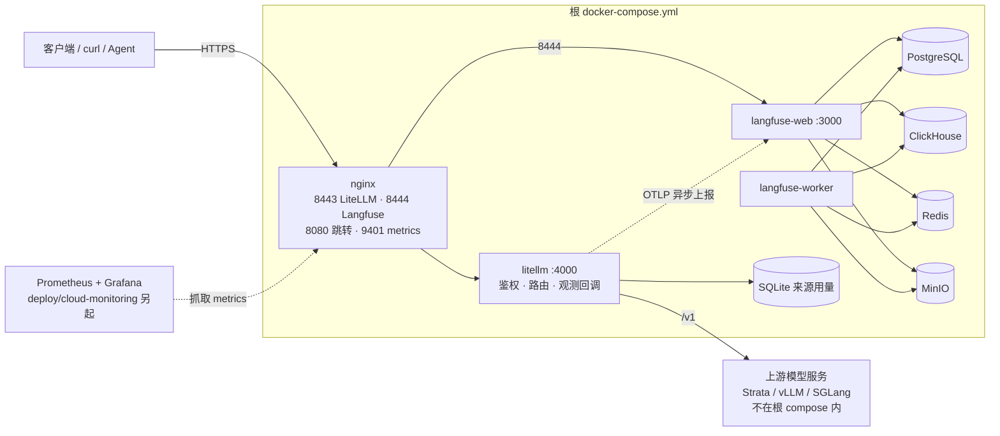

<details>
<summary>mermaid 无法渲染时查看图片版</summary>

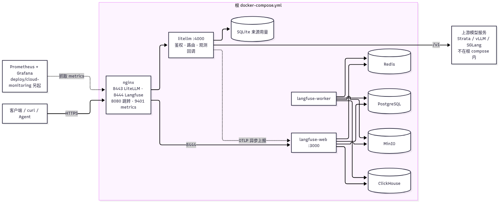

</details>

本指南只部署网关和 Langfuse。推理服务、Prometheus 和 Grafana 需另行准备。Langfuse 是异步追踪支路，不在推理响应的返回路径上。

## 适用机型

| 项目 | 要求 | 依据 |
| --- | --- | --- |
| CPU 架构 | x86_64（linux/amd64）；ARM 未验证 | 仓库的离线包和镜像清单只有 linux/amd64，arm64 需另做镜像映射 |
| 操作系统 | 64 位 Linux，推荐 Ubuntu 22.04/24.04 或 CentOS 7.9+ | 仓库在 CentOS 7.9 上实际部署，WSL 为 Ubuntu 24.04，目标机为麒麟 V10（断网冷安装未验收）。Ubuntu 22.04 为【补充建议】 |
| Docker | Docker Engine 20.10+ | 仓库现场版本为 20.10.17。新机直接装最新稳定版【补充建议】 |
| Docker Compose | Compose v2（`docker compose`） | 仓库用过独立 docker-compose 2.29.7。compose 文件用到顶层 `name` 和 `service_completed_successfully`，建议 v2【补充建议】 |
| CPU / 内存 / 磁盘 | 最低 4 核 / 8 GB / 50 GB；建议 8 核 / 16 GB / 100 GB SSD | 【补充建议】仓库未给最低值，只写了离线包场景至少预留 30 GiB，参考环境为 32 核 / 约 94 GiB / 2×A800（含模型推理） |
| GPU | 网关和 Langfuse 不需要 | GPU 只用于 Strata、vLLM 推理 |
| 端口 | 8443（LiteLLM HTTPS）、8444（Langfuse HTTPS）、8080（跳转）、9401（指标）、9090（MinIO） | `docker-compose.yml`，均绑定到 `HOST_IP` |
| 网络 | 能访问 `swr.cn-north-4.myhuaweicloud.com` 和 Docker 官方源 | 镜像来自华为云 SWR 镜像站。无外网时改用离线包 |

## 下载与链接

下列链接均在 2026-11-19 用 curl 检查过。仓库公开，不需要登录。

| 资源 | 地址 | 检查结果 |
| --- | --- | --- |
| 仓库 | https://github.com/tyloryang/litellm-langfuse-monitoring | 200 |
| git clone 地址 | https://github.com/tyloryang/litellm-langfuse-monitoring.git | 匿名 clone 成功 |
| zip 下载（main） | https://github.com/tyloryang/litellm-langfuse-monitoring/archive/refs/heads/main.zip | 200，约 24 MB（24,139,539 字节） |
| 离线包 Release | https://github.com/tyloryang/litellm-langfuse-monitoring/releases/tag/offline-reuse-amd64-20261116 | 200，附件可匿名下载 |
| Docker Engine 安装 | https://docs.docker.com/engine/install/ | 200 |
| Docker 便捷安装脚本 | https://get.docker.com | 200 |
| Docker Compose 安装 | https://docs.docker.com/compose/install/linux/ | 200 |
| Compose 独立二进制 | https://github.com/docker/compose/releases/tag/v2.29.7 | 200，仓库用过 2.29.7 |
| LiteLLM、Langfuse 文档 | https://docs.litellm.ai/ 和 https://langfuse.com/self-hosting | 均为 200 |

### 离线包 Release 的分卷和校验值

无外网时使用，数据取自 Release 当前附件和 `docs/cloud-offline-verification-summary-20261116.md`（提交 `e4218a3` 更新后的摘要）。五个分卷合并成 `kylin-v10-gateway-reuse-amd64-20261116.tar`，合并后应为 2,101,688,320 字节，SHA-256 为 `8b50cf74306f1c455487f257b91587ccffad17df1a6046d339cd1b474a8b48ae`。

| 分卷 | 字节数 | SHA-256 |
| --- | --- | --- |
| `kylin-v10-gateway-reuse-amd64-20261116.tar.part01` | 469,762,048 | `8ad2ab7baa67ed0b250ccb8f401c4d707b58af4fe8cf93b902690008343925fe` |
| `…tar.part02` | 469,762,048 | `97c4dc3983468c68055eff21a406b68ef993e9b4067a1e6dddee8fb8d00f9d73` |
| `…tar.part03` | 469,762,048 | `551d62e463f8ed7231e1f241b75826bc4d7ee3e29181cd100a3d2de5db534e3f` |
| `…tar.part04` | 469,762,048 | `f5ac1161ed84e712004087d957904e9857f5befc16f458aa76059b621e5eaee5` |
| `…tar.part05` | 222,640,128 | `8955bd8c7d9d60c303d3b3a1c1493f3922e18357e94c0bae78688ccb680aa485` |

校验值也在 Release 的 `BUNDLE-PARTS-SHA256SUMS` 里。合并与校验命令见 [docs/kylin-v10-complete-offline-operations-20261116.md](../kylin-v10-complete-offline-operations-20261116.md)。

用到的 9 个镜像，来自 `.env.example`：

```text
swr.cn-north-4.myhuaweicloud.com/ddn-k8s/docker.io/library/nginx:1.28-alpine
swr.cn-north-4.myhuaweicloud.com/ddn-k8s/docker.io/postgres:17.11
swr.cn-north-4.myhuaweicloud.com/ddn-k8s/docker.io/clickhouse/clickhouse-server:26.3.21.7
swr.cn-north-4.myhuaweicloud.com/ddn-k8s/docker.io/redis:7.4.11
swr.cn-north-4.myhuaweicloud.com/ddn-k8s/docker.io/minio/minio:RELEASE.2025-09-07T16-13-09Z-cpuv1
swr.cn-north-4.myhuaweicloud.com/ddn-k8s/docker.io/minio/mc:RELEASE.2025-05-21T01-59-54Z-cpuv1
swr.cn-north-4.myhuaweicloud.com/ddn-k8s/docker.io/langfuse/langfuse:4.63.0
swr.cn-north-4.myhuaweicloud.com/ddn-k8s/docker.io/langfuse/langfuse-worker:4.63.0
swr.cn-north-4.myhuaweicloud.com/ddn-k8s/ghcr.io/berriai/litellm:v1.106.6
# .env.example 中的镜像地址还带 @sha256 摘要，请直接使用 cp .env.example
# 上游同名镜像：library/nginx:1.28-alpine、postgres:17.11、redis:7.4.11、
# clickhouse/clickhouse-server:26.3.21.7、langfuse/langfuse 与 langfuse-worker:4.63.0、ghcr.io/berriai/litellm:v1.106.6
```

Docker Hub 上 nginx、postgres、redis、clickhouse、langfuse、langfuse-worker 的对应 tag 存在，ghcr 的 litellm v1.106.6 存在；SWR 上 minio（cpuv1 tag）和 nginx（按 digest）可匿名取到 manifest。镜像没有在本机实际 pull 过。Docker Hub 上查不到 MinIO 的 cpuv1 tag，仓库只指向 SWR。

## 部署步骤

在目标机的同一个终端里按顺序执行。步骤 3 定义的 `set_env` 函数在步骤 6 还要用。

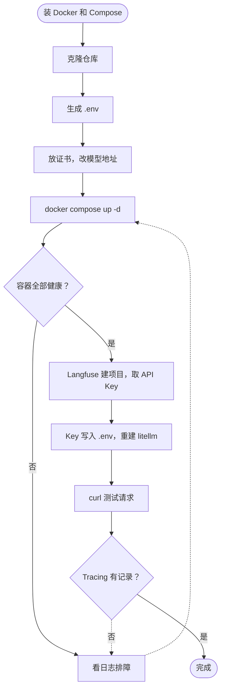

### 步骤 1：安装 Docker 和 Compose

```bash
# 官方便捷脚本（补充建议），其他发行版见上方安装页
curl -fsSL https://get.docker.com -o get-docker.sh
sudo sh get-docker.sh
sudo systemctl enable --now docker
sudo usermod -aG docker $USER && newgrp docker
docker version
docker compose version
```

预期输出：`docker version` 列出 Client 和 Server 两段；`docker compose version` 显示 v2 版本。

```text
Client: Docker Engine - Community
 Version:           <版本号>
Server: Docker Engine - Community
 Engine:
  Version:          <版本号>
Docker Compose version v2.<次版本>
```

无外网的机器按仓库离线流程部署，见 [docs/kylin-v10-offline-operations-step-by-step.md](../kylin-v10-offline-operations-step-by-step.md)，需要下载上面的离线包 Release。

### 步骤 2：克隆仓库

```bash
git clone https://github.com/tyloryang/litellm-langfuse-monitoring.git
cd litellm-langfuse-monitoring

# 不用 git 时改用 zip（约 24 MB，解压后目录名为 litellm-langfuse-monitoring-main）
curl -L -o main.zip https://github.com/tyloryang/litellm-langfuse-monitoring/archive/refs/heads/main.zip
unzip main.zip && cd litellm-langfuse-monitoring-main
```

预期输出：

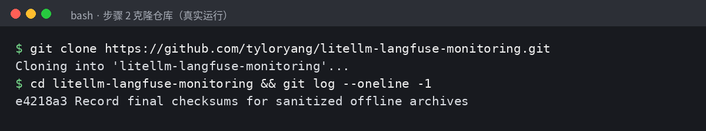

*真实运行：克隆结果。非终端环境不显示进度条，只有一行 Cloning into。*

克隆下载约 22 MB，展开后工作区约 62 MB，其中 `source/` 约 60 MB 是上游源码快照，部署网关用不到。

### 步骤 3：生成 .env

```bash
cp .env.example .env && chmod 600 .env
set_env() { sed -i "s|^$1=.*|$1=$2|" .env; }

# 宿主机对外 IPv4，也可以手动填写
HOST_IP=$(ip -4 route get 1.1.1.1 | grep -oP 'src \K\S+')
set_env HOST_IP $HOST_IP
set_env NEXTAUTH_URL https://$HOST_IP:8444
set_env LANGFUSE_MEDIA_PUBLIC_ENDPOINT http://$HOST_IP:9090

# 随机密钥用 hex，避免特殊字符破坏 DATABASE_URL（补充建议）
for k in POSTGRES_PASSWORD CLICKHOUSE_PASSWORD REDIS_AUTH MINIO_PASSWORD SALT NEXTAUTH_SECRET VLLM_API_KEY SGLANG_API_KEY STRATA_API_KEY; do
  set_env $k $(openssl rand -hex 24)
done
set_env ENCRYPTION_KEY $(openssl rand -hex 32)
set_env LITELLM_MASTER_KEY sk-$(openssl rand -hex 24)

grep -n REPLACE .env
grep -n -E '^(HOST_IP|NEXTAUTH_URL)=' .env
```

预期输出：只剩 Langfuse 的两行 key 带 REPLACE，它们在步骤 6 填写；`HOST_IP` 和 `NEXTAUTH_URL` 是你机器的地址（下图为文档示例地址 192.0.2.10）。

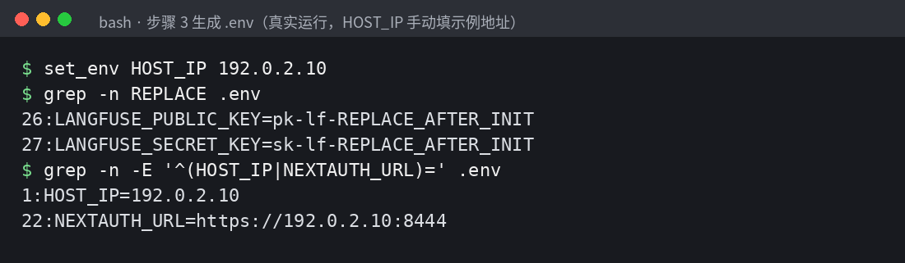

*真实运行：.env 生成结果。为避免暴露真实地址，HOST_IP 手动填文档示例地址。*

必须填的变量只有 `HOST_IP`（宿主机真实网卡地址）、`NEXTAUTH_URL`（浏览器访问 Langfuse 的完整地址）和密钥。完整变量说明见[附录 B](#b-变量说明)。

### 步骤 4：放入证书，修改模型配置

Nginx 挂载 `./nginx/certs`，仓库不带证书（`.gitignore` 已排除该目录）。仓库手册要求证书的 SAN 包含真实访问地址。自签示例【补充建议】：

```bash
mkdir -p nginx/certs
openssl req -x509 -newkey rsa:2048 -nodes -days 365 \
  -keyout nginx/certs/server.key -out nginx/certs/server.crt \
  -subj "/CN=$HOST_IP" -addext "subjectAltName=IP:$HOST_IP"
chmod 600 nginx/certs/server.key
ls nginx/certs
```

预期输出：

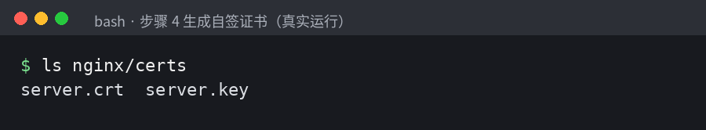

*真实运行：证书目录。*

`litellm/config.yaml` 自带 vllm、sglang、strata 三个示例模型，地址是 10.0.0.x。删掉不存在的模型块，把保留的改成真实地址。下面是仓库手册给出的最小配置：

```yaml
model_list:
  - model_name: qwen-strata                      # 客户端使用的别名
    litellm_params:
      model: openai/qwen3.8-flash-next-iq3_xxs   # 上游真实模型 ID，与上游 /v1/models 一致
      api_base: http://<上游IP>:8008/v1          # 以 /v1 结尾
      api_key: os.environ/STRATA_API_KEY

litellm_settings:
  callbacks:
    - prometheus
    - observability_callback.observability
  prometheus_emit_stream_label: true
  prometheus_metrics_max_series_per_metric: 5000

general_settings:
  master_key: os.environ/LITELLM_MASTER_KEY
  use_x_forwarded_for: false
```

`nginx/nginx.conf` 的 9401 指标端口只放行 192.168.10.20，不用 Prometheus 时可忽略。8080 的跳转固定指向 8443，经过 NAT 时需改成实际入口。

### 步骤 5：启动并检查容器

```bash
docker compose config --quiet
docker compose pull
docker compose up -d
docker compose ps -a
```

预期结果：

- `config --quiet` 无输出。
- postgres、clickhouse、redis 显示 healthy。
- minio-init 显示 Exited (0)，它是一次性初始化任务。
- 其余服务为 running。首次启动要做数据库迁移，可能需要几分钟。

再检查回调依赖和 Nginx 配置：

```bash
docker compose exec -T litellm python -c "import prometheus_client, opentelemetry.sdk.trace; from opentelemetry.exporter.otlp.proto.http.trace_exporter import OTLPSpanExporter; print('CALLBACK_DEPS_OK')"
docker compose exec nginx nginx -t
```

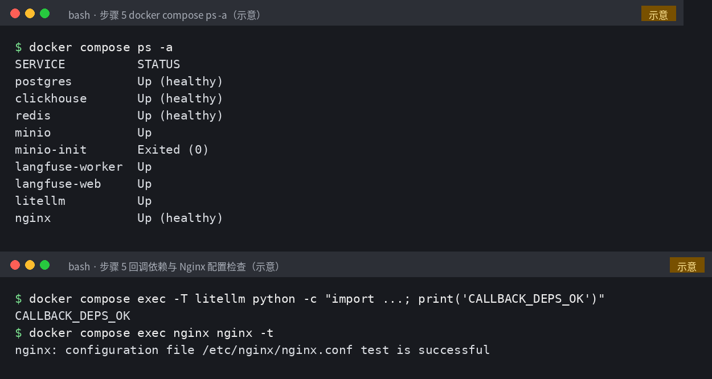

*示意：启动后的服务状态和两条检查命令的预期输出。服务名取自 docker-compose.yml，不是实机截图。*

官方 LiteLLM 镜像不一定带回调需要的 `prometheus_client` 和 `opentelemetry` 包。缺包时第一条命令会报 `ModuleNotFoundError`，需要按 `requirements-callback.txt` 构建镜像（检查方式取自仓库 `docs/offline-deployment-baseline.md`）。

### 步骤 6：在 Langfuse 创建项目并配置 key

根目录的 compose 没有 `LANGFUSE_INIT_*` 初始化变量（它们在离线 Release 的 `offline-override.yml` 里），所以要在界面里注册第一个账号。注册和建项目的界面文案以实际版本为准【补充建议】。

1. **打开 `https://HOST_IP:8444`**：自签证书会触发浏览器警告，选择继续。点 Sign up 注册管理员账号。
2. **创建组织和项目**：进入项目后打开 Settings，再进 API Keys（路径取自仓库手册 8.3）。创建一对 key，复制 `pk-lf-` 和 `sk-lf-` 开头的两个值，私钥只显示一次。
3. **写入 .env 并重建 litellm**：容器环境在创建时确定，改了 .env 必须重建，restart 不生效。

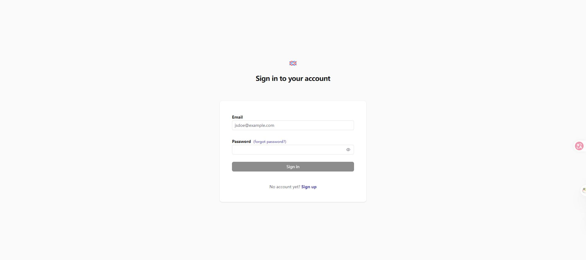

*Langfuse 登录页（仓库截图 `docs/cloud-container-deployment-20261116-assets/langfuse-sign-in-local-tunnel.jpg`，历史快照）。*

```bash
# 在设置过 set_env 的同一个终端执行；换成 Langfuse 页面上复制的真实 key
set_env LANGFUSE_PUBLIC_KEY pk-lf-xxxxxxxx
set_env LANGFUSE_SECRET_KEY sk-lf-xxxxxxxx
docker compose up -d --no-deps --force-recreate litellm
```

确认这对 key 属于哪个项目（脚本取自仓库手册 8.3）：

```bash
docker compose exec -T litellm python - <<'PY'
import os, json, base64, urllib.request
pair = os.environ['LANGFUSE_PUBLIC_KEY'] + ':' + os.environ['LANGFUSE_SECRET_KEY']
auth = base64.b64encode(pair.encode()).decode()
url = os.environ['LANGFUSE_HOST'].rstrip('/') + '/api/public/projects'
req = urllib.request.Request(url, headers={'Authorization': 'Basic ' + auth})
with urllib.request.build_opener(urllib.request.ProxyHandler({})).open(req, timeout=20) as r:
    print('HTTP', r.status)
    for p in json.load(r).get('data', []): print('project:', p.get('name'), 'id:', p.get('id'))
PY
```

预期输出：HTTP 200 和项目名称。返回 401 说明 key 不是同一对，或者 litellm 没有重建。

```text
HTTP 200
project: <项目名> id: <项目ID>
```

## 验证

先发请求，再到 Langfuse 里找这条记录。请求体来自仓库手册 8.4，模型别名要和 `config.yaml` 一致。

```bash
KEY=$(grep '^LITELLM_MASTER_KEY=' .env | cut -d= -f2)
HOST_IP=$(grep '^HOST_IP=' .env | cut -d= -f2)

# 模型列表（自签证书用 -k）
curl -sk https://$HOST_IP:8443/v1/models -H "Authorization: Bearer $KEY"

# 带唯一标记的测试请求
curl -sk https://$HOST_IP:8443/v1/chat/completions \
  -H "Authorization: Bearer $KEY" -H "Content-Type: application/json" \
  -d '{"model":"qwen-strata","messages":[{"role":"user","content":"Reply only TRACE_OK"}],"max_tokens":32,"stream":false,"metadata":{"trace_name":"manual-trace-001","session_id":"manual-trace-001"}}'
```

预期输出（取自本机 LiteLLM v1.106.6 加模拟上游的真实运行，字段值以你的上游为准）：

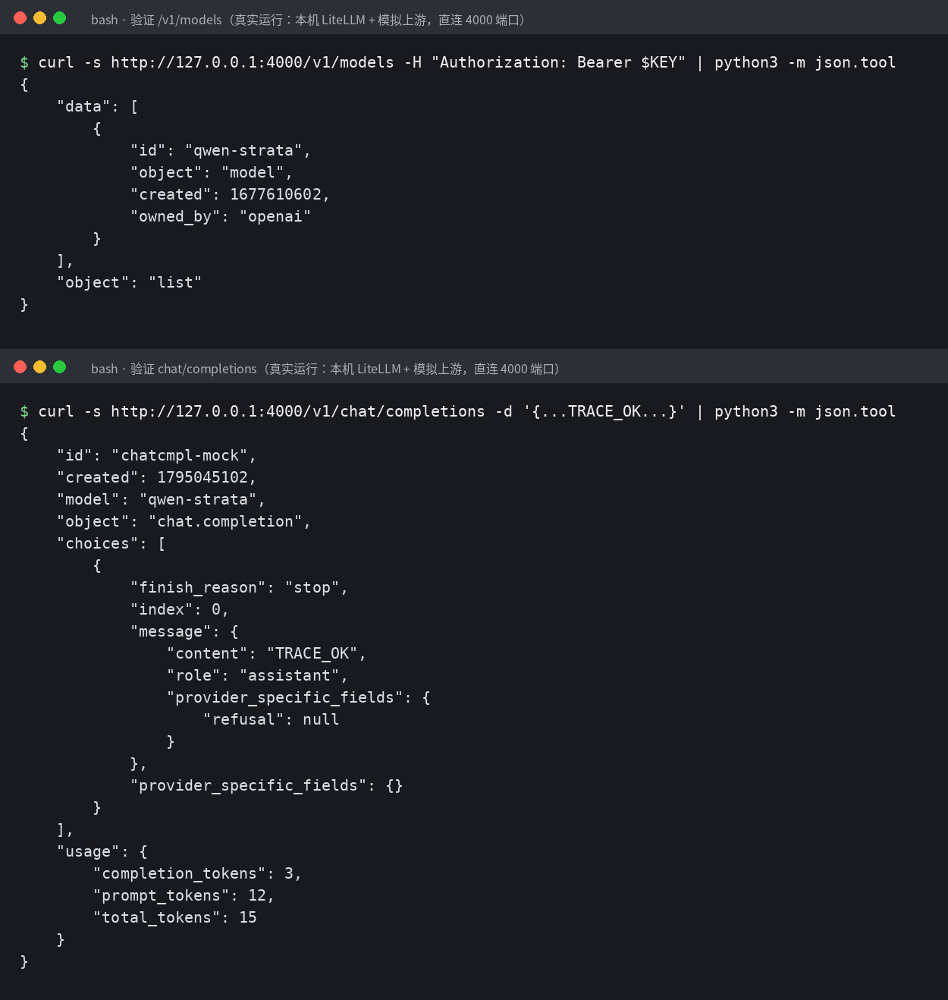

*真实运行：模型列表和测试请求的返回。本机直连 LiteLLM 4000 端口，模型为模拟上游，未经 Nginx，也没有接 Langfuse。*

1. **确认接口返回 200**：回答里含 `TRACE_OK`，并带有 usage。返回 502 或超时说明上游地址不通或模型未加载。
2. **打开 Langfuse 的 Tracing 页**：选择 key 所属的组织和项目，时间范围覆盖当前，environment 包含 production，搜索 `manual-trace-001`。写入是异步的，等几秒再刷新。
3. **核对 Generation**：输入、输出、模型和 token usage 都应有值。普通 Generation 不能证明工具被真实执行，工具链需要客户端自己埋点，示例见 `examples/traced_tool_agent.py`。

调用路径和异步上报的先后顺序：

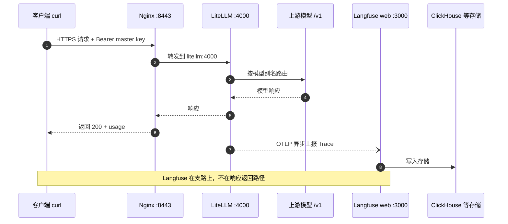

<details>
<summary>mermaid 无法渲染时查看图片版</summary>

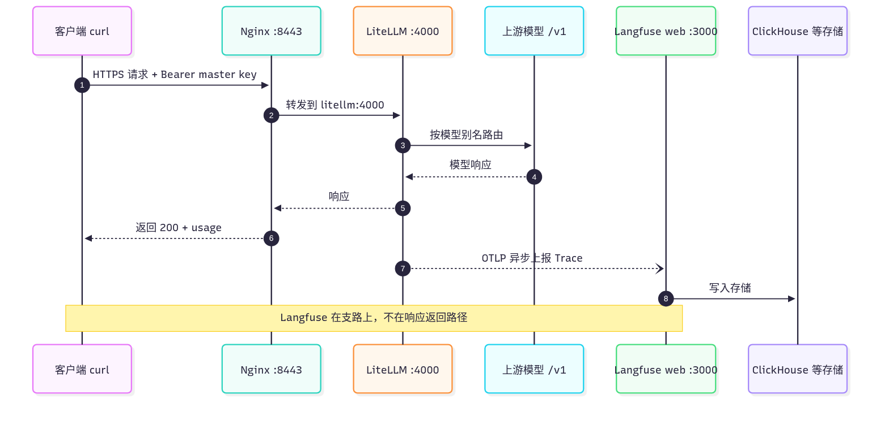

</details>

下面 3 张来自有道笔记“litellm+langfuse链路监控示意图”（笔记图 7 到 9），环境为 WSL，项目为 strata-observability，用户信息已打码。

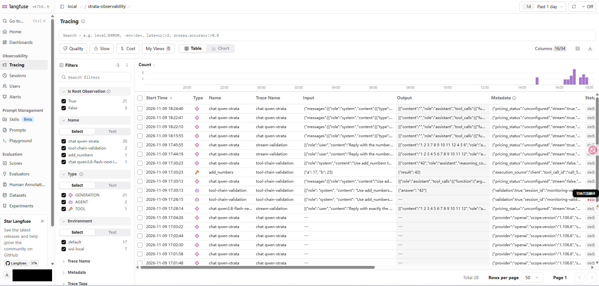

*笔记图 7：Tracing 列表，模型调用（GENERATION）、智能体（AGENT）和工具（TOOL）记录并存，列出输入、输出和元数据。*

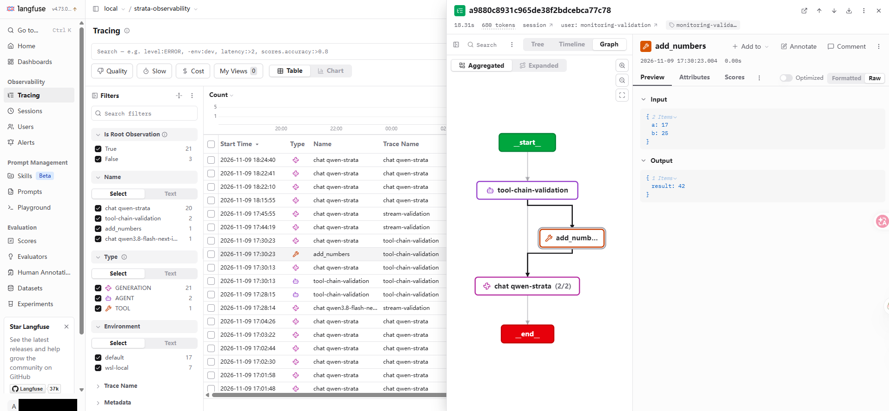

*笔记图 8：Trace 的 Graph 视图，智能体、工具 add_numbers（输入 17 和 25，输出 42）、第二次模型调用。*

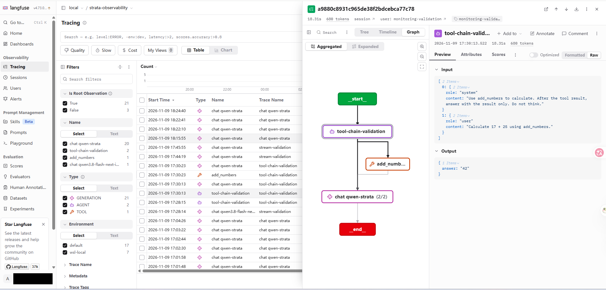

*笔记图 9：同一条 Trace 选中智能体节点，输入为系统和用户消息，输出答案 42，对应 `examples/traced_tool_agent.py` 的工具链验证。*

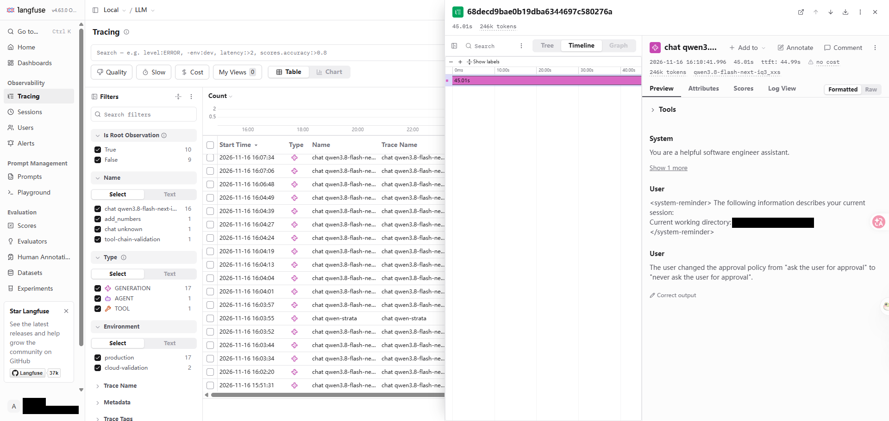

*期望看到的 Tracing 页面（仓库截图 `docs/kylin-v10-offline-assets/cloud-langfuse-trace.png`，已打码的历史快照，不是本次部署结果）。*

## 监控效果（可选）

Prometheus 和 Grafana 不属于本指南的部署范围，仓库的监控准备脚本目前不能直接用在新装主栈上，原因见[附录 C 第 3 条](#c-仓库现状与已知问题)。下面是接好监控后的看板效果。笔记图 1 到 6 来自有道笔记，对应看板“LLM 推理观测 · Strata / LiteLLM / GPU”的 01 到 06 分区，环境为 WSL（GPU 为 wsl-rtx3080）。

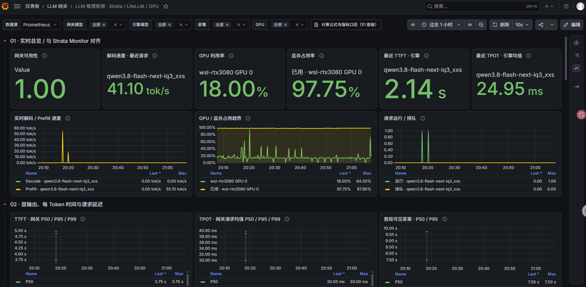

*笔记图 1，01 实时总览：网关可用性、解码速度、GPU 利用率和显存、TTFT、TPOT。*

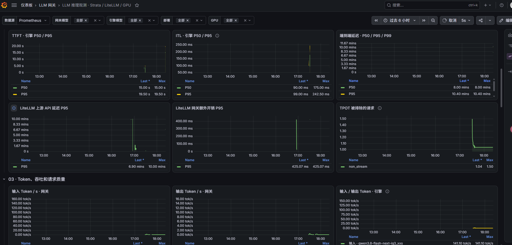

*笔记图 2，02 首输出与请求延迟：TTFT、ITL、端到端延迟、LiteLLM 上游延迟与网关额外开销。*

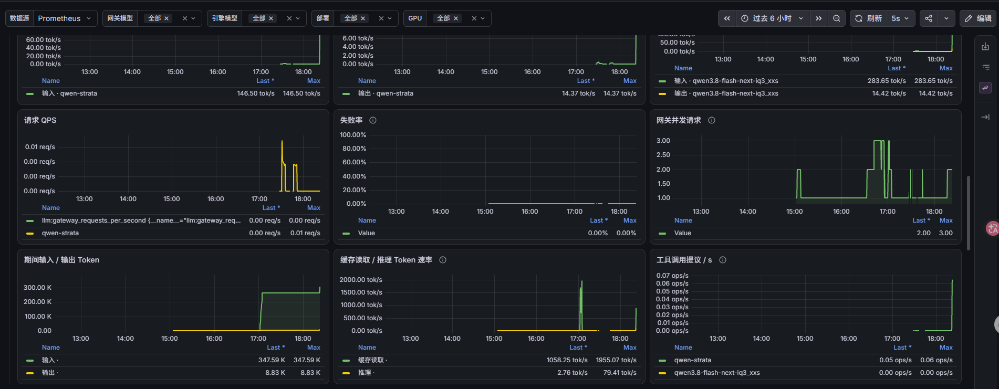

*笔记图 3，03 Token、吞吐和请求质量：QPS、失败率、并发、Token 速率、工具调用提议。*

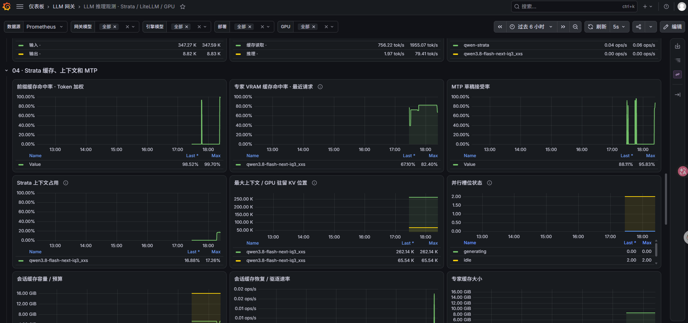

*笔记图 4，04 Strata 缓存、上下文与 MTP：缓存命中率、上下文占用、并行槽位。*

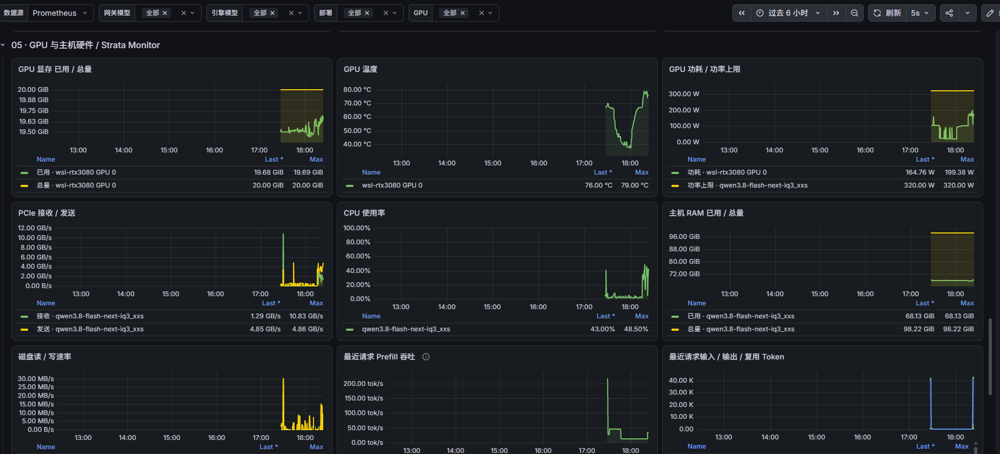

*笔记图 5，05 GPU 与主机硬件：显存、温度、功耗、PCIe、CPU、内存、磁盘。*

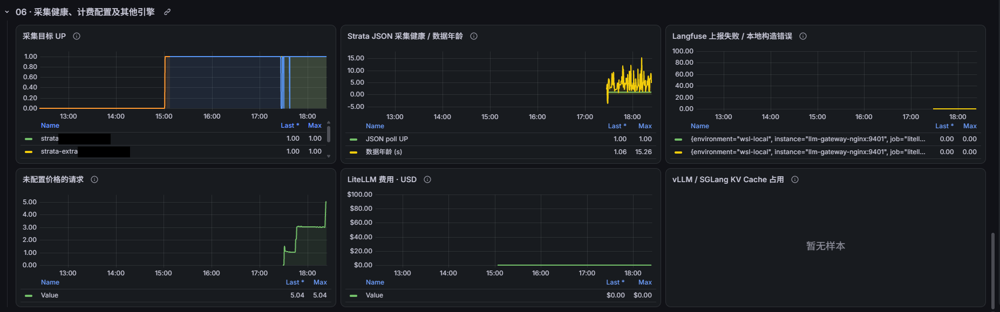

*笔记图 6，06 采集健康与计费：采集目标状态（地址已打码）、Langfuse 上报失败、未配置价格的请求。*

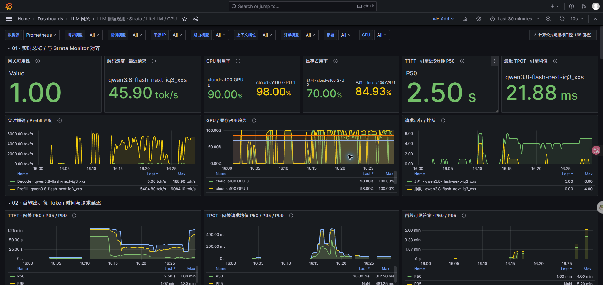

*仓库截图 `docs/kylin-v10-offline-assets/cloud-grafana-overview.png`（历史快照）。*

## 常见问题

| 现象 | 原因与处理 |
| --- | --- |
| `docker compose up` 提示变量未设置或镜像拉取被拒绝 | 确认 `.env` 由 `.env.example` 复制而来。镜像来自 SWR，拉取失败时检查网络，或改用上游同名镜像【补充建议】 |
| 端口绑定失败 | `HOST_IP` 必须是本机网卡上的地址，公网 IP 通常不在网卡上。用 `ss -ltnp` 查端口冲突 |
| nginx 反复重启 | 多半缺少 `nginx/certs/server.crt` 或 `server.key`，执行 `docker compose logs nginx` 确认 |
| LiteLLM 返回 401 | 有三类 key：客户端用 `LITELLM_MASTER_KEY`，LiteLLM 访问上游用 `STRATA_API_KEY` 等，Langfuse 用 pk 和 sk。改 `.env` 后要重建 litellm |
| LiteLLM 返回 502 或超时 | `config.yaml` 里的 `api_base` 必须是容器能访问的真实地址（容器内的 localhost 不行），以 `/v1` 结尾，且上游模型已加载 |
| Langfuse 显示 Waiting for first trace | 仓库手册记录过这个案例：网页打开的项目与 LiteLLM 的 key 不属于同一个项目。用步骤 6 的脚本核对，再到该项目的 Tracing 查看。直连上游不会产生 Trace，请求必须经过 LiteLLM |
| 没有 Trace，litellm 日志出现回调导入错误 | 容器缺少 `prometheus_client` 或 `opentelemetry` 包，按步骤 5 的检查命令确认，缺包时构建镜像 |
| 浏览器打不开 Langfuse 的媒体文件 | `NEXTAUTH_URL` 和 `LANGFUSE_MEDIA_PUBLIC_ENDPOINT` 要填浏览器能访问的地址，并放行 9090 端口 |
| TLS 报错 | 自签证书用 `curl -k`，或在客户端导入证书。正式环境使用 SAN 匹配的可信证书 |
| 访问 Langfuse 的 OTLP 地址返回 405 | 该端点只接受 POST，GET 返回 405 属于正常现象，不代表上报失败 |

排查时常用的命令：

```bash
ss -ltnp | grep -E ':(8080|8443|8444|9401|9090)\s'
docker compose ps -a
docker compose logs --since 15m --tail 100 litellm
docker compose logs --since 15m --tail 100 langfuse-web langfuse-worker
```

## 停止、升级、备份

```bash
# 停止与启动，数据保留
docker compose stop
docker compose start

# 冷备份（会短暂中断服务）
docker compose stop
tar --numeric-owner -czf ../llm-gateway-backup-$(date +%Y%m%d-%H%M%S).tar.gz .env nginx litellm data
sha256sum ../llm-gateway-backup-*.tar.gz
docker compose up -d

# 升级：先备份，再把 .env 里的 *_IMAGE 改成新版本
docker compose pull
docker compose up -d

# 只改了 LiteLLM 配置或 .env
docker compose up -d --no-deps --force-recreate litellm
docker compose exec nginx nginx -t && docker compose exec nginx nginx -s reload
```

> [!CAUTION]
> 不要用 `docker compose down -v` 排障，它会删除数据卷。不要把较新的 Langfuse 数据库挂给较旧的镜像，仓库文档说明不能这样降级。备份要连 `.env` 一起保存，换机时 `SALT`、`ENCRYPTION_KEY`、`NEXTAUTH_SECRET` 和各存储密码必须与备份一致。仓库手册的备份流程更完整，包含监控数据卷，见 [离线手动部署文档.md](../../离线手动部署文档.md) 第 14.5 节。

## 附录

### A. 架构

架构图见[背景](#背景)，调用时序见[验证](#验证)。上游模型和监控栈不在根 compose 内。

### B. 变量说明

| 变量 | 填写方式与作用 |
| --- | --- |
| `HOST_IP` | 宿主机真实网卡 IPv4。compose 用它绑定 8080、8443、8444、9401、9090，填错会导致端口绑定失败 |
| `NEXTAUTH_URL` | 浏览器访问 Langfuse 的完整 URL，默认 `https://HOST_IP:8444`。NAT 或域名场景填外部地址 |
| `LANGFUSE_MEDIA_PUBLIC_ENDPOINT` | 浏览器能访问的 MinIO API，默认 `http://HOST_IP:9090` |
| `*_IMAGE`（9 个） | 已带版本和 digest，保持原样，不要改成 latest |
| `POSTGRES_PASSWORD`、`CLICKHOUSE_PASSWORD`、`REDIS_AUTH`、`MINIO_PASSWORD` | 存储密码。首次启动后不要再改，否则已有数据卷与新密码不一致 |
| `SALT`、`ENCRYPTION_KEY`、`NEXTAUTH_SECRET` | Langfuse 的盐、加密密钥（64 位 hex）和会话密钥。迁移时必须与备份一致 |
| `LITELLM_MASTER_KEY` | 客户端访问 LiteLLM 的 Bearer key |
| `STRATA_API_KEY`、`VLLM_API_KEY`、`SGLANG_API_KEY` | `config.yaml` 通过 `os.environ/XXX` 引用的上游 key，要和上游服务的实际 key 一致 |
| `LANGFUSE_HOST` | 保持 `http://langfuse-web:3000`，这是容器内地址，不要填公网地址 |
| `LANGFUSE_PUBLIC_KEY`、`LANGFUSE_SECRET_KEY` | 同一个 Langfuse 项目的 key 对，步骤 6 获得后回填 |
| `LANGFUSE_TRACING_ENVIRONMENT` | 示例值 production。Langfuse 按 environment 筛选时要包含它 |
| `LITELLM_OTEL_V2` | 示例值 false。追踪由自定义回调负责，避免重复上报 |
| `GATEWAY_TRUSTED_PROXY_CIDRS` | 留空，或只填 Nginx 地址、专用网段，不要填 `0.0.0.0/0`。用于按来源 IP 统计 |

### C. 仓库现状与已知问题

| # | 现象 | 影响 |
| --- | --- | --- |
| 1 | 手册依赖的 `config/prepare.sh` 和 `offline-override.yml` 不在 git 里，只在离线 Release 的压缩包中。根 `.env.example` 没有 `LANGFUSE_INIT_*` 变量 | 只 clone 仓库无法走手册的 prepare.sh 路线，需要在界面手动建 Langfuse 项目，本指南采用这条路线 |
| 2 | `nginx/certs/` 被 `.gitignore` 排除，仓库没有证书生成命令 | 不放证书 Nginx 起不来 |
| 3 | `deploy/cloud-monitoring/prepare.py` 写死容器名 `llm-a100-litellm-1`、`llm-a100-strata-1` 和网络 `llm-a100_backend`，根 compose 的项目名是 `llm-gateway`。`prometheus.yml` 里 strata 目标是 `strata:8080` | 新装主栈上不能直接运行监控脚本，需要按离线手册 9.2 节逐项修改 |
| 4 | 示例地址不统一：`.env.example` 用 192.168.10.10，`config.yaml` 用 10.0.0.x，本指南用 192.0.2.10。根 README 说明 203.0.113.30、203.0.113.10、192.0.2.10、198.51.100.0/24 是文档保留地址，`YOUR_USER`、`YOUR_PROJECT` 等是占位 | 按文档拼命令时容易混淆，使用前换成自己的真实值 |
| 5 | LiteLLM 回调依赖没有在根 compose 里安装，仓库文档说明容器不会自动继承依赖 | 官方镜像缺包时回调无法加载，需要自行验证或构建镜像 |
| 6 | `litellm/routing_decision_log.py` 默认把决策日志写到仓库下的 `.runtime/token-router-decisions.jsonl`，可用环境变量 `TOKEN_ROUTER_DECISION_LOG` 修改 | 只在使用自动路由试验配置（`token_router_config.yaml`）时相关，容器里需要指向可写挂载 |
| 7 | 仓库自己标注麒麟 V10 的断网冷安装尚未验收 | 麒麟 V10 目标机需要现场验收 |
