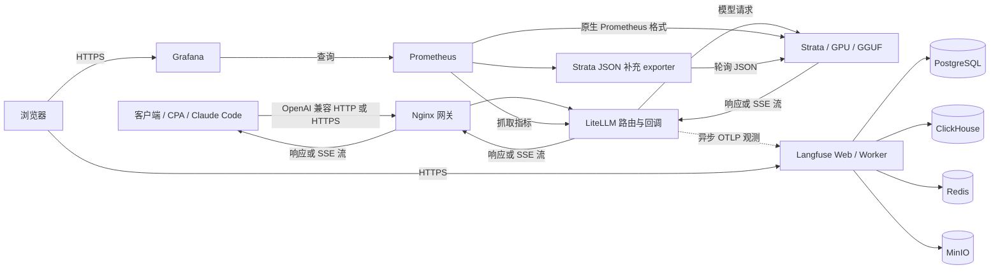
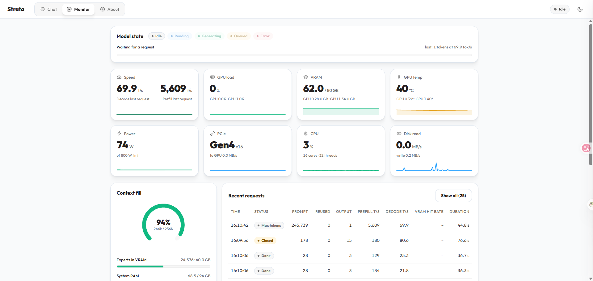
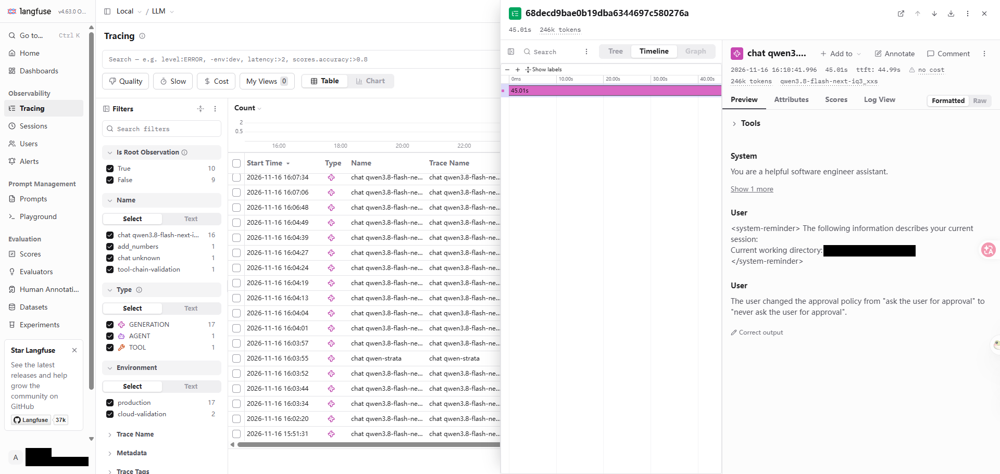
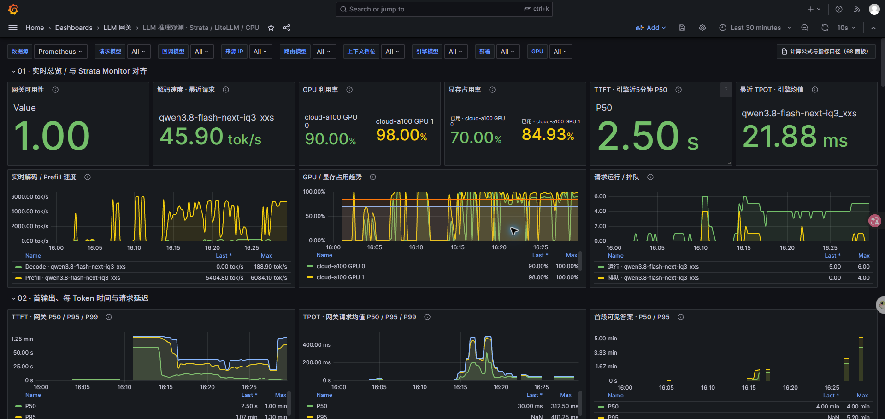
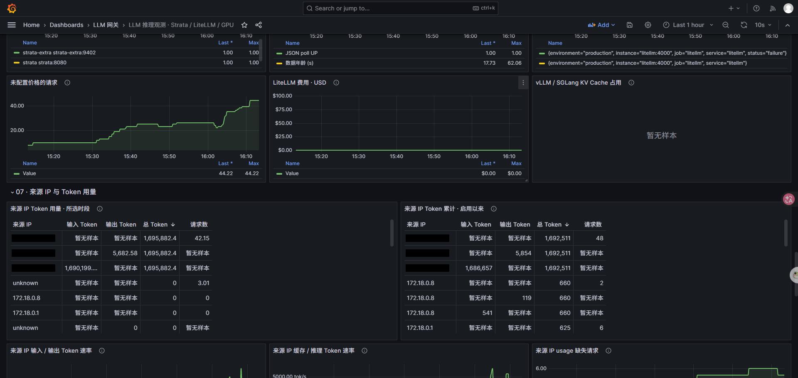

# 麒麟 V10 离线部署主手册：Nginx、LiteLLM、Strata、Langfuse 与 Grafana

编写日期：2026-11-16。本文以本仓库、已发布离线候选物料和云端现场记录为基础，提供从联网准备到内网验收的操作路径。**麒麟 V10 具体 SP / Build 的依赖闭包、干净机器断网安装、GPU 驱动、冷启动及恢复尚未实测；本手册不是目标机已验收报告。** 命令中显式指出的示例地址和路径须按现场替换，缺少物料或前置条件时停在对应步骤。

本次按用户要求复用目标机的容器环境、Strata 和模型。取得综合离线包后，先阅读[复用已有 Strata 的离线包使用入口](kylin-v10-reuse-offline-bundle-20261116.md)，依次校验、解包和恢复主包，再返回本文第 5.2 节。宿主工具检查与 CentOS / NVIDIA 候选 RPM 的来源及限制见[麒麟 V10 宿主工具准备](kylin-v10-package-preparation.md)；候选包不是已验证的麒麟 RPM 依赖闭包。云端 JSON 参数及日志抽样结果见[配置核对记录](cloud-strata-json-log-audit-20261116.md)。

本文原有四张云端配图由用户提供，是**云端历史快照，不是麒麟目标机截图或验收证明**。Trace 图包含请求内容，来源 IP 图包含 IP；图片在本地按原样保留，公开或跨环境交付前由数据负责人审查并另行脱敏，不应直接发布。目标机的验收截图和测试记录仍需现场采集。

用户另提供两张目标机环境历史照片：可辨认 Kylin Linux Advanced Server V10（Sword）、`x86_64`、双路 Intel Xeon Gold 6238R、每路 28 核 / 每核 2 线程、112 个逻辑 CPU、两张 NVIDIA A100-PCIE-40GB；GPU 图的 `nvidia-smi` 显示驱动 `535.104.12`、CUDA `12.2`，两卡上均有 `/data/Strata/engine-cuda12/strata` 进程，显存占用约 31 / 38 GiB。照片还显示主机名、进程路径、PCI / NUMA 拓扑和系统漏洞状态，移交前须由负责人审查。照片存在拍摄清晰度和时效限制，具体 SP / Build、实际驱动及 CUDA 数字、监听和模型状态须到目标机复核；进程是否由 Docker 或服务管理，截图不足以确定。该信息不证明干净机器断网安装、模型请求、迁移或目标验收通过。本手册原有四张云端截图继续保留。


## 1. 目标架构和数据流



推理响应路径是客户端 → Nginx → LiteLLM → Strata，再沿原路返回。Langfuse 是 LiteLLM 的**异步观测支路，不是每个推理 Token 的必经节点**；但部署时的 Compose 依赖、队列容量和回调异常仍须实测，不能据架构图保证 Langfuse 故障时网关一定无影响。Grafana 通过 Prometheus 查询指标，不在推理响应链路中。

仓库默认入口：Nginx `8443` 为 LiteLLM HTTPS，`8444` 为 Langfuse HTTPS，`9401` 为受限 metrics；容器内部 LiteLLM `4000`。云端本次另有公网 `13258` → 主机 `8800` 的 **HTTP** 实验入口、`13259` Langfuse、`13260` Grafana、`13261` Strata 页面；这些是云端映射，不是麒麟默认端口。目标内网应由负责人确定监听地址、TLS、访问控制、证书 SAN 与防火墙；不得把云端公网地址、证书或凭据直接当成目标机配置。

## 2. 物料、版本与交付门槛

| 物料 | 当前证据与缺口 |
| --- | --- |
| 主离线候选包 | linux/amd64，原始 tar **5,714,677,760 字节**，9 个 Nginx、LiteLLM、Langfuse 及存储镜像；包含 Compose v2.29.7。独立资产审计报告分卷、合并 gzip / tar 校验通过 |
| 监控扩展包 | `monitoring-amd64-20261116.tar`，**202,598,400 字节**；Prometheus 2.45.1、Grafana 10.1.5。审计报告 SHA 通过；独立于主包 |
| 源码与修复 | `source-and-docs-20261116-validated.tar.gz` 有独立校验；**已发布监控包早于本次 TTFT 修复**，须另外携带最终检查过的 dashboard / 公式文件 |
| 系统组件 | 主包仅有三个 CentOS 7 候选 RPM（Docker CE / CLI、containerd）；不是麒麟 V10 依赖闭包，NVIDIA 驱动和 Container Toolkit 也不在主包内 |
| Strata / 模型 | 主包与监控扩展均不含 Strata 镜像或 GGUF；需要单独准备目标架构镜像、驱动、模型、MTP、tokenizer / pack 和离线运行资产 |
| 凭据与数据 | 现场生成或通过受控渠道移交；包不含真实密钥、历史 Langfuse / Prometheus / Grafana 数据或此次 CPA HTTP 私有映射 |

发行物记录与文件名称见 [离线候选包说明](offline-release-20261116.md)、[监控扩展说明](offline-monitoring-addon-20261116.md)。本次独立审计结论由部署方提供；它证明所审文件校验通过，不证明麒麟兼容。在线打开 Release 页时返回 404，不能据此判断发布状态；下载前由准备机核实访问权限和实际资产，下载失败就停止，不能用占位文件代替。

`ops/offline_bundle.py seal` 的通用封包布局与上述现有主候选包不同；不要对现有候选包按另一布局封包、重算清单或混用验证命令。若重新构建一套通用包，必须以其自身 manifest、布局及工具说明独立验收。

## 3. 联网准备机：下载并校验候选包

在联网 **Linux amd64 准备机**上执行；以下目录只是本手册约定的交付目录。确保存储空间覆盖分卷、合并 gzip、原始 tar、模型、镜像及传输副本。下面命令依赖 Release 资产仍可访问，`curl` 失败必须停止。

```bash
set -eu
HANDOFF=/opt/llm-handoff
test ! -e "$HANDOFF" || { printf '交付目录已存在，请选择新目录\n' >&2; exit 1; }
mkdir -p "$HANDOFF/downloads" "$HANDOFF/models" "$HANDOFF/strata" "$HANDOFF/patches" "$HANDOFF/manual"
cd "$HANDOFF/downloads"
RELEASE='https://github.com/tyloryang/litellm-langfuse-monitoring/releases/download/offline-candidate-amd64-20261116'
for file in \
  nginx-litellm-langfuse-amd64-centos7-candidate-20261116-v3.tar.gz.part01 \
  nginx-litellm-langfuse-amd64-centos7-candidate-20261116-v3.tar.gz.part02 \
  nginx-litellm-langfuse-amd64-centos7-candidate-20261116-v3.tar.gz.part03 \
  nginx-litellm-langfuse-amd64-centos7-candidate-20261116-v3.tar.gz.part04 \
  SHA256SUMS manifest.json source-and-docs-20261116-validated.tar.gz VALIDATED-SHA256SUMS \
  monitoring-amd64-20261116.tar MONITORING-SHA256SUMS
do
  test ! -e "$file" || { printf '文件已存在，请先核查：%s\n' "$file" >&2; exit 1; }
  curl -fL --retry 3 --connect-timeout 20 -o "$file" "$RELEASE/$file"
done

grep '\.part0[1-4]$' SHA256SUMS | sha256sum -c -
sha256sum -c VALIDATED-SHA256SUMS
sha256sum -c MONITORING-SHA256SUMS
cat nginx-litellm-langfuse-amd64-centos7-candidate-20261116-v3.tar.gz.part01 \
    nginx-litellm-langfuse-amd64-centos7-candidate-20261116-v3.tar.gz.part02 \
    nginx-litellm-langfuse-amd64-centos7-candidate-20261116-v3.tar.gz.part03 \
    nginx-litellm-langfuse-amd64-centos7-candidate-20261116-v3.tar.gz.part04 \
    > nginx-litellm-langfuse-amd64-centos7-candidate-20261116-v3.tar.gz
grep 'candidate-20261116-v3.tar.gz$' SHA256SUMS | sha256sum -c -
gzip -dc nginx-litellm-langfuse-amd64-centos7-candidate-20261116-v3.tar.gz > nginx-litellm-langfuse-amd64-centos7-candidate-20261116-v3.tar
grep 'candidate-20261116-v3.tar$' SHA256SUMS | sha256sum -c -
```

主包合并 gzip 的历史摘要为 `18d0c72ba47b918951927e5aae37b59f1a6aa39e31121c7ca6a1c5dd4ddaaf3d`；原始 tar 为 `627e4b44ba9fcf4da8a7f9f3d1227348815ca021d153c978236758ced206b702`。下载和内部清单核验都应通过；摘要要与可信发布渠道独立核对。发布包不会自动更新，若目标需要当前 TTFT 修复，应从已经审阅的当前仓库单独复制 `grafana/dashboards/litellm-gpu-overview.json`、`docs/grafana-formulas.md`，记录仓库版本和两个文件的 SHA-256；它们不是已发布旧监控包的一部分。

```bash
# REPO 必须由管理员设为已审阅的本仓库在准备机上的绝对路径。
test -n "${REPO:-}" && test -f "$REPO/grafana/dashboards/litellm-gpu-overview.json"
install -m 0644 "$REPO/grafana/dashboards/litellm-gpu-overview.json" "$HANDOFF/patches/litellm-gpu-overview.json"
install -m 0644 "$REPO/docs/grafana-formulas.md" "$HANDOFF/patches/grafana-formulas.md"
cd "$HANDOFF/patches"
sha256sum litellm-gpu-overview.json grafana-formulas.md > PATCH-SHA256SUMS
sha256sum -c PATCH-SHA256SUMS
```

上面的 `install` 用于全新交付目录；若目录已有其他人的文件，先核对并使用新的 `HANDOFF`，不要覆盖。只携带审阅通过的公开配置；`.env`、证书私钥、token、用户数据和运行日志单独受控管理，不放入公开交付包。

本手册比现有主包和已发布源码快照更新，**必须另行与包一起移交**；四张云端截图、两张目标机环境照片、公式文件及手册链接的本地材料也须按原相对路径携带。截图含请求内容、IP 和主机环境信息，交付前须由数据负责人审查并使用受控介质。准备机上 `REPO` 指向已审阅的当前仓库后执行：

```bash
set -eu
test -n "${REPO:-}" && test -d "$REPO/docs/kylin-v10-offline-assets"
test ! -e "$HANDOFF/manual/docs"
mkdir -p "$HANDOFF/manual/docs" "$HANDOFF/manual/nginx" "$HANDOFF/manual/litellm" "$HANDOFF/manual/deploy/cloud-monitoring" "$HANDOFF/manual/ops"
for file in kylin-v10-full-offline-deployment-20261116.md kylin-v10-reuse-offline-bundle-20261116.md kylin-v10-package-preparation.md cloud-strata-json-log-audit-20261116.md offline-release-20261116.md offline-monitoring-addon-20261116.md cloud-strata-262k-tuning-20261116.md cloud-strata-cpa-access-20261116.md cloud-real-inference-20261116.md grafana-formulas.md offline-acceptance-template.md; do
  install -m 0644 "$REPO/docs/$file" "$HANDOFF/manual/docs/$file"
done
cp -a "$REPO/docs/kylin-v10-offline-assets" "$HANDOFF/manual/docs/"
install -m 0644 "$REPO/nginx/nginx.conf" "$HANDOFF/manual/nginx/nginx.conf"
install -m 0644 "$REPO/litellm/config.yaml" "$REPO/litellm/token_router_config.yaml" "$HANDOFF/manual/litellm/"
install -m 0644 "$REPO/deploy/cloud-monitoring/strata-proxy.conf" "$HANDOFF/manual/deploy/cloud-monitoring/strata-proxy.conf"
install -m 0644 "$REPO/ops/adapt_monitoring_existing_strata.py" "$HANDOFF/manual/ops/adapt_monitoring_existing_strata.py"
for file in kylin-target-inventory.sh kylin-download-rpms.sh kylin-rpm-offline-check.sh kylin-verify-nvidia-metadata.py; do
  install -m 0644 "$REPO/ops/$file" "$HANDOFF/manual/ops/$file"
done
cd "$HANDOFF/manual"
find . -type f ! -name MANUAL-SHA256SUMS -print0 | sort -z | xargs -0 sha256sum > MANUAL-SHA256SUMS
sha256sum -c MANUAL-SHA256SUMS
```

完整交接目录约定如下；其中系统、GPU 测试镜像、Strata runtime 的名称是交付约定，须由负责人实际准备并按各自清单核验，当前不能据目录示意声称这些文件已经存在：

```text
/opt/llm-handoff/
├── downloads/                           # 主包分卷、合并后的 v3.tar 和 SHA256SUMS；监控 tar 和 MONITORING-SHA256SUMS；源码附件及校验
├── models/IQ3_XXS/                      # 两片 GGUF；models/MODEL-SHA256SUMS
├── strata/
│   ├── strata-0.1.45-cuda12.tar         # 目标平台镜像，示例名称
│   ├── STRATA-IMAGE-SHA256SUMS
│   ├── runtime/                         # 匹配模型的 pack、tokenizer、MTP、其他离线 runtime
│   └── STRATA-RUNTIME-SHA256SUMS        # 覆盖 runtime 文件，由提供方生成
├── system/
│   ├── rpms/                            # 目标麒麟版本的系统 RPM 及完整依赖
│   ├── nvidia/                          # 目标驱动、Container Toolkit 及依赖
│   ├── gpu-test/                        # GPU 测试镜像 tar 及其校验清单
│   └── SYSTEM-SHA256SUMS                # 覆盖系统、驱动和依赖，由提供方生成
├── patches/                             # 修复版 dashboard、公式和 PATCH-SHA256SUMS
└── manual/
    ├── MANUAL-SHA256SUMS
    ├── docs/                            # 本手册、公式、相关文档及 kylin-v10-offline-assets/ 六张图片
    ├── nginx/                           # 手册链接的配置示例
    ├── litellm/                         # 手册链接的模型配置示例
    ├── deploy/cloud-monitoring/          # 手册链接的代理配置示例
    └── ops/adapt_monitoring_existing_strata.py  # 复用宿主实例的监控适配脚本
```

介质上打开 `manual/docs/kylin-v10-full-offline-deployment-20261116.md` 即可离线读取正文、四张云端截图、两张目标机环境照片和 `manual/docs/grafana-formulas.md`；互联网链接离线不可用。`docs-dashboard` 补充包只用于交付文档和看板，不能替代包含主包、监控镜像、模型、Strata、系统依赖和校验材料的全量交付。所有缺项补齐并在目标机实际完成离线验收之前，不得宣称目标可离线成功。

## 4. Qwen 模型、Strata 与下载源

### 4.1 模型来源及源 IP

本次模型为 `ISTA-DASLab/Qwen3.8-Flash-Next-GSQ-RCO-GGUF` 的 `IQ3_XXS`，固定 revision `ed59f92082b1e93c0e96d60a8b11aab089b52f09`。[上游固定版本目录](https://huggingface.co/ISTA-DASLab/Qwen3.8-Flash-Next-GSQ-RCO-GGUF/tree/ed59f92082b1e93c0e96d60a8b11aab089b52f09/IQ3_XXS)列出两片；[上游 README](https://huggingface.co/ISTA-DASLab/Qwen3.8-Flash-Next-GSQ-RCO-GGUF/blob/ed59f92082b1e93c0e96d60a8b11aab089b52f09/README.md)提供模型说明。本仓库现场下载脚本 `.runtime/model_download_temp.py` 中的下载根目录、文件大小和 SHA-256 与云端记录一致；云端两片下载后已报告校验通过。

| 文件名 | 字节数 | SHA-256 |
| --- | ---: | --- |
| `Qwen3.8-Flash-Next-GSQ-RCO-IQ3_XXS-00001-of-00002.gguf` | 47039860096 | `219ea929900dfa9ef091f3aa473fdba6874b65fcb36526d7d851ac9e95856d15` |
| `Qwen3.8-Flash-Next-GSQ-RCO-IQ3_XXS-00002-of-00002.gguf` | 28800138432 | `316b46f3a2dbd68c900f43136ab9449f9dcc3725dfd8c794847c204bc161e113` |

两片合计约 75.84 GB / 70.63 GiB。**现场内网模型源 IP、共享目录和授权方式未提供，不能推定。** 公网上游域名解析可能变化，也不是可直接填入防火墙的固定内网源 IP；若企业模型库已有副本，由管理员提供实际地址、导出目录及以上同一 revision 的独立校验记录。

联网准备机下载示例。也可选择第 4.2 节从 WSL 原件复制的流程；两者选一种，不能在同一交付目录重复执行。支持使用 `.part` 续传，只有大小和 SHA-256 均匹配才改成最终文件名；若最终文件已存在，本命令停止，避免覆盖已有模型。

```bash
set -eu
MODEL_DIR=/opt/llm-handoff/models/IQ3_XXS
mkdir -p "$MODEL_DIR"
MODEL_BASE='https://huggingface.co/ISTA-DASLab/Qwen3.8-Flash-Next-GSQ-RCO-GGUF/resolve/ed59f92082b1e93c0e96d60a8b11aab089b52f09/IQ3_XXS'
download_shard() {
  file=$1; expected_size=$2; expected_hash=$3
  test ! -e "$MODEL_DIR/$file" || { printf '最终文件已存在，请先核查\n' >&2; return 1; }
  if [ ! -f "$MODEL_DIR/$file.part" ] || [ "$(stat -c %s "$MODEL_DIR/$file.part")" != "$expected_size" ]; then
    curl -fL -C - --retry 5 --connect-timeout 20 -o "$MODEL_DIR/$file.part" "$MODEL_BASE/$file"
  fi
  test "$(stat -c %s "$MODEL_DIR/$file.part")" = "$expected_size"
  printf '%s  %s\n' "$expected_hash" "$MODEL_DIR/$file.part" | sha256sum -c -
  mv -- "$MODEL_DIR/$file.part" "$MODEL_DIR/$file"
}
download_shard Qwen3.8-Flash-Next-GSQ-RCO-IQ3_XXS-00001-of-00002.gguf 47039860096 219ea929900dfa9ef091f3aa473fdba6874b65fcb36526d7d851ac9e95856d15
download_shard Qwen3.8-Flash-Next-GSQ-RCO-IQ3_XXS-00002-of-00002.gguf 28800138432 316b46f3a2dbd68c900f43136ab9449f9dcc3725dfd8c794847c204bc161e113
cd "$MODEL_DIR"
sha256sum Qwen3.8-Flash-Next-GSQ-RCO-IQ3_XXS-00001-of-00002.gguf Qwen3.8-Flash-Next-GSQ-RCO-IQ3_XXS-00002-of-00002.gguf > ../MODEL-SHA256SUMS
sha256sum -c ../MODEL-SHA256SUMS
```

部分镜像或代理可能不支持续传；遇到下载失败或校验不符应保留问题证据并重新获取，不能把 `.part` 直接重命名。若使用内网模型源，应由管理员提供**实际源 IP / 域名、端口和目录**，然后在获授权的准备机按其提供的传输命令取得文件并执行同样的大小 / 哈希检查；不能使用云服务器公网 IP 充当模型源。

### 4.2 Strata 固定版本与离线资产

云端记录使用 Strata **0.1.45**、源码提交 `477ac13cbe8e582c20484871ce459d20d82df09d`、CUDA 12、双 A100；此前 GPU 容器内可见两张卡并完成真实推理。麒麟目标机的 CPU 架构、GPU 型号、驱动、CUDA 和镜像兼容性尚未知，不能把云端 sm80 镜像直接称为适配麒麟。联网准备机可获取 [固定版本源码](https://github.com/Niko1221/Strata/tree/477ac13cbe8e582c20484871ce459d20d82df09d)；访问和编译结果以准备机实测为准。

除两片 GGUF 外，还需目标环境匹配的 Strata 镜像与 CUDA 运行库、Python 依赖、`third_party/llama.cpp`、tokenizer / native pack / profile、MTP `rt` 和其依赖；图像编码器、实验投影等仅在需要且已核验时携带。空 `/data` 配合 `GGUF_DIR` 仍可能尝试拉取 MTP、Python 包或 llama.cpp；**不可假定只有 GGUF 就能离线首启**。MTP 固定版本及校验逻辑见 Strata 的 `tools/mtp_fetch.py`；在联网准备环境准备并验证后，再做断网首启演练。不得把含现场 key 的运行配置或镜像层作为公共物料导出。

2026-11-16 云端只读复核：`local/strata:0.1.45-cuda12` 的 image ID 为 `sha256:d8271ad5f342a97565dc82c39dbfc860f0f5034b1c8d213b784a422cf1231ea4`，平台 `linux/amd64`，镜像 `Size=7856932212` 字节；运行中的 `llm-a100-strata-1` 使用同一 ID。该云机实际挂载 `/opt/llm-observability-deploy/strata-data` → `/data`、`/opt/llm-observability-deploy/models` → `/models`，当时磁盘可用约 52G。这是可追溯的准备机来源和云机映射，**不是已导出的 tar、tar 文件大小或麒麟兼容证明**；第 6 节目标建议路径不同，必须核对容器内路径与配置。镜像目前仅确认标签标注 CUDA 12，精确 CUDA runtime 尚未查明；目标截图中驱动显示的 CUDA 12.2 不能证明其安装了对应 Toolkit，也不能据此判定 `535.104.12` 驱动与该镜像兼容。目标已有 Strata 进程同样不证明新镜像可运行。导出前还应确认磁盘容量、镜像内容及授权，兼容性以实际版本核验和受控测试为准。

如果准备机确实已有经安全审阅、匹配目标平台的 `local/strata:0.1.45-cuda12` 镜像，可在准备机执行下面命令导出；镜像名为云端历史标签，**目标机可用性和文件存在性尚待确认**：

```bash
set -eu
docker image inspect local/strata:0.1.45-cuda12 --format '{{.Id}} {{.Os}}/{{.Architecture}}'
test ! -e /opt/llm-handoff/strata/strata-0.1.45-cuda12.tar
docker image save -o /opt/llm-handoff/strata/strata-0.1.45-cuda12.tar local/strata:0.1.45-cuda12
cd /opt/llm-handoff/strata
sha256sum strata-0.1.45-cuda12.tar > STRATA-IMAGE-SHA256SUMS
sha256sum -c STRATA-IMAGE-SHA256SUMS
```

还需由模型负责人从已验证准备环境提供与目标挂载路径一致的、**不含密钥和用户数据**的 tokenizer / pack / MTP 资产及其清单；本仓库没有可直接交付的完整 Strata 镜像 / 数据树，缺少这些文件应停止，不能把镜像导入当作推理服务已准备好。

本机 WSL 只读发现 `/home/YOUR_USER/project/YOUR_MODEL_DIR/Strata-data` 的两片 GGUF 大小与第 4.1 节一致，`packs/iq3_xxs` 含 dense、index、native experts 路径清单和 tokenizer，**没有主 pack 的 `experts.bin`**；`mtp/rt` 有四个文件。用户报告 MTP 原始 tensors 的 31 项独立只读哈希均通过；GGUF 第一片本次重算 SHA-256 与第 4.1 节一致，第二片为了减少正在运行的 Strata 磁盘 I/O 争用已停止重算，目前**仅核对过大小，不能标为哈希通过**。下列方法只复制列出的模型、pack 文件、tokenizer 文件与四个 MTP runtime 文件，不复制 `config`、日志、用户数据、`.done` 或原始 tensors。它不自动补齐其他依赖；应在合适的低负载时段完成两片完整校验，不要为校验停止现有进程。

在能读取上述 WSL 路径的准备机执行；`HANDOFF` 为第 3 节的全新交付目录。首次两片源文件校验必须通过；已有目标文件或 runtime 目录则停止。复制后逐文件比较，并分别生成模型与 runtime 清单；时间和空间开销较大：

```bash
set -euo pipefail
SRC=/home/YOUR_USER/project/YOUR_MODEL_DIR/Strata-data
HANDOFF=/opt/llm-handoff
test -d "$HANDOFF/models" && test -d "$HANDOFF/strata"
test ! -e "$HANDOFF/strata/runtime"
test ! -e "$HANDOFF/models/IQ3_XXS"
test ! -e "$HANDOFF/models/MODEL-SHA256SUMS"
test ! -e "$HANDOFF/strata/STRATA-RUNTIME-SHA256SUMS"
models=(Qwen3.8-Flash-Next-GSQ-RCO-IQ3_XXS-00001-of-00002.gguf Qwen3.8-Flash-Next-GSQ-RCO-IQ3_XXS-00002-of-00002.gguf)
pack=(dense.bin index.txt native_experts.txt conversions.json tokenizer/tokenizer.json tokenizer/merges.txt tokenizer/vocab.json tokenizer/token_type.json tokenizer/chat_template.jinja)
mtp=(experts.bin draft_vocab.bin dense.txt dense.bin)
for file in "${models[@]}"; do test -f "$SRC/models/IQ3_XXS/$file" && test ! -L "$SRC/models/IQ3_XXS/$file"; done
for file in "${pack[@]}"; do test -f "$SRC/packs/iq3_xxs/$file" && test ! -L "$SRC/packs/iq3_xxs/$file"; done
for file in "${mtp[@]}"; do test -f "$SRC/mtp/rt/$file" && test ! -L "$SRC/mtp/rt/$file"; done
(cd "$SRC/models/IQ3_XXS" && printf '%s  %s\n' \
  219ea929900dfa9ef091f3aa473fdba6874b65fcb36526d7d851ac9e95856d15 "${models[0]}" \
  316b46f3a2dbd68c900f43136ab9449f9dcc3725dfd8c794847c204bc161e113 "${models[1]}" | sha256sum -c -)
mkdir -p "$HANDOFF/models/IQ3_XXS" "$HANDOFF/strata/runtime/packs/iq3_xxs/tokenizer" "$HANDOFF/strata/runtime/mtp/rt"
for file in "${models[@]}"; do cp -- "$SRC/models/IQ3_XXS/$file" "$HANDOFF/models/IQ3_XXS/$file"; cmp -s "$SRC/models/IQ3_XXS/$file" "$HANDOFF/models/IQ3_XXS/$file"; done
for file in "${pack[@]}"; do cp -- "$SRC/packs/iq3_xxs/$file" "$HANDOFF/strata/runtime/packs/iq3_xxs/$file"; cmp -s "$SRC/packs/iq3_xxs/$file" "$HANDOFF/strata/runtime/packs/iq3_xxs/$file"; done
for file in "${mtp[@]}"; do cp -- "$SRC/mtp/rt/$file" "$HANDOFF/strata/runtime/mtp/rt/$file"; cmp -s "$SRC/mtp/rt/$file" "$HANDOFF/strata/runtime/mtp/rt/$file"; done
(cd "$HANDOFF/models/IQ3_XXS" && sha256sum "${models[@]}" > ../MODEL-SHA256SUMS && sha256sum -c ../MODEL-SHA256SUMS)
(cd "$HANDOFF/strata" && find runtime -type f -print0 | sort -z | xargs -0 sha256sum > STRATA-RUNTIME-SHA256SUMS && sha256sum -c STRATA-RUNTIME-SHA256SUMS)
```

`native_experts.txt` 含原环境绝对路径，需按目标容器内实际模型路径适配并核对引用分片；原始清单先留存，修改后另记修改文件的摘要和映射，再按目标版本重新核验。WSL 与云端 pack 不能未经版本、路径重映射及断网实测就互换；MTP tensors 的原始 31 项校验也不证明四个转换后的 `rt` 文件在目标机可运行。复制内容只是候选物料，镜像、完整依赖、目标模型加载及请求仍需实际验收。

## 5. 转运与麒麟 V10 目标机前置检查

### 5.1 媒体转运

使用经批准的离线介质传输 `/opt/llm-handoff`。下例假定介质挂载点为 `/mnt/usb` 且空间足够；命令在联网准备机运行，目标目录必须为空或由管理员另设新路径：

```bash
test ! -e /mnt/usb/llm-handoff
mkdir -p /mnt/usb/llm-handoff
cp -a /opt/llm-handoff/. /mnt/usb/llm-handoff/
sync
```

在断网麒麟机挂载介质后，确认没有已有目标目录，再复制并重验。先核验网关和监控包以及随介质移交的手册；复用现有 Strata 的接入分支可以没有独立模型、Strata 镜像和 GPU 测试镜像，缺少这些文件时跳过下方注明的全量 / 新容器校验块。要完成**全量离线交付**，管理员仍须携带匹配目标系统的 Docker / NVIDIA 驱动及其完整离线依赖、模型、Strata 镜像和经审核的 runtime 数据树及校验清单，缺项须登记且不能标记全量通过。

```bash
test ! -e /opt/llm-handoff
mkdir -p /opt/llm-handoff
cp -a /mnt/usb/llm-handoff/. /opt/llm-handoff/
cd /opt/llm-handoff/downloads
grep 'candidate-20261116-v3.tar$' SHA256SUMS | sha256sum -c -
sha256sum -c MONITORING-SHA256SUMS
cd /opt/llm-handoff/manual
sha256sum -c MANUAL-SHA256SUMS
```

仅在**全量交付或新建 Strata 容器路线**中，确保模型、镜像和清单均已交付，再执行下列块；复用现有实例且未携带这些文件时直接跳过，不要执行其中的 `cd`：

```bash
set -eu
cd /opt/llm-handoff/models/IQ3_XXS
sha256sum -c ../MODEL-SHA256SUMS
cd /opt/llm-handoff/strata
sha256sum -c STRATA-IMAGE-SHA256SUMS
sha256sum -c STRATA-RUNTIME-SHA256SUMS
```

携带已验证源码附件时，在 `downloads/` 执行 `sha256sum -c VALIDATED-SHA256SUMS`；要使用第 10 节修复版 dashboard 时，在 `patches/` 执行 `sha256sum -c PATCH-SHA256SUMS`。缺少可选源码附件或补丁不应冒称已验证相应材料；若未携带补丁，暂不能执行第 10 节补丁替换，须先补齐或沿用原看板并记录旧版边界。传输清单应覆盖额外的系统包、Strata 数据树和管理员后来加入的物料；上述校验仅覆盖命令中列出的文件。必要的私有材料使用单独受限渠道交付。

全量 / 新容器路线中，系统、GPU 测试镜像和 runtime 文件交付后，应分别在各校验清单的基准目录执行 `sha256sum -c`，人工确认清单覆盖实际安装或挂载的全部文件并与独立可信摘要一致；该路线缺清单或缺资产即停止。`STRATA-RUNTIME-SHA256SUMS` 的路径约定以 `/opt/llm-handoff/strata/` 为基准，`SYSTEM-SHA256SUMS` 以 `/opt/llm-handoff/system/` 为基准。通过后才将已核验 runtime 按现场权限复制到 `/opt/strata-data`，并再次按映射核对内容。现有实例复用分支不因此复制或改动它的数据。

### 5.2 系统和 GPU 检查

在目标机记录以下输出，先确认与交付物架构及目标 SP / Build 一致。命令只检查环境，不安装系统包：

```bash
cat /etc/os-release
uname -a
uname -m
getconf GNU_LIBC_VERSION
df -h / /opt
free -h
command -v docker || true
docker version || true
nvidia-smi || true
command -v nvidia-container-cli || true
```

主包是 `linux/amd64`；目标截图所述 `x86_64` 在架构名称上对应，但必须现场复核。若实际为 ARM64 或其他架构，须重新准备**所有**对应架构镜像和依赖，不能直接导入后声称兼容。Kylin 的 SP / Build、内核、glibc、systemd、cgroup v1/v2 与祖先限制、SELinux、存储 / 网络驱动及系统包版本必须由目标机实际确认。目标截图显示双 A100；云端 94 GiB RAM 和磁盘快照不是目标机最低保证。准备机需针对目标 SP / Build 完成系统包依赖闭包、签名和安装顺序；三个 CentOS 7 RPM 不能直接当作麒麟安装方案。本仓库缺少完整闭包和目标系统的可复用驱动安装命令，未补齐前停止，勿联网兜底。

**复用现有 Strata：**核对宿主实际 `nvidia-smi`、驱动和第 6.3 节的现有服务状态、认证及容器网络可达性；不要因为复用而安装或更换驱动、停止既有进程。没有 GPU 测试镜像时跳过下方块。现有进程运行不能证明 Docker GPU runtime 或新镜像兼容，也不能据此标记完整离线交付通过。

**全量交付 / 新建 Strata 容器：**在完成对应系统包和 NVIDIA 驱动 / Container Toolkit 准备并经现场安排后，先导入独立交付、适配目标架构并核验过的 GPU 测试镜像，再验证容器运行时。主包不含此测试镜像；管理员须提供镜像 tar、独立 SHA-256 清单及其实际 tag。以下变量须先设为真实文件和镜像名，清单应在其所在目录验证：

```bash
test -n "${GPU_TEST_IMAGE:-}" && test -n "${GPU_TEST_TAR:-}" && test -n "${GPU_TEST_SUMS:-}"
test "$(dirname "$(realpath "$GPU_TEST_TAR")")" = "$(dirname "$(realpath "$GPU_TEST_SUMS")")"
awk -v file="$(basename "$GPU_TEST_TAR")" '$2 == file {found=1} END {exit !found}' "$GPU_TEST_SUMS"
(cd "$(dirname "$GPU_TEST_SUMS")" && sha256sum -c "$(basename "$GPU_TEST_SUMS")")
docker load -i "$GPU_TEST_TAR"
docker image inspect "$GPU_TEST_IMAGE" --format '{{.Id}} {{.Os}}/{{.Architecture}}'
docker run --rm --pull never --gpus all "$GPU_TEST_IMAGE" nvidia-smi
```

全量 / 新容器路线须确认清单实际覆盖 `GPU_TEST_TAR` 且路径、摘要一致，且驱动、runtime、容器可见 GPU 和 cgroup / 存储均通过；测试容器无法启动不能用宿主 `nvidia-smi` 成功替代。复用路线继续第 6.3 节实际检查，待主栈启动后再完成容器到宿主的网络测试。正式断网验收需按现场控制要求隔绝互联网，保留内网客户端通信；`--pull never` 只是防拉取，不本身证明全程断网。

## 6. 导入镜像并核查既有 Strata

目标截图显示 GPU 上已有 Strata 进程，**优先复用现有实例，不要在同一 GPU 上再启动 Strata 容器，也不要重启原进程**。本节仅导入镜像和检查数据；容器 Strata 路线只在负责人明确停用或迁移原实例、完成验证后使用。全量离线交付仍须补齐独立镜像与 runtime 资产；现有服务可用不代表这些缺口已消除。

### 6.1 导入主包及可用的 Strata 镜像

```bash
set -eu
test ! -e /opt/llm-offline || { printf '解包目录已存在，请选择新路径并同步修改后续路径\n' >&2; exit 1; }
mkdir -p /opt/llm-offline
cd /opt/llm-handoff/downloads
tar -xf nginx-litellm-langfuse-amd64-centos7-candidate-20261116-v3.tar -C /opt/llm-offline
BUNDLE=/opt/llm-offline/nginx-litellm-langfuse
cd "$BUNDLE"
sha256sum -c SHA256SUMS
docker load -i images/images.tar
host/compose/docker-compose version
```

仅当独立 Strata 镜像及清单已准备并确认适配时，再导入候选镜像；这不会启动容器：

```bash
set -eu
cd /opt/llm-handoff/strata
sha256sum -c STRATA-IMAGE-SHA256SUMS
docker load -i strata-0.1.45-cuda12.tar
docker image inspect local/strata:0.1.45-cuda12 --format '{{.Id}} {{.Os}}/{{.Architecture}}'
```

上述 Strata 导入只适用于交付资产已齐备时；如没有镜像文件或其平台不匹配，不能执行该导入、不能走新容器路线，也不能宣称全量离线交付完成。若只是检查和接入现有实例，可在核验并导入主包后跳过该独立镜像导入，继续第 6.3 节的只读核查。仅在获准的新容器路线中，Strata 才应加入稍后创建的 backend 网络并以 `strata` 名称被 LiteLLM 与监控解析。目标 `STRATA_CUDA=12` 仅在 GPU / 驱动、镜像构建及现场测试支持时采用。

### 6.2 模型与 runtime 目录

本手册建议目标路径：

```text
/opt/llm-handoff/models/IQ3_XXS/        两片已校验 GGUF，容器只读挂载
/opt/strata-data/packs/iq3_xxs/          与模型匹配的 native pack / tokenizer
/opt/strata-data/mtp/rt/                 已验证 MTP runtime
/opt/strata-data/config/                 目标机现场生成的私有运行配置
```

仅在全量准备 / 新容器路线中，把由准备机独立核验的 runtime 资产放到新建 `/opt/strata-data`，核对各文件 SHA、目录和所有者；上面是建议布局，不是主包内已有文件。若目标路径已有数据，先保留并检查，不覆盖。若使用既有完整数据树，检查配置的绝对路径与容器内 `/data`、`/models/IQ3_XXS` 一致，并在私有环境重新设置认证；不得打印配置。需要单独核对模型版本、pack 的 `native_experts.txt` / `dense.bin` / `index.txt` / tokenizer，以及 `mtp/rt/experts.bin`。若存在主 pack 的 `experts.bin`，还需核对 sidecar、来源、布局和完整大小。复用现有服务时跳过本节的数据复制和认证变更，直接到第 6.3 节只读检查。

云端 262K 记录曾以独立容器尝试 resident pack，触发磁盘剩余保护而清理候选，原 pack 未动；**resident experts 未启用**。[容量与实测记录](cloud-strata-262k-tuning-20261116.md)的快照不能替代目标机实际容量检查。

云端现有配置报告 `--max-context 262144 --kv k8v4 --kv-resident 32768 --batch 4`，监控显示实际 4 槽；显式 batch 会使服务层不再从 `parallel: 6` 追加 batch，`--pipeline-windows 2` 与批槽的冲突需要按实际二进制确认。云端合成检索最高 261840 输入 Token 正确找回标记，但大幅复用缓存，不能据此推算冷预填充或麒麟的容量 / 性能。完整参数、resident 候选包保护和验收边界见前述记录；目标机应先以适配硬件的配置完成基础请求，再单独做长上下文和并发验收。



上图为用户提供的云端历史快照；目标硬件指标和模型状态需以目标机重采样为准。

### 6.3 优先复用目标机现有 Strata

现场管理员先只读确认原图信息、进程归属、版本、监听地址 / 端口和模型 ID；不要修改或重启该进程。`nvidia-smi` 显示的 CUDA 版本是驱动报告的能力，不等同于容器内 CUDA toolkit 版本。以下输出可能含内网地址和进程信息，应受控保存：

```bash
cat /etc/os-release
uname -m
lscpu
nvidia-smi
ps -C strata -o pid,comm
ss -ltnp
# 由管理员从上述结果选择实际 PID，仅查看可执行文件路径。
STRATA_PID='<实际PID>'
readlink -f "/proc/$STRATA_PID/exe"
```

由管理员根据实际安装方式只读核对版本及服务归属（例如受控检查 systemd 单元或 Docker 进程映射），不要假定其属于或不属于 Docker。准备实际可从主机访问的健康地址和令牌，交互式验证 `/health` 和 `/v1/models`；若镜像版本接口不同，以该实例实际接口核对。以下不会打印令牌，模型 ID 会输出，应按现场要求保护：

```bash
export STRATA_CHECK_URL='http://<主机可达的实际地址>:<实际端口>'
python3 - <<'PY'
import getpass, json, os, urllib.request
base = os.environ['STRATA_CHECK_URL'].rstrip('/')
token = getpass.getpass('现有 Strata 实际 API key: ')
opener = urllib.request.build_opener(urllib.request.ProxyHandler({}))
for path in ('/health', '/v1/models'):
    req = urllib.request.Request(base + path, headers={'Authorization': 'Bearer ' + token})
    with opener.open(req, timeout=15) as response:
        data = json.load(response)
        if path == '/health':
            print('health HTTP:', response.status, 'loaded:', data.get('loaded'))
            if data.get('loaded') is not True: raise SystemExit('模型尚未加载')
        else:
            ids = [item.get('id') for item in data.get('data', [])]
            print('model IDs:', ids)
            if not ids: raise SystemExit('未返回模型 ID')
PY
unset STRATA_CHECK_URL
```

第 7 节主栈启动后，从 LiteLLM 容器测试**容器实际可达的目标宿主地址和端口**；不得使用容器自己的 `127.0.0.1` 代替宿主。管理员需先确定现有 Strata 监听是否接受该地址、Docker 路由和宿主防火墙 / 访问控制是否允许网关及监控访问，令牌仍须与真实服务一致。以下仅测 TCP，不证明认证和推理：

```bash
HOST_STRATA_IP='<Docker容器实际可达的目标宿主IP>'
HOST_STRATA_PORT='<实际端口>'
docker exec -i llm-a100-litellm-1 python - "$HOST_STRATA_IP" "$HOST_STRATA_PORT" <<'PY'
import socket, sys
with socket.create_connection((sys.argv[1], int(sys.argv[2])), timeout=5):
    print('LiteLLM 容器到现有 Strata 的 TCP 可达')
PY
```

如果现有实例仅监听宿主回环地址，须由管理员先规划受控的可达入口及网络策略；不要直接改监听或重启现有进程。现有服务真实性能和云端镜像的兼容性均不能由截图推断。

## 7. 初始化 Nginx、LiteLLM 与 Langfuse

在离线目标机先完成系统前置和主包导入。下列命令使用专用 Compose 二进制和新目录；在执行 `prepare.sh` **之前**填写目标机实际可绑定的 `HOST_IP`、客户端实际访问的 Langfuse URL 和可访问 MinIO 媒体的 URL。这里的“公开 URL”指相应客户端可访问的地址，不要求互联网开放。目标目录必须不存在，绝不覆盖现有部署。

```bash
set -eu
BUNDLE=/opt/llm-offline/nginx-litellm-langfuse
cd "$BUNDLE"
sha256sum -c SHA256SUMS
test ! -e /opt/llm-gateway
# 以下三项必须按目标真实地址修改后再执行，不要保留尖括号。
export HOST_IP='<目标机实际绑定IP>'
export PUBLIC_LANGFUSE_URL='https://<目标Langfuse域名>:8444'
export PUBLIC_MEDIA_URL='http://<目标MinIO可达地址>:9090'
# 如需可信代理 CIDR，请在准备后按实际情况编辑 .env。
unset GATEWAY_TRUSTED_PROXY_CIDRS
bash config/prepare.sh /opt/llm-gateway
unset PUBLIC_LANGFUSE_URL PUBLIC_MEDIA_URL HOST_IP
```

主包 `init-env.sh` 生成的自签证书只有 CN、**没有 SAN**，现代客户端无法按域名 / IP 正确校验；启动前须更换。现场 CA 证书、服务证书与私钥尚未提供，先由管理员准备；以下在目标机具备写入部署目录权限的 Bash 中执行，变量必须换成真实路径和域名。先检查 SAN、CA 信任、域名及公钥匹配，再备份生成证书并安装；检查不会输出私钥。若用 IP 访问，将 `-verify_hostname "$TLS_DNS"` 改为 `-verify_ip "$TLS_IP"` 并实际检查 IP SAN。

```bash
set -euo pipefail
CERT_FILE='/实际受控路径/server.crt'
KEY_FILE='/实际受控路径/server.key'
CA_FILE='/实际受控路径/ca.pem'
TLS_DNS='实际内网域名'
test -r "$CERT_FILE" && test -r "$KEY_FILE" && test -r "$CA_FILE"
openssl x509 -in "$CERT_FILE" -noout -ext subjectAltName
openssl verify -CAfile "$CA_FILE" -verify_hostname "$TLS_DNS" "$CERT_FILE"
cert_pub=$(openssl x509 -in "$CERT_FILE" -pubkey -noout | openssl pkey -pubin -outform DER | openssl dgst -sha256)
key_pub=$(openssl pkey -in "$KEY_FILE" -pubout -outform DER | openssl dgst -sha256)
test "$cert_pub" = "$key_pub" || { printf '证书与私钥不匹配\n' >&2; exit 1; }
cd /opt/llm-gateway/nginx/certs
test ! -e server.crt.generated && test ! -e server.key.generated
umask 077
cp -p server.crt server.crt.generated
cp -p server.key server.key.generated
chmod 600 server.key.generated
install -m 0644 "$CERT_FILE" server.crt
install -m 0600 "$KEY_FILE" server.key
```

管理员还须确认 SAN 明确包含所有实际访问域名 / IP；CA 链、中间证书与客户端信任按现场准备。媒体 URL 使用 HTTP 是候选包 MinIO 端口的示例；若现场要求 TLS，应先配置实际可达的 HTTPS 代理，再填写对应 URL。核对 `.env` 中可信代理 CIDR 等现场设置，避免打印密钥。

主包 `source.tar` 中 `.env.example` 的 `STRATA_API_KEY=REPLACE` 会被保留到生成的 `.env`；`litellm/config.yaml` 的 `qwen-strata` 初始地址是 `http://10.0.0.13:8008/v1`。在启动任何主栈容器前，先以 root 或等效受控管理员创建私有目录与仅含非密钥字段的环境文件；若目录已有文件则先检查，不覆盖已有 `strata.env`。这里填写的是待目标镜像验证的示例：

```bash
set -eu
test "$(id -u)" -eq 0 || { printf '请在受控管理员 shell 中执行\n' >&2; exit 1; }
if [ ! -d /etc/llm-offline ]; then install -d -m 0700 /etc/llm-offline; fi
test ! -e /etc/llm-offline/strata.env
install -m 0600 /dev/null /etc/llm-offline/strata.env
cat > /etc/llm-offline/strata.env <<'ENV'
MODEL=IQ3_XXS
GGUF_DIR=/models/IQ3_XXS
STRATA_CUDA=12
ENV
```

在同一有权读写部署目录和该私有文件的管理员 shell 中继续。复用既有实例时，下面交互输入的是**已经通过第 6.3 节认证验证的现有 Strata key**；写入 `strata.env` 只为未来候选容器预备配置，不会改变正在运行的进程。容器新装路线则输入该容器计划使用的 key。先按分支设置 `STRATA_API_BASE`：复用实例填从 Docker 实际可达的宿主 IPv4 和现有监听端口；只有获准迁移并确认原实例停用后，才使用 `http://strata:8080/v1`。

```bash
# 复用现有实例：替换为 Docker 可达的实际宿主 IPv4 和端口。
export STRATA_API_BASE='http://<实际宿主IPv4>:<实际端口>/v1'
# 如改走经批准的新容器路线，改为：export STRATA_API_BASE='http://strata:8080/v1'
```

输入的密钥通过交互一次写入两个私有文件；先备份原文件，保持现有回调和其他 YAML 配置。以下脚本校验选定地址，拒绝意外的原始地址或占位值，避免误改已有部署：

```bash
set -eu
cd /opt/llm-gateway
test -f /etc/llm-offline/strata.env
umask 077
test ! -e .env.before-strata && test ! -e litellm/config.yaml.before-strata
test ! -e /etc/llm-offline/strata.env.before-strata
cp -p .env .env.before-strata
cp -p litellm/config.yaml litellm/config.yaml.before-strata
cp -p /etc/llm-offline/strata.env /etc/llm-offline/strata.env.before-strata
chmod 600 .env.before-strata litellm/config.yaml.before-strata /etc/llm-offline/strata.env /etc/llm-offline/strata.env.before-strata
python3 - <<'PY'
from pathlib import Path
from urllib.parse import urlsplit
import getpass, ipaddress, os, re

env = Path('.env')
config = Path('litellm/config.yaml')
strata = Path('/etc/llm-offline/strata.env')
e, c, s = (p.read_text(encoding='utf-8') for p in (env, config, strata))
old = 'api_base: http://10.0.0.13:8008/v1'
base = os.environ.get('STRATA_API_BASE', '')
try:
    url = urlsplit(base)
    if url.scheme != 'http' or url.path != '/v1' or url.query or url.fragment or url.username or url.password or not url.port:
        raise ValueError('地址格式不符')
    if url.hostname != 'strata':
        addr = ipaddress.IPv4Address(url.hostname)
        if addr.is_loopback or addr.is_unspecified or addr.is_multicast:
            raise ValueError('须使用容器可达的非回环 IPv4')
    elif url.port != 8080:
        raise ValueError('新容器示例使用 strata:8080')
except ValueError as exc:
    raise SystemExit('STRATA_API_BASE 无效: ' + str(exc))
if c.count(old) != 1 or len(re.findall(r'^STRATA_API_KEY=REPLACE[ \t]*\r?$', e, re.M)) != 1:
    raise SystemExit('原始配置不符，请保留备份并人工检查')
if len(re.findall(r'^API_KEY=', s, re.M)) > 1:
    raise SystemExit('Strata 环境存在重复 API_KEY，请先检查')
key = getpass.getpass('输入 Strata 实际 API key: ')
if not re.fullmatch(r'[A-Za-z0-9_-]+', key) or key == 'REPLACE':
    raise SystemExit('密钥不能为空或占位值，本示例仅接受字母、数字、下划线或连字符')
if key != getpass.getpass('再次输入以确认: '):
    raise SystemExit('两次输入不一致，文件未修改')
e = re.sub(r'^STRATA_API_KEY=REPLACE[ \t]*\r?$', lambda _: 'STRATA_API_KEY=' + key, e, count=1, flags=re.M)
c = c.replace(old, 'api_base: ' + base, 1)
if re.search(r'^API_KEY=', s, re.M):
    s = re.sub(r'^API_KEY=.*$', lambda _: 'API_KEY=' + key, s, count=1, flags=re.M)
else:
    s = s.rstrip('\n') + '\nAPI_KEY=' + key + '\n'
for path, data in ((env, e), (config, c), (strata, s)):
    path.write_text(data, encoding='utf-8')
env.chmod(0o600)
strata.chmod(0o600)
print('上游地址和两处私有环境已更新；未输出密钥。')
PY
```

上述操作仅修改一个地址，不覆盖 `litellm_settings.callbacks`；核对 `qwen-strata` 的 `model` 与第 6.3 节查询到的实际模型 ID 一致，不一致时在备份基础上修改该字段。`qwen-vllm` 和 `qwen-sglang` 仍为示例，未实际部署时在备份后按现场删除。若写入中断，三个文件的修改并非原子操作，保留私有备份并人工核对、恢复。备份包含私密信息，应受控保存。复用时按原样输入已生效密钥；新建实例应使用足够长度的随机密钥。`API_KEY` 如不符合示例字符集，须由管理员用受限编辑器以镜像实际支持的格式安全配置，确保两处值一致。

Compose 的 shell 环境变量优先于 `.env`。每次使用 Compose 前在对应目录清理与该目录 `.env` 同名的已导出变量，防止旧值覆盖文件；以下命令不打印值。先启动主栈，由它创建网络；始终保留 `offline-override.yml`，其中将初始化变量注入 Langfuse Web。

```bash
set -eu
cd /opt/llm-gateway
while IFS='=' read -r name _; do
  if [[ "$name" =~ ^[A-Za-z_][A-Za-z0-9_]*$ ]]; then unset "$name"; fi
done < .env

COMPOSE=/opt/llm-offline/nginx-litellm-langfuse/host/compose/docker-compose
"$COMPOSE" -p llm-a100 -f docker-compose.yml -f offline-override.yml config --quiet
"$COMPOSE" -p llm-a100 -f docker-compose.yml -f offline-override.yml up -d --pull never --no-build
"$COMPOSE" -p llm-a100 -f docker-compose.yml -f offline-override.yml ps -a
"$COMPOSE" -p llm-a100 -f docker-compose.yml -f offline-override.yml exec nginx nginx -t
```

准备脚本会生成私有 `.env`、证书及初始化材料；不要打印、提交或把它们与公开物料一起封包。上述 `up` 创建主服务和 `llm-a100_backend` 网络，默认 Compose 不包含 Strata；复用现有实例时回到第 6.3 节从 LiteLLM 容器验证可达性，再进行真实推理与 Trace 验证，**跳过第 7.1 节新容器启动**。若启动后修改 `.env`，仅重启容器不会重新注入环境：重新清理 shell 覆盖变量后使用相同两个 `-f` 执行 `up -d --no-build --pull never --force-recreate litellm`；其他读取该变量的服务也应按实际影响重建。容器重建后检查 Nginx 上游并按维护流程 reload。

本次从主 tar 提取实际 `prepare.sh`、`init-env.sh`、Compose、`source.tar` 与 `images.env`，在 WSL Ubuntu 24.04 隔离目录执行 `prepare.sh`，未启动容器；`compose config --quiet` 通过。检查程序仅输出布尔值，确认 Langfuse 初始化公私 key 分别与回调使用的值一致，`STRATA_API_KEY` 为 `REPLACE`。非 root 测试时 Grafana 目录 chown 失败且旧 Grafana provisioning glob 不存在，但 `prepare.sh` 仍退出成功；这不证明目录权限正确、容器可运行或麒麟验收通过。目标机须检查实际挂载目录与运行 UID/GID，按需修正权限，不以脚本退出码替代运行验证。

针对上面的配置修改代码，另以该初始化结果的隔离副本和测试密钥验证了宿主地址、新容器地址、回环地址拒绝、两处密钥一致及回调保留；测试替换了交互输入，不代表目标机认证、网络或推理已经通过。

### 7.1 可选：明确迁移原实例后启动新 Strata 容器

仅在负责人明确决定停用或迁移原实例，并由现场完成停用 / 迁移及 GPU 资源验证后使用；本手册不操作既有 Strata 进程。复用现有实例应跳过本节。管理员应按目标镜像的真实入口与认证方式部署 Strata。若镜像与同版本仓库 `docker-entrypoint.sh` 一致、已准备好全部离线 runtime、私有 env 文件和网络，下面是**待目标机验证的示例**，不是现成包内的已验收部署：

```bash
# 第 7 节已在受限的 /etc/llm-offline/strata.env 中设置认证；不要打印文件。
# 必须核对 MODEL=IQ3_XXS、GGUF_DIR=/models/IQ3_XXS、STRATA_CUDA=12 和 API_KEY。
# API_KEY 的值通过私有渠道设置；还要确认与目标 GPU / 数据树及实际运行 key 一致。
test -f /etc/llm-offline/strata.env
test -d /opt/strata-data/mtp/rt
docker network inspect llm-a100_backend --format '{{.Name}}'
docker run -d --name llm-a100-strata-1 --restart unless-stopped \
  --pull never --gpus all --ulimit memlock=-1:-1 \
  --network llm-a100_backend --network-alias strata \
  --env-file /etc/llm-offline/strata.env \
  -v /opt/strata-data:/data \
  -v /opt/llm-handoff/models/IQ3_XXS:/models/IQ3_XXS:ro \
  local/strata:0.1.45-cuda12
```

先确认 `llm-a100-strata-1` 不与已有容器重名，镜像内存在对应 CUDA 12 构建且 NVIDIA runtime 正常。此 entrypoint 首次安装读取容器环境 **`API_KEY`**，LiteLLM 上游使用其私有环境中的 **`STRATA_API_KEY`**；两者必须与 Strata 实际运行认证一致。监控扩展 `prepare.py` 固定从 Strata 容器取 `API_KEY`、从 LiteLLM 容器取 `LITELLM_MASTER_KEY`；仅在其他地方配置 `STRATA_API_KEY` 并不满足该脚本。已有 `/data/config/strata-iq3_xxs.json` 时入口可能跳过安装，`API_KEY` 不一定会重写既有配置；管理员必须在受控环境验证实际生效认证与上述值一致，不能打印它们。若镜像、运行库、目录、入口或 CPU / GPU 不匹配，应停止并适配。

按固定版本 [Strata entrypoint 源码](https://github.com/Niko1221/Strata/blob/477ac13cbe8e582c20484871ce459d20d82df09d/docker-entrypoint.sh)，设置 `CONFIG` 时优先使用该容器内现有文件，文件不存在就退出且不会自动生成；未设置 `CONFIG` 且 `REINSTALL` 不为 `1` 时，若已有指向数据目录配置的有效链接，或 `/data/config/strata-iq3_xxs.json` 已存在，就跳过初次 setup。此时更改的 `API_KEY` 等环境值不一定写入现有配置。未设置 `CONFIG` 且没有可复用配置时才会 setup；这可能需要缺失的 runtime、依赖或下载。不要仅因目录或文件存在就声称可以启动；保留现有配置，核对其真实模型路径、密钥和全部所需文件，缺失时停止补齐。`REINSTALL=1` 会重做 setup 并可能改写配置，不应为排障随意启用。

大模型首次加载可能很久。启动后直接轮询健康状态并等待 JSON 的 `loaded` 为 `true`，同时按需查看容器状态、日志、GPU 和内存；不要为了等待而反复重启容器。下面最多等待约一小时，超时后保留现场并排查，不自动重启：

```bash
set -o pipefail
ready=0
for attempt in $(seq 1 360); do
  if docker exec llm-a100-strata-1 curl -fsS http://127.0.0.1:8080/health 2>/dev/null |
    python3 -c 'import json,sys; sys.exit(0 if json.load(sys.stdin).get("loaded") is True else 1)' 2>/dev/null; then
    ready=1
    break
  fi
  sleep 10
done
test "$ready" -eq 1 || { printf '尚未 loaded=true，请保留运行状态并排查\n' >&2; exit 1; }
printf 'Strata health loaded=true；仍须验证真实认证和推理。\n'
```

主包 `prepare.sh` 自动生成 Langfuse 项目公私钥，并将同一对值分别写入回调变量与 `LANGFUSE_INIT_PROJECT_*_KEY`；保留 `offline-override.yml`、等待初始化完成并核对真实 Trace，**不需要额外创建项目或重新注入另一对密钥**。初始化用户信息也在私有 `.env` 中，管理员通过受控方式读取。回调只有在项目密钥、网络、Worker / ClickHouse / MinIO 就绪后才能上报。重新创建 LiteLLM 或其他 Nginx 上游后，Nginx 静态解析的容器 IP 可能变化，需检查并按现场维护流程 reload Nginx。单节点 ClickHouse 的 `CLICKHOUSE_CLUSTER_ENABLED=false` 适用于候选包单机模式，不可直接套用已有集群。

正式内网服务须配置真实绑定地址、受信 CA / SAN、Langfuse 和 MinIO 媒体访问 URL、可信代理 CIDR 及访问控制；不要把回环地址当成其他机器可访问入口。完整 `compose config` 可能展开凭据，应只用 `config --quiet`，不要将密钥写入命令行或截图。

### 7.2 Nginx 反代、流式与采集白名单

主包准备后的实际主配置为 `/opt/llm-gateway/nginx/nginx.conf`，对应仓库 [nginx/nginx.conf](../nginx/nginx.conf)；证书在 `/opt/llm-gateway/nginx/certs/` 按实际挂载提供。云端另一套现场配置位于 `/opt/llm-observability-deploy/src/monitoring/nginx/nginx.conf`，不要把云端 HTTP 令牌映射当成主包已包含的内容。

下方是独立完整的**最小结构示例**，用于说明实际反代、SSE 和 metrics IP 白名单，不是替换现有文件的命令。`192.0.2.10` 是保留示例地址，必须换成 Nginx 容器实际观察到的 Prometheus 来源 IP；监听、证书、路径及其他现有规则按目标机调整。改动前保留原配置并确认 bind mount；不要删除已有 TLS、认证、媒体代理或网络策略。

```nginx
events { worker_connections 2048; }
http {
  server {
    listen 8443 ssl;
    ssl_certificate /etc/nginx/certs/server.crt;
    ssl_certificate_key /etc/nginx/certs/server.key;
    ssl_protocols TLSv1.2 TLSv1.3;
    location / {
      proxy_set_header Host $host;
      proxy_set_header X-Request-ID $request_id;
      proxy_set_header X-Real-IP $remote_addr;
      proxy_set_header X-Forwarded-For $remote_addr;
      proxy_set_header X-Forwarded-Proto https;
      proxy_set_header Connection "";
      proxy_http_version 1.1;
      proxy_buffering off;
      proxy_request_buffering on;
      proxy_read_timeout 600s;
      proxy_pass http://litellm:4000;
    }
  }
  server {
    listen 8444 ssl;
    ssl_certificate /etc/nginx/certs/server.crt;
    ssl_certificate_key /etc/nginx/certs/server.key;
    location / {
      proxy_set_header Host $http_host;
      proxy_set_header X-Real-IP $remote_addr;
      proxy_set_header X-Forwarded-For $remote_addr;
      proxy_set_header X-Forwarded-Proto https;
      proxy_pass http://langfuse-web:3000;
    }
  }
  server {
    listen 9401;
    allow 192.0.2.10;
    deny all;
    location = /metrics {
      proxy_set_header Authorization $http_authorization;
      proxy_pass http://litellm:4000/metrics;
    }
    location = /metrics/ {
      proxy_set_header Authorization $http_authorization;
      proxy_pass http://litellm:4000/metrics/;
    }
    location / { return 404; }
  }
}
```

按目标地址和证书准备后，在主部署目录检查语法、证书访问和未携凭据的 metrics 行为：

```bash
cd /opt/llm-gateway
COMPOSE=/opt/llm-offline/nginx-litellm-langfuse/host/compose/docker-compose
"$COMPOSE" -p llm-a100 -f docker-compose.yml -f offline-override.yml exec nginx nginx -t
curl --cacert /实际路径/可信CA证书.pem -fsS https://实际内网域名:8444/api/public/health
curl -sS -o /dev/null -w 'metrics HTTP %{http_code}\n' http://实际网关内网地址:9401/metrics
```

最后一条在非白名单来源预期 403；白名单来源仍取决于 LiteLLM 是否要求 metrics 认证，未认证可能为 401 / 403，不应为了通过测试关闭认证。第 10 节监控包默认直接抓取 `litellm:4000`，不经过 Nginx 的 `9401` 白名单；它的抓取成功不能证明白名单生效。若现场另行改为经 Nginx 抓取，须调整实际 scrape 地址、认证和来源规则后，分别验证授权抓取与非白名单拒绝。第 11.2 节的真实流式请求验证多帧和 `[DONE]`；`nginx -t` 或一次非流式请求不足以证明 SSE 及代理刷新正常。日志不要包含 Authorization 或私有配置。

### 7.3 LiteLLM 管理界面与 Strata Monitor

LiteLLM 管理界面的通常入口为网关根地址下的 `/ui`，例如目标机按上面配置且证书、DNS 已正确设置时访问 `https://实际内网域名:8443/ui`。仓库 Nginx 的 `/` 反代可以转发该路径；具体页面资源、登录与数据库功能必须在目标机验证。[LiteLLM 当前版管理界面文档](https://docs.litellm.ai/docs/proxy/ui)要求配置 master key 和数据库，说明 `UI_USERNAME` 默认 `admin`、未单独设置 `UI_PASSWORD` 时可使用 master key；这是当前文档，不能直接当作包内 1.106.6 全部行为已经验证。云端 LiteLLM 未连接自身数据库，`/key/generate` 返回 `DB not connected` 500；本次未验证其 `/ui` 可用、登录或管理功能。Langfuse 自用的 PostgreSQL 不等于 LiteLLM 已连接数据库。云端 CPA 的推理专用 token 对非允许路径返回 403，不是管理员凭据。

Strata 网页的入口是 Strata 服务根路径 `/`，进入页面的 **Monitor** 标签；目标既有实例能否从浏览器访问由其实际监听和现场访问策略决定。新容器示例仅加入 Docker 内部网络，未发布主机 8080 端口，不能直接从浏览器访问。要从其他机器访问，应单独部署并限制独立代理，如仓库 [strata-proxy.conf](../deploy/cloud-monitoring/strata-proxy.conf)，根据现场映射与可信证书访问 `https://实际域名:实际端口/`。云端历史入口为 `https://203.0.113.30:13261/`，当时首页及 `/web/app.js` 均为 200、`/health` 显示 `loaded=true`，无认证访问 `/metrics` 为 401；这不证明目标机已部署或 Monitor 的交互功能已验收。

本机 0.1.45 同版本源码中，首页资源与 `/health` 可公开返回；若 Strata 配置了 API key，Monitor 读取的 `/metrics` 和其他受保护接口需要该 **Strata key**。页面 About / Settings 可输入该 key，前端会将其保存在浏览器本地存储；管理员应通过私有渠道输入，勿使用 CPA token 或将值截图、写入文档。实际目标镜像、代理及浏览器页面的认证和实时数据仍需验收。

## 8. 多源模型与路由策略

仓库 [litellm/config.yaml](../litellm/config.yaml) 示例提供 `qwen-vllm`、`qwen-sglang`、`qwen-strata` 三个**不同别名**及示例地址；没有这些后端时应删除对应项，不应保留假地址。多实例负载均衡通常使用同一对外 `model_name` 对应多个实际部署，但策略、权重、健康检查、重试和故障转移必须先在包内 LiteLLM **1.106.6** 上验证。[LiteLLM 当前路由文档](https://docs.litellm.ai/docs/routing)可能已更新，不能把新版策略直接称为本包已验证能力。

下面是需要按实际环境填充的结构示例，**不是可覆盖现有配置的完整文件**；只将相应条目合并进现有配置并保留所有回调和原有设置，各上游必须是内网真实地址，认证值从目标进程的私有环境获取：

```yaml
model_list:
  - model_name: qwen-strata
    litellm_params:
      model: openai/qwen3.8-flash-next-iq3_xxs
      api_base: http://strata:8080/v1
      api_key: os.environ/STRATA_API_KEY
litellm_settings:
  callbacks:
    - prometheus
    - observability_callback.observability
general_settings:
  master_key: os.environ/LITELLM_MASTER_KEY
  use_x_forwarded_for: false
```

如果已经有**两台真实、各自可请求的** OpenAI 兼容 Strata 后端，可以改用同名模型条目；以下 YAML 也是**片段**，须合并进现有 `model_list` / `router_settings`，不能整文件覆盖，否则会丢失现有 callbacks 等配置。地址、模型 ID 和环境变量均须按现场替换，不能以这两个示例 DNS 名称充当已存在的服务：

```yaml
model_list:
  - model_name: qwen-shared
    litellm_params:
      model: openai/qwen3.8-flash-next-iq3_xxs
      api_base: http://strata-a:8080/v1
      api_key: os.environ/STRATA_A_API_KEY
  - model_name: qwen-shared
    litellm_params:
      model: openai/qwen3.8-flash-next-iq3_xxs
      api_base: http://strata-b:8080/v1
      api_key: os.environ/STRATA_B_API_KEY
router_settings:
  routing_strategy: simple-shuffle
```

两项 `model_name` 均为客户端请求的 `qwen-shared`，后端实际模型名和密钥分别配置。仓库针对 1.106.6 的 [token_router_config.yaml](../litellm/token_router_config.yaml) mock 使用 `simple-shuffle`，这是本示例的版本相关配置依据；该 mock 不是两台真实后端的负载均衡验收，不证明分配比例、权重、顺序或故障切换行为。其他策略以包内实际能力和目标测试为准，不把当前在线文档的新版能力视为 1.106.6 已验收。

验收先分别对 A、B 做带认证的真实模型请求并检查上下文，再通过网关多次请求 `qwen-shared`，以各后端的脱敏请求日志或独立计数确认两端实际收到请求；记录时间、请求量及分布，不预设精确比例。在隔离环境受控停用一个后端、检查实际重试与错误 / 回退行为，再恢复并复测；只有观察到对应结果后才能记录该策略的故障行为。认证从私有环境或受控客户端提供，不放在命令行、日志和截图中。

第二个模型 / 后端要填其真实 `model`、`api_base`、认证和可用上下文，不能把 GGUF 文件路径写成 OpenAI 兼容上游 URL。仓库 [token_router_config.yaml](../litellm/token_router_config.yaml) 是 **mock**：`qwen-auto` 的 32K / 64K / 128K / 256K 层级映射、插件、`mock_response` 和试验鉴权不能原样用于生产。`gpt-4o-mini` tokenizer 失败时回退字符估算，默认预留 1024 输出 Token，不等于 Qwen 的准确计数，也不等于本次请求真实输出预算。要投入使用必须接真实后端、删除 mock 和弱鉴权、预置离线 tokenizer、适配插件导入和日志目录，再测档位边界、超限、fallback、实际响应和 Trace。[LiteLLM 当前 Auto Routing 文档](https://docs.litellm.ai/docs/proxy/auto_routing)用于概念参考，版本功能以 1.106.6 和现场测试为准。

Nginx 记录连接来源和自有 request ID，并覆盖转发头。配置 `GATEWAY_TRUSTED_PROXY_CIDRS` 为实际受控代理地址后，回调才信任对应转发链；NAT、负载均衡和 WSL 可能改变可见来源。SQLite 来源账本应使用可写持久卷，检查 UID / GID、SELinux 标签和备份一致性；`source_ip=unknown`、代理 IP 或 `overflow` 都需要检查，不能仅凭表格判断真实用户身份。

## 9. Langfuse、流式追踪与图片

请求完成后 LiteLLM 自定义回调通过 OTLP 向 Langfuse 异步提交 Generation，Worker、Redis、对象存储和 ClickHouse 完成消费与持久化。实际现场曾在 ClickHouse `events_full` 找到事件；`traces` / `observations` 表为空、旧 Trace API 返回 404 或仅看到健康页，均不足以证明数据丢失或新请求已入库。Langfuse v4 可按版本使用 Observations v2 和项目 Trace ID 检查，先验证目标部署支持的接口。



图片中可能出现实际请求内容，仅供本地查看。目标机应在测试请求后核对**同一请求**的模型、输入、输出、时间、usage 与实际 Trace ID；如果客户端 `traceparent` 被 CPA 改写或未透传，按输入、输出、时间、usage 与网关标识综合关联，不能直接假定客户端 ID 等于 Langfuse ID。历史云端 `add_numbers` 的客户端确实执行了工具并上报 Agent / Tool，才构成完整工具链；模型返回 `tool_calls` 或 `tool_use` 只是提出调用。

## 10. Prometheus、Grafana、截图与指标

### 10.1 导入和启动

目标机应先启动主栈，并确认既有 Strata 已 `loaded=true`；容器新装分支也须先启动 Strata 并等待加载。监控包原版 `prepare.py` 固定读取 `llm-a100-litellm-1`、`llm-a100-strata-1`、`llm-a100-nginx-1`；如果复用目标现有宿主实例，**不能直接运行原版脚本**，须在准备私有配置之前按下方命令适配。LiteLLM、Nginx 容器名和 `llm-a100_backend` 仍须与实际一致，不一致则另行审阅适配。脚本创建私有 `.env` / `secrets` 并拒绝覆盖已有文件；凭据必须和实际服务生效认证一致。不要输出私有文件。证书目录应由目标机管理员预先安全准备。

```bash
set -eu
cd /opt/llm-handoff/downloads
sha256sum -c MONITORING-SHA256SUMS
test ! -e /opt/llm-monitoring-offline || { printf '监控解包目录已存在，请选择新路径并同步修改后续路径\n' >&2; exit 1; }
mkdir -p /opt/llm-monitoring-offline
tar -xf monitoring-amd64-20261116.tar -C /opt/llm-monitoring-offline
MONITOR=/opt/llm-monitoring-offline/monitoring-amd64-20261116
cd "$MONITOR"
sha256sum -c SHA256SUMS
gzip -t images.tar.gz
gzip -dc images.tar.gz | docker load
```

若携带了第 3 节独立核验的 TTFT 修复补丁，在全新的监控解包目录执行以下块；没有补丁时跳过，保留扩展包原版 dashboard，并将旧版 TTFT 修复缺失记录为待办，不能声称使用了修复版。

```bash
set -eu
MONITOR=/opt/llm-monitoring-offline/monitoring-amd64-20261116
cd /opt/llm-handoff/patches
sha256sum -c PATCH-SHA256SUMS
test ! -e "$MONITOR/source/grafana/dashboards/litellm-gpu-overview.json.before-ttft-fix"
cp -p "$MONITOR/source/grafana/dashboards/litellm-gpu-overview.json" "$MONITOR/source/grafana/dashboards/litellm-gpu-overview.json.before-ttft-fix"
install -m 0644 litellm-gpu-overview.json "$MONITOR/source/grafana/dashboards/litellm-gpu-overview.json"
cmp -s litellm-gpu-overview.json "$MONITOR/source/grafana/dashboards/litellm-gpu-overview.json"
cd "$MONITOR"
awk '$2 != "source/grafana/dashboards/litellm-gpu-overview.json" {print}' SHA256SUMS | sha256sum -c -
```

修改看板后，原 `SHA256SUMS` 中该 JSON 的原始摘要必然不再匹配：上述命令对未修改的原清单条目继续校验，`cmp` 和 `PATCH-SHA256SUMS` 用于校验替换文件；它们不证明修改后的整包仍符合原始清单，也不证明运行时行为。未替换看板时以原清单校验结果为准。若为现场适配修改 `prepare.py` 等其他文件，应另行备份、审阅并记录这些文件修改前后的独立摘要，不能沿用上述只排除 dashboard 的检查结果冒充全包通过。公式在交付的 `manual/docs/` 和可选的 `patches/` 中，按各自清单校验。

**复用现有宿主 Strata 分支：**在运行 `prepare.py` 之前，用随介质交付的适配脚本修改全新监控副本；先确认现有服务监听的地址不是仅 `127.0.0.1`、Docker bridge 真实可达且访问控制允许，不能只凭 `nvidia-smi` 判断。下例 IP 和端口须与第 6.3 节已检查的实际入口及第 7 节 LiteLLM 地址一致：

```bash
set -eu
cd /opt/llm-handoff/manual
sha256sum -c MANUAL-SHA256SUMS
MONITOR=/opt/llm-monitoring-offline/monitoring-amd64-20261116
HOST_STRATA_IP='<Docker容器可达的实际宿主IPv4>'
HOST_STRATA_PORT='<实际端口>'
python3 /opt/llm-handoff/manual/ops/adapt_monitoring_existing_strata.py \
  "$MONITOR/source/deploy/cloud-monitoring" --host-ip "$HOST_STRATA_IP" --port "$HOST_STRATA_PORT"
cd "$MONITOR"
awk '$2 != "source/grafana/dashboards/litellm-gpu-overview.json" && $2 != "source/deploy/cloud-monitoring/prometheus.yml" && $2 != "source/deploy/cloud-monitoring/docker-compose.yml" && $2 != "source/deploy/cloud-monitoring/prepare.py" {print}' SHA256SUMS | sha256sum -c -
sha256sum source/deploy/cloud-monitoring/prometheus.yml source/deploy/cloud-monitoring/docker-compose.yml source/deploy/cloud-monitoring/prepare.py > HOST-ADAPT-SHA256SUMS
sha256sum -c HOST-ADAPT-SHA256SUMS
```

脚本在发现已有 `.env`、`secrets`、备份或原始内容不符时停止；成功后备份三份原文件，将 Prometheus Strata 目标和 `strata-extra` URL 改为所给地址，并让 `prepare.py` 交互输入两次现有 Strata key。准备时输入已验证的真实 key；脚本不会读取或更改既有 Strata 进程。上面的原清单筛选统一排除了 dashboard；若未替换 dashboard，应另外核验其原始清单行，例如 `grep '  source/grafana/dashboards/litellm-gpu-overview.json$' SHA256SUMS | sha256sum -c -`。备份和新摘要仅证明文件来源与改动后的内容，不能证明目标网络、认证或指标采集成功。用户报告该适配脚本已在原监控包副本通过静态 fixture 测试；使用 Prometheus 2.45.1 原镜像、`--network none` 对适配后的样例执行 `promtool check config` 通过，包含 16 条 recording rules 和 9 条 alert rules。这只验证样例配置和规则，**未验证目标内网抓取**；还需在目标执行 `promtool`、实际抓取和页面验收。只有新容器分支才保留原版 `prepare.py` 对 `llm-a100-strata-1` 的读取。

以下使用 `grafana.example.internal` 和 `/opt/llm-certs` 作为示例，先由管理员配置目标机可访问的域名、证书及实际网络。包内 `prepare.py` 要访问 Docker，并将两个凭据文件 `chown 65534:65534` 供 Prometheus 读取；普通用户可能无法 chown，应由具备 Docker 与 chown 权限的管理员执行，例如下面的 `sudo python3`，并核对宿主权限、SELinux 和容器内可读性。脚本失败时可能已创建部分私有目录或文件：保留现场，受控检查和备份后再决定恢复方式，不能直接删除或覆盖。`prepare.py` 默认容器名称和环境变量必须先与目标核对；不要在已经初始化的部署中重复运行。

```bash
cd /opt/llm-monitoring-offline/monitoring-amd64-20261116/source/deploy/cloud-monitoring
sudo python3 prepare.py --grafana-root-url https://grafana.example.internal:8802/ \
  --certs-dir /opt/llm-certs --network llm-a100_backend --host-port 8802
# 让当前执行 Compose 的管理员可读取生成的 .env；secrets 保持脚本设置的权限。
sudo chown "$(id -u):$(id -g)" .env
COMPOSE=/opt/llm-offline/nginx-litellm-langfuse/host/compose/docker-compose
while IFS='=' read -r name _; do
  if [[ "$name" =~ ^[A-Za-z_][A-Za-z0-9_]*$ ]]; then unset "$name"; fi
done < .env
"$COMPOSE" -p llm-monitoring -f docker-compose.yml config --quiet
"$COMPOSE" -p llm-monitoring -f docker-compose.yml run --rm --no-deps \
  --entrypoint /bin/promtool prometheus check config /etc/prometheus/prometheus.yml
"$COMPOSE" -p llm-monitoring -f docker-compose.yml run --rm --no-deps \
  --entrypoint /bin/promtool prometheus check rules /etc/prometheus/rules/recording-rules.yml /etc/prometheus/rules/alerts.yml
"$COMPOSE" -p llm-monitoring -f docker-compose.yml up -d --no-build --pull never
"$COMPOSE" -p llm-monitoring -f docker-compose.yml ps
```

监控包默认 Prometheus 用 Bearer 凭据直连 `litellm:4000` 和 `strata:8080`；宿主复用分支经上面的适配后，Strata 抓取改为实际宿主 IP / 端口，LiteLLM 仍直抓 `litellm:4000`，不经过 Nginx metrics 白名单。默认 Grafana 代理端口映射为 `8802:8802`，通常绑定宿主所有地址；`--host-port` 只改变端口，不限制绑定 IP。部署前须按现场要求在审阅后的 Compose 中改为指定宿主 IP 绑定，或配置宿主防火墙 / 网络访问策略，并核对 Grafana HTTPS 证书 SAN 与 `GRAFANA_ROOT_URL`。若修改 Compose，按前述方式记录独立摘要及验证边界。

`promtool` 通过后仍须检查目标采集、规则及页面。Prometheus 2.45.1 / Grafana 10.1.5 的历史试验曾出现乱序样本、GPU recording rule 同时间戳冲突；以目标实际日志和图表为准。Grafana 数据源指向容器网络中的 Prometheus，dashboard 由 provisioning 导入并选择真实数据源；`callback_model`、`gateway_model`、`engine_model` 是不同标签来源，不应强行当作同一模型名。

首次部署后，浏览器访问准备时设置的 Grafana 地址，例如 `https://grafana.example.internal:8802/`。`prepare.py` 默认创建用户名 `admin`，并生成随机管理员密码写入监控目录的私有 `.env`；管理员在目标机以受控方式读取 `GRAFANA_ADMIN_PASSWORD` 后登录，不要把密码粘贴到终端记录、截图或手册。若复用已有 Grafana 数据卷，初始化变量不一定会重置既有账号密码，应使用该实例现有的账号管理流程。登录后进入 **Dashboards → LLM 网关 → LLM 推理观测 · Strata / LiteLLM / GPU**，选择实际 Prometheus 数据源。

### 10.2 看板、截图和口径

当前工作区 JSON 为 `litellm-gpu-overview`，**68 个指标面板 / 8 个分区 / 105 条查询**；验收模板已按此口径更新，最终交付仍应以实际 JSON 和目标导入结果为准。目标机可在已安装 Python 3 的情况下只读统计：

```bash
python3 - <<'PY'
import json
p='/opt/llm-monitoring-offline/monitoring-amd64-20261116/source/grafana/dashboards/litellm-gpu-overview.json'
with open(p, encoding='utf-8') as f: d=json.load(f)
panels=[x for x in d['panels'] if x.get('type') != 'row']
print('uid:', d.get('uid'), 'panels:', len(panels), 'queries:', sum(len(x.get('targets', [])) for x in panels))
PY
```

云端 TTFT 已修复并在真实 Grafana UI 观察：独立 `callback_model` 变量；总览 TTFT 改为**引擎 histogram 近 5 分钟 P50**，Prometheus 有有效样本时 UI 约 2.50 秒。窗口无新样本可能为空，这不是“最近一次请求精确 TTFT”。该现场 UI 验证不能代替麒麟验收，也不能用旧扩展包自动推断包含修复。





来源 IP 截图中同一 IP 有多行且输入 / 输出存在暂无样本，这是当时的界面问题，**不表示行级归并已通过**。目标 Grafana 必须按 IP 核对表格聚合、输入输出、请求数、时间范围与真实返回 usage；截图涉及来源 IP，交付前审查脱敏。

重要指标口径：网关 TTFT 为请求到第一个有效内容 / 推理 / 工具增量；网关 TPOT 为有效流式请求的 `(last-first)/(completion_tokens-1)`，不是每帧耗时；引擎 ITL 和网关 TPOT 的观察边界不同。输入 / 输出 Token 总数中，缓存输入和推理输出分别是子集，不能重复相加。Strata 的 `vllm:kv_cache_usage_perc` 在本看板表示上下文占用，不是物理 KV 显存占比；仅有 `model` 标签的补充 PCIe 指标不能误当双卡分别统计。自动路由未启用、没有流量、未配置价格或引擎不支持的字段可能无样本，不能伪造为 0。逐项公式见 [Grafana 公式与查询](grafana-formulas.md)。

## 11. 客户端、API 与逐 Token 链路

### 11.1 客户端配置

内网 OpenAI 兼容客户端的 `base_url` 指向目标 Nginx 的 `https://<目标域名>:8443/v1`，模型使用现场配置的 `qwen-strata`；真实域名、CA 和认证由目标管理员提供。不要把云端 CPA 的公网 HTTP 地址、独立 token 或现场 master key 复制到麒麟环境。可直接访问的 Strata `/v1` 入口是独立边界，绕过 LiteLLM 时不会产生该网关的来源统计和回调；生产客户端应使用既定网关路径。Langfuse 默认经 Nginx `8444`，Grafana 示例经独立代理 `8802`；是否对客户端开放由现场规则决定。

如使用 CPA，在保留现有配置和备份的前提下新增 OpenAI 兼容 provider：`base-url` 指向目标 Nginx `/v1`，上游实际模型名 `qwen-strata`，客户端别名可设为 `cloud-qwen-strata`；凭据在私有配置中维护。Claude Code / 其他 Agent 的模型窗口、输出预算及项目级设置需与真实后端一致；设置 262144 并不验证 262144 输入，更不等于所有模型都支持。项目级环境变量可能影响该项目所有模型；新会话或重启读取结果需实测。

### 11.2 实际非流式 / 流式验收示例

下面命令在**目标机或内网客户端**执行，先设置为目标可信 CA、证书名称匹配的真实 URL。程序交互读取网关密钥，不写入命令参数或输出；会产生两次真实推理和观测事件。若目标未支持流式 usage 或不透传 `traceparent`，记录实际结果并排查，不得将其标为通过。

```bash
export GATEWAY_URL='https://实际内网域名:8443'
export GATEWAY_CA='/实际路径/可信CA证书.pem'
python3 - <<'PY'
import getpass, json, os, secrets, ssl, sys, urllib.request

key = getpass.getpass('网关认证: ')
ctx = ssl.create_default_context(cafile=os.environ['GATEWAY_CA'])
opener = urllib.request.build_opener(urllib.request.ProxyHandler({}), urllib.request.HTTPSHandler(context=ctx))
url = os.environ['GATEWAY_URL'].rstrip('/') + '/v1/chat/completions'
for stream in (False, True):
    trace = secrets.token_hex(16)
    body = {'model': 'qwen-strata', 'messages': [{'role': 'user', 'content': '17加25等于多少？只回答数字。'}],
            'max_tokens': 128, 'stream': stream}
    if stream:
        body['stream_options'] = {'include_usage': True}
    req = urllib.request.Request(url, data=json.dumps(body).encode(), method='POST', headers={
        'Content-Type': 'application/json', 'Authorization': 'Bearer ' + key,
        'traceparent': '00-' + trace + '-' + secrets.token_hex(8) + '-01'})
    with opener.open(req, timeout=600) as response:
        text, usage, frames, done = '', None, 0, not stream
        if stream:
            for line in response:
                if not line.startswith(b'data:'):
                    continue
                data = line[5:].strip()
                if data == b'[DONE]':
                    done = True; break
                if not data:
                    continue
                item = json.loads(data); frames += 1
                usage = item.get('usage') or usage
                for choice in item.get('choices') or []:
                    text += (choice.get('delta') or {}).get('content') or ''
        else:
            item = json.load(response); usage = item.get('usage')
            for choice in item.get('choices') or []:
                text += (choice.get('message') or {}).get('content') or ''
        print('stream=', stream, 'HTTP=', response.status, 'client_trace=', trace,
              'answer=', text, 'usage=', usage, 'frames=', frames, 'done=', done)
        if response.status != 200 or '42' not in text or not usage or not done or (stream and frames < 2):
            sys.exit('请求未达到验收条件')
PY
```

该脚本显示的是测试答案和 usage；实际业务输入、令牌、完整响应及个人信息不应放进交付日志。`client_trace` 是客户端发送值，须确认各代理是否保留；以 Langfuse 实际 ID 和请求内容关联为准。若客户端使用 CPA，另行从 CPA 的实际监听端口验证其模型别名、认证和流式协议，不能用直连网关结果冒充 CPA 端到端通过。

### 11.3 逐 Token / SSE 的真实过程

1. 客户端提交 messages、模型与输出上限；LiteLLM 选择真实上游并转发到 Strata。
2. Strata tokenizer / chat template 形成输入 Token，先做 prefill；缓存前缀可复用，未复用部分才是真正新算的 prefill。随后解码生成内容、推理或工具调用增量。
3. 流式响应经 Strata → LiteLLM → Nginx → 客户端按 SSE 帧转发；Nginx 要关闭代理缓冲并设置足够读取超时。**SSE 帧数不等于 Token 数**，一帧可能含多个 Token，role、空帧和 usage 帧也不是生成 Token。
4. 最终 usage 可报告输入 / 输出及缓存、推理子项；回调根据请求与有效增量计算 TTFT / TPOT、来源统计，并异步发送 Generation 给 Langfuse。Prometheus 按采样周期抓指标，Grafana 查询历史样本；这些步骤不决定每个 Token 何时能返回客户端。

## 12. 分层验收、故障处理与恢复

| 阶段 | 必须看到的证据 | 当前状态 |
| --- | --- | --- |
| 物料 | 分卷、主 tar、监控包、源码、模型、Strata 镜像 / 数据逐项校验，离线系统依赖闭包完整 | 上述资产审计已通过部分文件；目标机闭包未完成 |
| 系统 / GPU | 麒麟 SP / Build、架构、驱动、GPU runtime、cgroup 和持久卷通过目标机检查 | 待目标机验收 |
| Strata | `loaded=true`，实际模型、GPU、上下文 / KV、真实响应与 usage | 云端已验证；麒麟待验收 |
| 网关 | Nginx 证书 / 鉴权、非流式和流式请求、真实模型与来源 | 云端 HTTP / HTTPS 路径有独立历史记录；麒麟待验收 |
| Langfuse | 对应请求实际 Trace、输入输出 / usage；需要时工具真实执行和父子关系 | 云端真实记录存在；麒麟待验收 |
| 监控 | 四目标 UP、`strata_extra_up=1`、规则与样本、双卡及 TTFT / TPOT UI；IP 表按 IP 逐行核对 | 云端有样本及 UI 观察；麒麟待验收 |
| 冷启动 / 恢复 | 全程断网，重启后新请求、历史数据、证书与密钥一致；备份恢复演练 | 待目标机验收 |

常见问题按顺序排查：

- **依赖安装失败：**先核对麒麟版本、架构和离线 RPM 闭包，CentOS 包名不能证明兼容；不要启用公网仓库兜底。
- **Strata 不加载：**检查 GPU 容器、驱动 / CUDA、模型分片、MTP、tokenizer / pack、磁盘和 cgroup；`max_context` 配置不是长上下文通过。批大小和 `parallel`、pipeline、resident 模式的冲突见 [云端 262K 记录](cloud-strata-262k-tuning-20261116.md)。
- **Nginx 502 / 证书错误：**检查容器 DNS、上游真实端口与模型 ID；重建上游后按维护流程 reload Nginx；按 CA 与 SAN 校验实际入口。云端 HTTP 实验链路不提供传输加密。
- **网关 401 / 指标 403：**分别检查实际认证、Prometheus 容器内凭据文件权限；仅在采集确实经过 Nginx 时检查 metrics 来源白名单。不要打印密钥。
- **有请求但 Langfuse 没有新事件：**按实际请求时间 / Trace ID、回调导出指标、Worker 与 `events_full` 逐段检查；健康状态不等于新数据写入。
- **Grafana 有空图：**先检查 datasource、job 名称、目标和规则，再核对 `gateway_model` / `callback_model` / `engine_model`、最近时间窗口、是否有流式使用数据。来源 IP 表需独立验证行聚合；旧监控包不含最新 TTFT 修复。

恢复前先备份并核验现有 Compose、持久卷、数据库一致性快照、Langfuse 的盐和加密密钥、MinIO、Grafana / Prometheus 卷及目标 private env；**备份须加密并受控**，不可只备份 YAML 后声称可恢复历史数据。Nginx 单文件 bind mount 的配置恢复须保持原 inode，不能以重命名覆盖；实际操作前确认挂载并按目标环境验证。完整断网冷启动、备份和恢复结果应填写 [离线验收模板](offline-acceptance-template.md)，但面板数量以最终 JSON 为准。

尚需提供：麒麟 V10 的具体 SP / Build 和 CPU / GPU 架构、内网模型源 IP / 路径及权限、系统与 NVIDIA 依赖闭包、可交付 Strata 镜像 / runtime / MTP / pack 和其哈希、目标网络与证书、数据保留与权限要求，以及经过脱敏的目标机 Grafana / Langfuse 验收截图。这些缺口补齐前，不应将本手册标记为完整离线交付已通过。
